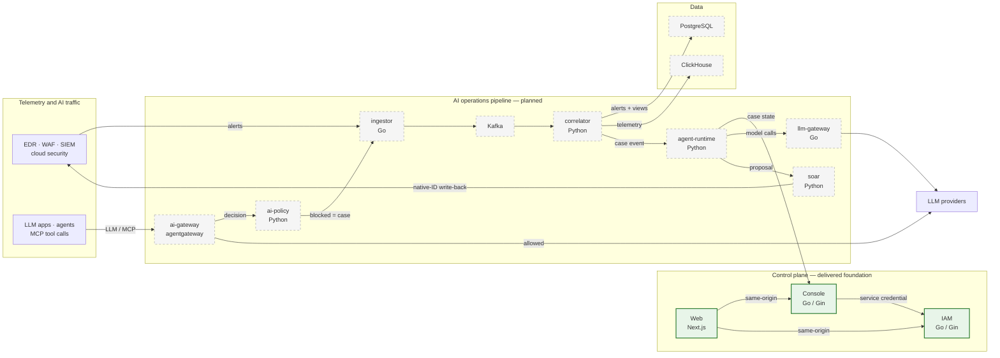
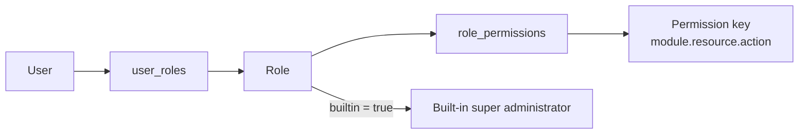

# SecPlexus

**One AI Security Platform: Protect, Operate, Respond.**

SecPlexus is an open-source, identity-first security operations platform for
teams whose defenses already span SIEM, EDR, WAF and cloud security. It does not
replace those systems. It is the neutral brain above them: it turns alerts from
different vendors into one attack story, investigates event groups with an
auditable AI analyst, and closes the loop through governed response that runs in
the tools you already own.

Most "AI SOC" products are a chat panel bolted onto an existing console: a human
starts the conversation, the model sees one alert at a time, and the reasoning
lives in a prompt. SecPlexus is designed the other way round. Alerts arrive as
data, correlation decides what belongs together, and a graph of deterministic
steps plus bounded model calls produces evidence, a verdict and an audit trail.

<p align="center">
  <a href="README.md">English</a> | <a href="README.zh-CN.md">简体中文</a> · <a href="docs/design/architecture/README.md">Documentation</a> · <a href="CONTRIBUTING.md">Contributing</a>
</p>

<div align="center">
  <a href="LICENSE"></a>
  <a href="https://github.com/EayonLee/SecPlexus/actions/workflows/ci.yml"></a>
  
  
  
  
  <a href="https://github.com/EayonLee/SecPlexus/stargazers"></a>
</div>

## Protect. Operate. Respond.

The platform direction is one product with three outcomes:

- **Protect** the new attack surface: LLM applications, agents, MCP tool calls
  and model keys. Identity and runtime policy live in the same platform, so a
  blocked prompt injection is not another product's alert; it enters the same
  case pipeline as an EDR detection.
- **Operate** the alert flood as one problem. SecPlexus normalizes vendor alerts
  into OCSF, collapses duplicates and related activity, and gives the AI an
  incident view rather than a single alert. Analysts work three queues: ready for
  approval, needs human context, and closed for spot-checking.
- **Respond** through a governed loop. The agent proposes; the SOAR executes
  after approval, checks the asset's blast radius, runs idempotent actions and
  writes back using each vendor's native ID. AI never holds the power to isolate
  a host or disable an account by itself.

The delivered foundation today is the identity and control plane. Ingestion,
correlation, investigation and response services are being built in public; the
status below is explicit about what exists.

## Why SecPlexus

- **Replace the brain, not the limbs.** Your SIEM, EDR, WAF and cloud security
  stay in place. SecPlexus sits above them, correlates what no single vendor can
  see, and sends actions back to the native tools.
- **Work on alerts, not a second log lake.** The unit is the normalized
  alert, not another archive of raw logs. Your SIEM remains the system of record;
  SecPlexus adds the cross-vendor correlation, case context and response that a
  vendor-siloed stack cannot provide.
- **AI-native is an architecture, not a prompt.** The unit of investigation is an
  event group. The workflow is a graph of deterministic steps with bounded model
  nodes, groundedness gates, evidence-level verdicts and a three-valued
  conclusion: true positive, false positive or `insufficient_info`. An empty
  tool result is never proof that an alert is benign.
- **Every correction becomes institutional memory.** When an analyst changes a
  conclusion, the reason is required. That reason, the evidence and the outcome
  become searchable context for the next investigation. Shadow mode records what
  the AI would have done before any alert category earns the right to auto-close.
- **Alerts are facts; cases are the product.** Alerts remain a complete,
  queryable fact layer. An incident view is the AI's working set. A case is the
  only persistent operational object: timeline, evidence, approval, response and
  post-incident review.
- **Identity is the foundation, not a bolt-on.** One IAM owns users, sessions,
  roles, permissions and audit. There is one authorization path — user → role →
  permission — with append-only audit and immediate session revocation through
  `auth_epoch`.
- **Failure is explicit.** Correlation degradation keeps the raw alerts and says
  so. Tool failures are distinguished from empty results. The uncertain queue is
  a first-class part of the workflow, not a hidden backlog.

## Status

SecPlexus is pre-1.0. Planned services are design commitments, not shipped
capabilities.

| Capability | State | Notes |
| --- | --- | --- |
| Identity and access (IAM) | Delivered | Login, revocable sessions, password change/reset, users, global roles, flat permissions, authorization, append-only audit, versioned migrations and schema comments. |
| Web and Console control plane | Delivered foundation | Web ships real IAM pages in English and Simplified Chinese. Console provides identity context and authorized SSE; case and workbench workflows are not implemented. |
| Alert ingestion and normalization | Planned | Go `ingestor`, Kafka buffering, OCSF 2004 normalization, vendor connector registry. |
| Correlation and incident views | Planned | Python `correlator`: exact dedupe, window suppression, cross-source entity correlation and rolling attack-chain views. |
| AI investigation and memory | Planned | Python `agent-runtime`, graph-orchestrated investigation, evidence ledger, institutional memory and rule proposals; all model calls through `llm-gateway`. |
| Response orchestration | Planned | Python `soar`: approvals, asset blast-radius gating, idempotent playbooks and native-ID write-back. |
| AI runtime protection | Planned | `ai-gateway` (agentgateway) and `ai-policy` for prompt injection, DLP, model-key abuse, MCP tool governance and agent audit. |

APIs, schema and UI may change before 1.0.

## Architecture

The target is a data-driven operations pipeline with a separate control plane:
alerts and AI traffic enter from the left, while people authorize work through
Web, Console and IAM.



Green modules are delivered today; dashed modules are planned. The only path
implemented today is Web → IAM/Console with PostgreSQL and Redis serving IAM. The pipeline is the next build, not a claim about current behavior.

| Layer | Components | State |
| --- | --- | --- |
| Identity and access | IAM, PostgreSQL, Redis | Delivered |
| Control plane | Web, Console | Foundation delivered |
| Ingestion | `ingestor`, Kafka, connector registry | Planned |
| Correlation | `correlator`, PostgreSQL alerts, ClickHouse telemetry | Planned |
| Investigation | `agent-runtime`, `llm-gateway`, evidence ledger, memory | Planned |
| Response | `soar`, approvals, native-ID write-back | Planned |
| AI runtime protection | `ai-gateway`, `ai-policy` | Planned |

### Identity and authorization (delivered)



- Permission keys are stable identifiers in the form
  `module.resource.action`; the key is stored, the three parts are derived.
- The configured administrator is the only `configured` account. It is created
  from configuration, cannot be deleted or disabled in the UI, and its password
  is changed only by configuration.
- Sessions are logical rows in PostgreSQL. Password changes, account status
  changes and configuration changes bump `auth_epoch`, which invalidates every
  older session immediately.
- Audit rows are append-only. A trigger rejects `UPDATE`; `DELETE` is allowed
  only inside retention maintenance with the `iam.audit_purge` transaction flag.

## Tech stack

| Layer | Choices |
| --- | --- |
| Delivered services | Go 1.27, Gin, GORM, Goose, pgx, SCS, Argon2id, Gorilla CSRF; Next.js 16, React 19, TypeScript, Tailwind CSS 4, shadcn/ui, TanStack Query/Table, Zod, React Hook Form, next-intl |
| Delivered data | PostgreSQL 16, Redis 7 |
| Planned services | `ingestor` (Go); `correlator`, `agent-runtime`, `soar`, `ai-policy` (Python); `llm-gateway` (Go); `ai-gateway` (agentgateway, Rust) |
| Planned data plane | Kafka, ClickHouse, S3-compatible object storage |
| Tooling | pnpm, GNU Make, Biome, Vitest, Playwright, Go test |

## Quick start

### Prerequisites

| Tool | Version / requirement |
| --- | --- |
| Go | 1.27.3 |
| Node.js | 22.12 or newer; 24 recommended |
| pnpm | 10.32.1 |
| GNU Make | Required for the root commands on all platforms |
| PostgreSQL / Redis | Reachable instances, or the supplied Compose stack |
| Docker with Compose | Only when you choose container dependencies |

On Windows, install GNU Make (w64devkit, Chocolatey, MSYS2 or equivalent) and run
`make` from PowerShell or `cmd.exe`. No POSIX shell is required.

### Run locally

```sh
git clone https://github.com/EayonLee/SecPlexus.git
cd SecPlexus

# 1. Create .env from the template and stop for review.
make config

# 2. Edit .env:
#    - change SPX_IAM_BOOTSTRAP_PASSWORD (at least 12 characters)
#    - set SPX_IAM_CSRF_KEY (exactly 32 bytes; openssl rand -hex 16)
#    - set SPX_CONSOLE_IAM_TOKEN (32-512 bytes; openssl rand -hex 32)
#    - point PostgreSQL/Redis at your instances

# 3. Optional: start the supplied PostgreSQL and Redis containers.
make compose-up SERVICES="postgres redis"

# 4. Apply IAM migrations and start IAM, Console and Web with hot reload.
make dev
```

Open <http://127.0.0.1:5173> and sign in with the administrator configured in
`.env`. The example password `changeme-at-least-12` is a placeholder: change it
before the first start. The configured administrator cannot be edited, disabled or
re-passworded from the UI; change the configuration and restart IAM instead.

`make dev` connects to the configured dependencies and never starts Docker.
`make stop` stops exactly the process trees it started on macOS, Linux and
Windows. See [configuration](docs/development/configuration.md) for every
setting and the reverse-proxy setup.

## Common commands

| Command | Purpose |
| --- | --- |
| `make config [MODULES="..."]` | Validate configuration offline. On first run it creates `.env` and stops for review. |
| `make dev [MODULES="..."]` | Migrate and start IAM, Console and Web with hot reload. |
| `make build` | Build both Go services and the Web production bundle. |
| `make preview [MODULES="..."]` | Run the backends and preview the built Web app. |
| `make compose-up [SERVICES="..."]` | Build and start the full Compose stack. |
| `make stop` | Stop this checkout's applications and containers; keep data. |
| `make test` | Run script, Go and Web unit tests. |
| `make test-e2e ARGS="--docker"` | Run the Playwright browser suite. |
| `make integration ARGS="--docker --race"` | Run Go integration tests. |
| `make typecheck` / `make lint` | TypeScript type check / Biome lint. |
| `make vet` / `make lint-go` / `make vuln-go` | Go vet, golangci-lint, govulncheck. |
| `make catalogs` / `make catalogs-generate` | Check / regenerate shared result-code and permission catalogs. |

## Project structure

```text
src/apps/
  iam/            Go IAM service: cmd, internal, migrations, config.yaml
  console/        Go Console service: cmd, internal, config.yaml
  web/            Next.js application: app, spx, messages, scripts, tests
src/packages/go/
  logging/        Structured slog setup and safe error fields
  result/         Shared HTTP result codes
  httpx/          Gin helpers, middleware, request IDs
  iamclient/      Typed IAM client and permission constants
scripts/          Root dev, build, test and migration tooling
deploy/           Compose stack and Dockerfiles
docs/             Architecture, development guides and plans
```

Each Go module follows the layering and dependency rules in
[backend structure](docs/development/backend-structure.md). Database tables,
comments, enums, indexes and migrations follow
[database design](docs/development/database-design.md).

## Documentation

| Document | Contents |
| --- | --- |
| [Architecture](docs/design/architecture/README.md) | System context, technical architecture and deployment view. |
| [Configuration](docs/development/configuration.md) | Environment variables, startup, logging and reverse proxy. |
| [Testing](docs/development/testing.md) | Test layers, commands, isolation and cleanup. |
| [Database design](docs/development/database-design.md) | Naming, types, enums, comments, indexes, migrations and scale rules. |
| [Backend structure](docs/development/backend-structure.md) | Repository layout, module layering, naming and review checklist. |
| [Plans](docs/plans/README.md) | Approved specs, implementation plans and validation evidence. |
| [Changelog](CHANGELOG.md) | Notable changes, fixes and security-relevant updates. |
| [Support](SUPPORT.md) | Where to ask questions and what to include. |
| [IAM](src/apps/iam/README.md) · [Console](src/apps/console/README.md) · [Web](src/apps/web/README.md) | Module contracts and responsibilities. |

## Security

Do not open a public issue for a suspected vulnerability. Use
[GitHub private vulnerability reporting](https://github.com/EayonLee/SecPlexus/security/advisories/new)
and follow [SECURITY.md](SECURITY.md). Include the affected revision, impact,
reproduction steps and sanitized logs; never include credentials or private data.

## Contributing

Contributions are welcome: code, tests, documentation, reproducible bug reports
and usability improvements. Read [CONTRIBUTING.md](CONTRIBUTING.md) for the
development setup, architecture boundaries, test requirements and pull-request
workflow. All participants follow the [Code of Conduct](CODE_OF_CONDUCT.md).

Good first issues are labelled `good first issue`. Security reports follow the
private channel above.

## License

SecPlexus is released under the [MIT License](LICENSE).

## Acknowledgements

SecPlexus is built on the work of many open-source projects. The logos below
identify the frameworks, libraries and tools used by the application or its
development workflow. They remain the property of their respective owners and
are used only for attribution; see [docs/assets/README.md](docs/assets/README.md)
for the source and license of each mark.


<table align="center" width="100%" border="0" cellspacing="0" cellpadding="8" role="presentation">
  <tr>
    <td align="center" valign="middle" width="20%">
      <a href="https://github.com/vercel/next.js" title="Next.js"></a><br />
      <sub>Next.js</sub>
    </td>
    <td align="center" valign="middle" width="20%">
      <a href="https://github.com/facebook/react" title="React"></a><br />
      <sub>React</sub>
    </td>
    <td align="center" valign="middle" width="20%">
      <a href="https://github.com/tailwindlabs/tailwindcss" title="Tailwind CSS"></a><br />
      <sub>Tailwind CSS</sub>
    </td>
    <td align="center" valign="middle" width="20%">
      <a href="https://github.com/shadcn-ui/ui" title="shadcn/ui"></a><br />
      <sub>shadcn/ui</sub>
    </td>
    <td align="center" valign="middle" width="20%">
      <a href="https://github.com/arhamkhnz/next-shadcn-admin-dashboard" title="next-shadcn-admin-dashboard"></a><br />
      <sub>Admin template</sub>
    </td>
  </tr>
  <tr>
    <td align="center" valign="middle" width="20%">
      <a href="https://github.com/postgres/postgres" title="PostgreSQL"></a><br />
      <sub>PostgreSQL</sub>
    </td>
    <td align="center" valign="middle" width="20%">
      <a href="https://github.com/redis/redis" title="Redis"></a><br />
      <sub>Redis</sub>
    </td>
    <td align="center" valign="middle" width="20%">
      <a href="https://github.com/gin-gonic/gin" title="Gin"></a><br />
      <sub>Gin</sub>
    </td>
    <td align="center" valign="middle" width="20%">
      <a href="https://github.com/go-gorm/gorm" title="GORM"></a><br />
      <sub>GORM</sub>
    </td>
    <td align="center" valign="middle" width="20%">
      <a href="https://github.com/pressly/goose" title="Goose"></a><br />
      <sub>Goose</sub>
    </td>
  </tr>
  <tr>
    <td align="center" valign="middle" width="20%">
      <a href="https://github.com/spf13/viper" title="Viper"></a><br />
      <sub>Viper</sub>
    </td>
    <td align="center" valign="middle" width="20%">
      <a href="https://github.com/spf13/cobra" title="Cobra"></a><br />
      <sub>Cobra</sub>
    </td>
    <td align="center" valign="middle" width="20%">
      <a href="https://github.com/gorilla/csrf" title="Gorilla CSRF"></a><br />
      <sub>Gorilla CSRF</sub>
    </td>
    <td align="center" valign="middle" width="20%">
      <a href="https://github.com/radix-ui/primitives" title="Radix UI"><picture>
      <source media="(prefers-color-scheme: dark)" srcset="docs/assets/radix-ui-dark.svg" />
      
    </picture></a><br />
      <sub>Radix UI</sub>
    </td>
    <td align="center" valign="middle" width="20%">
      <a href="https://github.com/mui/base-ui" title="Base UI"></a><br />
      <sub>Base UI</sub>
    </td>
  </tr>
  <tr>
    <td align="center" valign="middle" width="20%">
      <a href="https://github.com/lucide-icons/lucide" title="Lucide"><picture>
      <source media="(prefers-color-scheme: dark)" srcset="docs/assets/lucide-dark.svg" />
      
    </picture></a><br />
      <sub>Lucide</sub>
    </td>
    <td align="center" valign="middle" width="20%">
      <a href="https://tanstack.com" title="TanStack Query / Table"></a><br />
      <sub>TanStack Query</sub>
    </td>
    <td align="center" valign="middle" width="20%">
      <a href="https://github.com/axios/axios" title="Axios"><picture>
      <source media="(prefers-color-scheme: dark)" srcset="docs/assets/axios-dark.svg" />
      
    </picture></a><br />
      <sub>Axios</sub>
    </td>
    <td align="center" valign="middle" width="20%">
      <a href="https://github.com/colinhacks/zod" title="Zod"></a><br />
      <sub>Zod</sub>
    </td>
    <td align="center" valign="middle" width="20%">
      <a href="https://github.com/react-hook-form/react-hook-form" title="React Hook Form"></a><br />
      <sub>React Hook Form</sub>
    </td>
  </tr>
  <tr>
    <td align="center" valign="middle" width="20%">
      <a href="https://github.com/amannn/next-intl" title="next-intl"><picture>
      <source media="(prefers-color-scheme: dark)" srcset="docs/assets/next-intl-mark-dark.png" />
      
    </picture></a><br />
      <sub>next-intl</sub>
    </td>
    <td align="center" valign="middle" width="20%">
      <a href="https://github.com/microsoft/playwright" title="Playwright"></a><br />
      <sub>Playwright</sub>
    </td>
    <td align="center" valign="middle" width="20%">
      <a href="https://github.com/vitest-dev/vitest" title="Vitest"></a><br />
      <sub>Vitest</sub>
    </td>
    <td align="center" valign="middle" width="20%">
      <a href="https://github.com/biomejs/biome" title="Biome"></a><br />
      <sub>Biome</sub>
    </td>
    <td align="center" valign="middle" width="20%">
      <a href="https://github.com/peteromallet/desloppify" title="Desloppify"></a><br />
      <sub>Desloppify</sub>
    </td>
  </tr>
</table>

## Contributors

Thanks to everyone who contributes to SecPlexus.

<p align="center">
  <a href="https://github.com/EayonLee/SecPlexus/graphs/contributors">
    
  </a>
</p>
