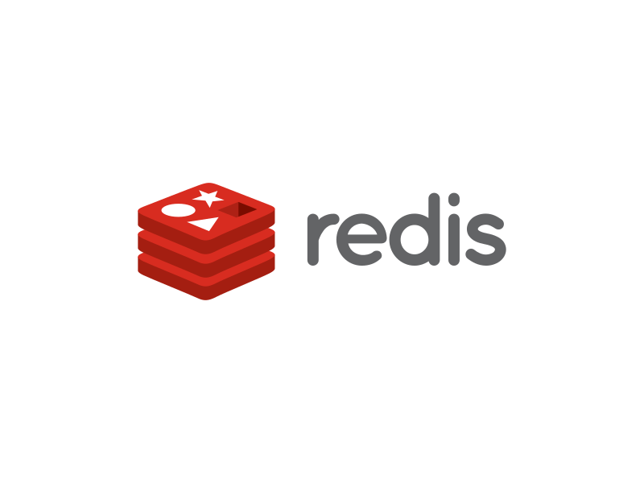

# SecPlexus

An AI-native security operations platform.

[English](README.md) | [简体中文](README.zh-CN.md)

## Development

Install Node.js 22.12+ and pnpm 10.32.1, then run this from the repository root:

```sh
make dev
```

This installs dependencies and starts the web app at <http://127.0.0.1:5173>.
Code changes appear automatically. Press Ctrl+C to stop. We recommend Node.js 24.

Development currently focuses on the frontend. IAM and Console have not been
implemented yet. The pages use sample data and a demo login: `admin` / `admin`.
Do not enter a real password.

```sh
make build   # Build the web app
make stop    # Stop running project services
```

See the [development guide](docs/development/README.md) and
[web README](src/apps/web/README.md) for details.

## Repository layout

```text
src/apps/       Application code (web, iam, console)
src/packages/   Shared libraries, added as needed
src/contracts/  Interface contracts
deploy/         Deployment configuration
scripts/        Development and release scripts
docs/           Project documentation
```

## Acknowledgements

Thanks to the maintainers and contributors of these projects.

<p>
  <a href="https://github.com/arco-design/arco-design" title="Arco Design">
    
  </a>
  &nbsp;&nbsp;
  <a href="https://github.com/redis/redis" title="Redis">
    
  </a>
  &nbsp;&nbsp;
  <a href="https://github.com/postgres/postgres" title="PostgreSQL">
    
  </a>
  &nbsp;&nbsp;
  <a href="https://github.com/BerriAI/litellm" title="LiteLLM">
    
  </a>
</p>
