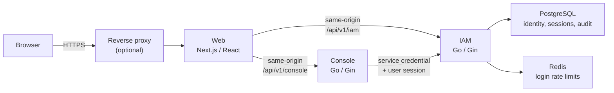
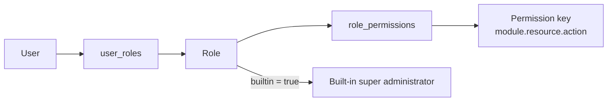

# SecPlexus

**An AI-native security operations platform, built around identity.**

SecPlexus is an open-source security operations platform. It brings identity,
authorization, audit, and the operational console into one system so security
teams can answer "who did what, with which permission, and why" from one place.

The project is in **early development (pre-1.0)**. The IAM service and the IAM
pages of the Web application are usable today; operations workflows, ingestion,
correlation and model integration are being built in public.

[English](README.md) | [简体中文](README.zh-CN.md) · [Documentation](docs/design/architecture/README.md) · [Contributing](CONTRIBUTING.md)

<div align="center">
  <a href="LICENSE"></a>
  <a href="https://github.com/EayonLee/SecPlexus/actions/workflows/ci.yml"></a>
  
  
  
  
  <a href="https://github.com/EayonLee/SecPlexus/stargazers"></a>
</div>

## Why SecPlexus

Security tools usually grow as separate products: one for identity, one for
detection, one for case work, each with its own permission model and audit log.
SecPlexus starts from the opposite direction:

- **Identity is the foundation.** Users, roles, permissions and sessions are
  owned by one IAM service. Every other module asks IAM instead of inventing a
  second answer.
- **One authorization path.** A user holds roles, roles hold permissions, and a
  permission is a stable key such as `iam.users.read`. There is no organization
  scope, super-admin bypass, or hidden second path in the current model.
- **Auditable by default.** Security-relevant changes write append-only audit
  events in the same transaction as the change. Audit rows cannot be updated;
  deletion is limited to retention maintenance.
- **Module boundaries are enforced.** Each application owns its configuration,
  startup and tables. Cross-module access goes through HTTP contracts, not
  private imports or shared tables.
- **One development entry on every OS.** `make dev`, `make test` and
  `make stop` work on macOS, Linux, Windows PowerShell and `cmd.exe`.

## Status

| Area | State | Notes |
| --- | --- | --- |
| IAM | Usable | Login, revocable sessions, password change/reset, users, global roles, flat permissions, authorization, append-only audit. Schema comments and versioned migrations included. |
| Web | Usable for IAM pages | Real `/login`, `/settings`, `/settings/users`, `/settings/roles` and `/settings/audit` pages; English and Simplified Chinese. The dashboard is still sample data. |
| Console | Early | Identity context and authorized SSE connections. Business workflows are not implemented. |
| Ingestion and normalization | Planned | See [ingest-and-normalization](docs/plans/ingest-and-normalization/spec.md). |
| Correlation and response | Planned | Not started. |
| `llm-gateway` | Planned | All outbound model calls will go through one module; no provider key will live in IAM, Console or Web. |

APIs, database schema and UI may change before 1.0. Anything marked planned is
not a delivered capability.

## Architecture



| Component | Technology | Responsibility |
| --- | --- | --- |
| **Web** | Next.js, React, TypeScript, Tailwind CSS, shadcn/ui | Browser entry, same-origin API proxy, product pages, EN/zh-CN UI. |
| **IAM** | Go, Gin, GORM, Goose | Accounts, Argon2id credentials, SCS-backed logical sessions, users, roles, flat permissions, authorization, audit. |
| **Console** | Go, Gin | Security-operations entry point. Verifies identity through IAM and authorizes SSE streams; business workflows are in progress. |
| **PostgreSQL** | PostgreSQL 16 | IAM tables and sessions. Every module owns its own schema and migrations. |
| **Redis** | Redis 7 | Login rate limiting and shared cache keys. |

Requests reach the Web same-origin entry; the Web server forwards `/api/v1/iam`
and `/api/v1/console` to the owning service. The optional reverse proxy
terminates HTTPS in deployments. Only IAM talks to PostgreSQL and Redis in the
current implementation.

### Authorization model



- Permission keys are stable identifiers in the form
  `module.resource.action`; the key is stored, the three parts are derived.
- The configured administrator is the only `configured` account. It is created
  from configuration, cannot be deleted or disabled in the UI, and its password
  is changed only by configuration.
- Sessions are logical rows in PostgreSQL. Password changes, account status
  changes and configuration changes bump `auth_epoch`, which invalidates every
  older session immediately.
- Audit rows are append-only. A trigger rejects `UPDATE`; `DELETE` is allowed
  only inside retention maintenance with the `iam.audit_purge` transaction flag.

## Tech stack

| Layer | Choices |
| --- | --- |
| Backend | Go 1.27.3, Gin, GORM, Goose, Cobra, Viper, SCS, Argon2id, Gorilla CSRF |
| Frontend | Next.js 16, React 19, TypeScript, Tailwind CSS 4, shadcn/ui, TanStack Query/Table, Zod, React Hook Form, next-intl |
| Data | PostgreSQL 16, Redis 7 |
| Tooling | pnpm, GNU Make, Biome, Vitest, Playwright, Go test |

## Quick start

### Prerequisites

| Tool | Version / requirement |
| --- | --- |
| Go | 1.27.3 |
| Node.js | 22.12 or newer; 24 recommended |
| pnpm | 10.32.1 |
| GNU Make | Required for the root commands on all platforms |
| PostgreSQL / Redis | Reachable instances, or the supplied Compose stack |
| Docker with Compose | Only when you choose container dependencies |

On Windows, install GNU Make (w64devkit, Chocolatey, MSYS2 or equivalent) and run
`make` from PowerShell or `cmd.exe`. No POSIX shell is required.

### Run locally

```sh
git clone https://github.com/EayonLee/SecPlexus.git
cd SecPlexus

# 1. Create .env from the template and stop for review.
make config

# 2. Edit .env:
#    - change SPX_IAM_BOOTSTRAP_PASSWORD (at least 12 characters)
#    - set SPX_IAM_CSRF_KEY (exactly 32 bytes; openssl rand -hex 16)
#    - set SPX_CONSOLE_IAM_TOKEN (32-512 bytes; openssl rand -hex 32)
#    - point PostgreSQL/Redis at your instances

# 3. Optional: start the supplied PostgreSQL and Redis containers.
make compose-up SERVICES="postgres redis"

# 4. Apply IAM migrations and start IAM, Console and Web with hot reload.
make dev
```

Open <http://127.0.0.1:5173> and sign in with the administrator configured in
`.env`. The example password `changeme-at-least-12` is a placeholder: change it
before the first start. The configured administrator cannot be edited, disabled or
re-passworded from the UI; change the configuration and restart IAM instead.

`make dev` connects to the configured dependencies and never starts Docker.
`make stop` stops exactly the process trees it started on macOS, Linux and
Windows. See [configuration](docs/development/configuration.md) for every
setting and the reverse-proxy setup.

## Common commands

| Command | Purpose |
| --- | --- |
| `make config [MODULES="..."]` | Validate configuration offline. On first run it creates `.env` and stops for review. |
| `make dev [MODULES="..."]` | Migrate and start IAM, Console and Web with hot reload. |
| `make build` | Build both Go services and the Web production bundle. |
| `make preview [MODULES="..."]` | Run the backends and preview the built Web app. |
| `make compose-up [SERVICES="..."]` | Build and start the full Compose stack. |
| `make stop` | Stop this checkout's applications and containers; keep data. |
| `make test` | Run script, Go and Web unit tests. |
| `make test-e2e ARGS="--docker"` | Run the Playwright browser suite. |
| `make integration ARGS="--docker --race"` | Run Go integration tests. |
| `make typecheck` / `make lint` | TypeScript type check / Biome lint. |
| `make vet` / `make lint-go` / `make vuln-go` | Go vet, golangci-lint, govulncheck. |
| `make catalogs` / `make catalogs-generate` | Check / regenerate shared result-code and permission catalogs. |

## Project structure

```text
src/apps/
  iam/            Go IAM service: cmd, internal, migrations, config.yaml
  console/        Go Console service: cmd, internal, config.yaml
  web/            Next.js application: app, spx, messages, scripts, tests
src/packages/go/
  logging/        Structured slog setup and safe error fields
  result/         Shared HTTP result codes
  httpx/          Gin helpers, middleware, request IDs
  iamclient/      Typed IAM client and permission constants
scripts/          Root dev, build, test and migration tooling
deploy/           Compose stack and Dockerfiles
docs/             Architecture, development guides and plans
```

Each Go module follows the layering and dependency rules in
[backend structure](docs/development/backend-structure.md). Database tables,
comments, enums, indexes and migrations follow
[database design](docs/development/database-design.md).

## Documentation

| Document | Contents |
| --- | --- |
| [Architecture](docs/design/architecture/README.md) | System context, technical architecture and deployment view. |
| [Configuration](docs/development/configuration.md) | Environment variables, startup, logging and reverse proxy. |
| [Testing](docs/development/testing.md) | Test layers, commands, isolation and cleanup. |
| [Database design](docs/development/database-design.md) | Naming, types, enums, comments, indexes, migrations and scale rules. |
| [Backend structure](docs/development/backend-structure.md) | Repository layout, module layering, naming and review checklist. |
| [Plans](docs/plans/README.md) | Approved specs, implementation plans and validation evidence. |
| [Changelog](CHANGELOG.md) | Notable changes, fixes and security-relevant updates. |
| [Support](SUPPORT.md) | Where to ask questions and what to include. |
| [IAM](src/apps/iam/README.md) · [Console](src/apps/console/README.md) · [Web](src/apps/web/README.md) | Module contracts and responsibilities. |

## Security

Do not open a public issue for a suspected vulnerability. Use
[GitHub private vulnerability reporting](https://github.com/EayonLee/SecPlexus/security/advisories/new)
and follow [SECURITY.md](SECURITY.md). Include the affected revision, impact,
reproduction steps and sanitized logs; never include credentials or private data.

## Contributing

Contributions are welcome: code, tests, documentation, reproducible bug reports
and usability improvements. Read [CONTRIBUTING.md](CONTRIBUTING.md) for the
development setup, architecture boundaries, test requirements and pull-request
workflow. All participants follow the [Code of Conduct](CODE_OF_CONDUCT.md).

Good first issues are labelled `good first issue`. Security reports follow the
private channel above.

## License

SecPlexus is released under the [MIT License](LICENSE).

## Acknowledgements

SecPlexus is built on open-source work. Thanks to the maintainers and
contributors of these projects and the many dependencies behind them.

<p align="center">
  <a href="https://github.com/vercel/next.js" title="Next.js"></a>
  &nbsp;&nbsp;
  <a href="https://github.com/facebook/react" title="React"></a>
  &nbsp;&nbsp;
  <a href="https://github.com/tailwindlabs/tailwindcss" title="Tailwind CSS"></a>
  &nbsp;&nbsp;
  <a href="https://github.com/shadcn-ui/ui" title="shadcn/ui"></a>
  &nbsp;&nbsp;
  <a href="https://github.com/postgres/postgres" title="PostgreSQL"></a>
  &nbsp;&nbsp;
  <a href="https://github.com/redis/redis" title="Redis"></a>
</p>

<p align="center">
  <a href="https://github.com/gin-gonic/gin" title="Gin"></a>
  &nbsp;&nbsp;
  <a href="https://github.com/go-gorm/gorm" title="GORM"></a>
  &nbsp;&nbsp;
  <a href="https://github.com/pressly/goose" title="Goose"></a>
  &nbsp;&nbsp;
  <a href="https://github.com/spf13/viper" title="Viper"></a>
</p>

<p align="center">
  <a href="https://github.com/TanStack/query" title="TanStack Query"></a>
  &nbsp;&nbsp;
  <a href="https://github.com/colinhacks/zod" title="Zod"></a>
  &nbsp;&nbsp;
  <a href="https://github.com/amannn/next-intl" title="next-intl"></a>
  &nbsp;&nbsp;
  <a href="https://github.com/react-hook-form/react-hook-form" title="React Hook Form"></a>
  &nbsp;&nbsp;
  <a href="https://github.com/microsoft/playwright" title="Playwright"></a>
  &nbsp;&nbsp;
  <a href="https://github.com/vitest-dev/vitest" title="Vitest"></a>
  &nbsp;&nbsp;
  <a href="https://github.com/biomejs/biome" title="Biome"></a>
</p>

The complete list, including logos, sources and licenses, is in
[ACKNOWLEDGEMENTS.md](docs/ACKNOWLEDGEMENTS.md).

## Contributors

Thanks to everyone who contributes to SecPlexus.

<p align="center">
  <a href="https://github.com/EayonLee/SecPlexus/graphs/contributors">
    
  </a>
</p>
