# SecPlexus

**One AI Security Platform: Protect, Operate, Respond.**

SecPlexus is an open-source AI security operations platform for the modern SOC.
It sits above the SIEM, EDR, WAF and cloud security a company already owns: it
turns alerts from different vendors into one attack story, investigates event
groups with an auditable AI analyst, and closes the loop through governed
response in the tools that already run the environment.

It also protects the AI surface itself — LLM traffic, agents, MCP tool calls and
model keys — inside the same platform. A prompt injection blocked by the
guardrail is not a side alert in another console; it enters the same case
pipeline as an EDR detection, because the assets being protected and the assets
being operated are the same.

SecPlexus is not another SIEM, not another EDR, and not a copilot bolted onto a
legacy console. It replaces the brain, not the limbs.

<p align="center">
  <a href="README.md">English</a> | <a href="README.zh-CN.md">简体中文</a> · <a href="docs/design/architecture/README.md">Documentation</a> · <a href="CONTRIBUTING.md">Contributing</a>
</p>

<div align="center">
  <a href="LICENSE"></a>
  <a href="https://github.com/EayonLee/SecPlexus/actions/workflows/ci.yml"></a>
  
  
  
  
  <a href="https://github.com/EayonLee/SecPlexus/stargazers"></a>
</div>

## Protect. Operate. Respond.

- **Protect the AI surface.** Inline guardrails for LLM and MCP traffic:
  prompt injection, DLP, privilege abuse and model-key misuse. Agent and MCP
  capability contracts, supply-chain admission and behavior audit. AI
  applications, agents, MCP servers and model keys are first-class assets, not
  an afterthought.
- **Operate the security workload.** Ingest alerts and findings from the stack
  already in place, normalize them to OCSF, deduplicate and correlate across
  vendors, and reconstruct attack chains. An AI analyst investigates the event
  group, not one alert at a time. Vulnerability findings, threat intelligence
  and asset criticality feed the same prioritization.
- **Respond with a governed loop.** The agent proposes; SOAR executes after
  approval, checks the asset's blast radius, runs idempotent playbooks and
  writes back with each vendor's native ID. Analysts work three queues: ready
  for approval, needs human context, and closed for spot-checking.

## Capabilities

| Capability | What it covers |
| --- | --- |
| AI alert operations | Alert and finding ingestion, OCSF normalization, dedupe, cross-source correlation, attack-chain incident views, AI investigation, triage, case management and the three-queue workbench. |
| AI runtime protection | Inline LLM and MCP guardrails: prompt injection, DLP, privilege abuse, model-key misuse, agent and MCP behavior audit. |
| Agent and MCP security | Capability contracts for tool calls, MCP/Skill supply-chain admission, and an audit trail of what an agent actually did. |
| Vulnerability operations | Ingest findings from the scanners a customer already runs, prioritize by KEV/EPSS and exploitability, and verify remediation. SecPlexus does not build another scanner. |
| Threat intelligence and assets | IOC lifecycle, ATT&CK mapping, entity profiles, asset criticality, and an AI asset inventory covering applications, agents, MCP servers and model keys. |
| Response and automation | SOAR playbooks, approvals, asset blast-radius gating, idempotent actions, notifications and native-ID write-back. |
| Platform foundation | IAM, roles and permissions, append-only audit, configuration, shared contracts and the operator console. |

This is the product map. The implementation is in progress; the build status
below separates what exists from what is being specified and built.

## Why SecPlexus

- **Replace the brain, not the limbs.** A company already owns detection and
  enforcement. SecPlexus sits above that stack, correlates what no single vendor
  can see, and sends actions back to the native tools.
- **Vendor AI cannot see across vendors.** An EDR sees its endpoint, a WAF sees
  its traffic, an identity system sees its login. The attack crosses all three.
  Only a neutral layer can reconstruct the whole story and keep the native IDs
  needed for response.
- **Work on alerts, not a second log lake.** The unit is the normalized alert,
  not another archive of raw logs. The SIEM remains the system of record;
  SecPlexus adds cross-vendor correlation, case context and response.
- **AI-native is an architecture, not a prompt.** The investigation unit is an
  event group. The workflow is a graph of deterministic steps with bounded model
  nodes, groundedness gates, evidence-level verdicts and a three-valued
  conclusion: true positive, false positive or `insufficient_info`. An empty
  tool result is never proof that an alert is benign.
- **The loop gets sharper.** Analyst corrections require a reason and become
  institutional memory. Shadow mode records what the AI would have done before
  an alert category earns the right to auto-close. Rule proposals go through
  propose → review → eval → promote.
- **Alerts are facts; cases are the product.** Alerts remain a complete,
  queryable fact layer. An incident view is the AI's working set. A case is the
  only persistent operational object: timeline, evidence, approval, response and
  post-incident review.
- **Protect and operate the same objects.** AI applications, agents, MCP tools
  and model keys are both what the guardrail protects and what the SOC
  investigates. A blocked prompt injection becomes a case, not a separate
  product.
- **Failure is explicit.** Correlation degradation keeps the raw alerts and
  says so. Tool failures are distinguished from empty results. The uncertain
  queue is a first-class part of the workflow, not a hidden backlog.

## Architecture

Two data entries, one brain. Alerts, findings, threat intelligence and AI traffic
enter the platform; the control plane is separate, so people authorize work
without data flowing through them.

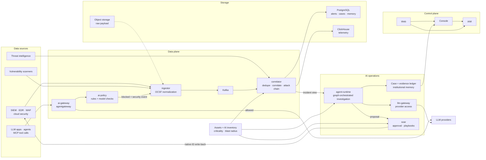

The diagram is the target architecture, not a claim that every service ships
today. The first implemented slice is the control plane; the data plane, AI
investigation, response and guardrail services are under active development.

## Tech stack

| Layer | Choices |
| --- | --- |
| Services | Go 1.27, Gin, sqlc, Goose, pgx; Python for the planned correlator, agent-runtime, SOAR and ai-policy; Next.js 16 and React 19 for Web |
| Data | PostgreSQL 16, Redis 7, Kafka, ClickHouse, S3-compatible object storage |
| AI | Graph-orchestrated agent runtime, `llm-gateway` (Bifrost core), NeMo Guardrails, `ai-gateway` (agentgateway) |
| Tooling | pnpm, GNU Make, Biome, Vitest, Playwright, Go test |

## Quick start

### Prerequisites

| Tool | Version / requirement |
| --- | --- |
| Go | 1.27.3 |
| Node.js | 22.12 or newer; 24 recommended |
| pnpm | 10.32.1 |
| GNU Make | Required for the root commands on all platforms |
| PostgreSQL / Redis | Reachable instances, or the supplied Compose stack |
| Docker with Compose | Only when you choose container dependencies |

On Windows, install GNU Make (w64devkit, Chocolatey, MSYS2 or equivalent) and run
`make` from PowerShell or `cmd.exe`. No POSIX shell is required.

### Run locally

```sh
git clone https://github.com/EayonLee/SecPlexus.git
cd SecPlexus

# 1. Create .env from the template and stop for review.
make config

# 2. Edit .env:
#    - change SPX_IAM_BOOTSTRAP_PASSWORD (at least 12 characters)
#    - set SPX_IAM_CSRF_KEY (exactly 32 bytes; openssl rand -hex 16)
#    - set SPX_CONSOLE_IAM_TOKEN (32-512 bytes; openssl rand -hex 32)
#    - point PostgreSQL/Redis at your instances

# 3. Optional: start the supplied PostgreSQL and Redis containers.
make compose-up SERVICES="postgres redis"

# 4. Apply IAM migrations and start IAM, Console and Web with hot reload.
make dev
```

Open <http://127.0.0.1:5173> and sign in with the administrator configured in
`.env`. The example password `changeme-at-least-12` is a placeholder: change it
before the first start. The configured administrator cannot be edited, disabled or
re-passworded from the UI; change the configuration and restart IAM instead.

`make dev` connects to the configured dependencies and never starts Docker.
`make stop` stops exactly the process trees it started on macOS, Linux and
Windows. See [configuration](docs/development/configuration.md) for every
setting and the reverse-proxy setup.

## Common commands

| Command | Purpose |
| --- | --- |
| `make config [MODULES="..."]` | Validate configuration offline. On first run it creates `.env` and stops for review. |
| `make dev [MODULES="..."]` | Migrate and start IAM, Console and Web with hot reload. |
| `make build` | Build both Go services and the Web production bundle. |
| `make preview [MODULES="..."]` | Run the backends and preview the built Web app. |
| `make compose-up [SERVICES="..."]` | Build and start the full Compose stack. |
| `make stop` | Stop this checkout's applications and containers; keep data. |
| `make test` | Run script, Go and Web unit tests. |
| `make test-e2e ARGS="--docker"` | Run the Playwright browser suite. |
| `make integration ARGS="--docker --race"` | Run Go integration tests. |
| `make typecheck` / `make lint` | TypeScript type check / Biome lint. |
| `make vet` / `make lint-go` / `make vuln-go` | Go vet, golangci-lint, govulncheck. |
| `make catalogs` / `make catalogs-generate` | Check / regenerate shared result-code and permission catalogs. |

## Project structure

```text
src/apps/
  iam/            Go IAM service: cmd, internal, migrations, config.yaml
  console/        Go Console service: cmd, internal, config.yaml
  web/            Next.js application: app, spx, messages, scripts, tests
src/packages/go/
  logging/        Structured slog setup and safe error fields
  result/         Shared HTTP result codes
  httpx/          Gin helpers, middleware, request IDs
  iamclient/      Typed IAM client and permission constants
scripts/          Root dev, build, test and migration tooling
deploy/           Compose stack and Dockerfiles
docs/             Architecture, development guides and plans
```

Each Go module follows the layering and dependency rules in
[backend structure](docs/development/backend-structure.md). Database tables,
comments, enums, indexes and migrations follow
[database design](docs/development/database-design.md).

## Documentation

| Document | Contents |
| --- | --- |
| [Architecture](docs/design/architecture/README.md) | System context, technical architecture and deployment view. |
| [Configuration](docs/development/configuration.md) | Environment variables, startup, logging and reverse proxy. |
| [Testing](docs/development/testing.md) | Test layers, commands, isolation and cleanup. |
| [Database design](docs/development/database-design.md) | Naming, types, enums, comments, indexes, migrations and scale rules. |
| [Backend structure](docs/development/backend-structure.md) | Repository layout, module layering, naming and review checklist. |
| [Plans](docs/plans/README.md) | Approved specs, implementation plans and validation evidence. |
| [Changelog](CHANGELOG.md) | Notable changes, fixes and security-relevant updates. |
| [Support](SUPPORT.md) | Where to ask questions and what to include. |
| [IAM](src/apps/iam/README.md) · [Console](src/apps/console/README.md) · [Web](src/apps/web/README.md) | Module contracts and responsibilities. |

## Build status

SecPlexus is pre-1.0 and built in public. The repository currently contains the
first implemented slice: the control plane (IAM, Web and Console). The data plane,
AI investigation, response orchestration, AI runtime protection, vulnerability
operations, agent security and threat intelligence are specified in
[docs/plans](docs/plans/README.md) and under active development. Planned services
are not presented as available.

## Security

Do not open a public issue for a suspected vulnerability. Use
[GitHub private vulnerability reporting](https://github.com/EayonLee/SecPlexus/security/advisories/new)
and follow [SECURITY.md](SECURITY.md). Include the affected revision, impact,
reproduction steps and sanitized logs; never include credentials or private data.

## Contributing

Contributions are welcome: code, tests, documentation, reproducible bug reports
and usability improvements. Read [CONTRIBUTING.md](CONTRIBUTING.md) for the
development setup, architecture boundaries, test requirements and pull-request
workflow. All participants follow the [Code of Conduct](CODE_OF_CONDUCT.md).

Good first issues are labelled `good first issue`. Security reports follow the
private channel above.

## License

SecPlexus is released under the [MIT License](LICENSE).

## Acknowledgements

SecPlexus is built on the work of many open-source projects. The logos below
identify the frameworks, libraries and tools used by the application or its
development workflow. They remain the property of their respective owners and
are used only for attribution; see [docs/assets/README.md](docs/assets/README.md)
for the source and license of each mark.


<table align="center" width="100%" border="0" cellspacing="0" cellpadding="8" role="presentation">
  <tr>
    <td align="center" valign="middle" width="20%">
      <a href="https://github.com/vercel/next.js" title="Next.js">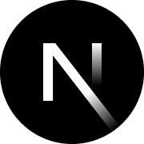</a><br />
      <sub>Next.js</sub>
    </td>
    <td align="center" valign="middle" width="20%">
      <a href="https://github.com/facebook/react" title="React"></a><br />
      <sub>React</sub>
    </td>
    <td align="center" valign="middle" width="20%">
      <a href="https://github.com/tailwindlabs/tailwindcss" title="Tailwind CSS"></a><br />
      <sub>Tailwind CSS</sub>
    </td>
    <td align="center" valign="middle" width="20%">
      <a href="https://github.com/shadcn-ui/ui" title="shadcn/ui"></a><br />
      <sub>shadcn/ui</sub>
    </td>
    <td align="center" valign="middle" width="20%">
      <a href="https://github.com/arhamkhnz/next-shadcn-admin-dashboard" title="next-shadcn-admin-dashboard"></a><br />
      <sub>Admin template</sub>
    </td>
  </tr>
  <tr>
    <td align="center" valign="middle" width="20%">
      <a href="https://github.com/postgres/postgres" title="PostgreSQL">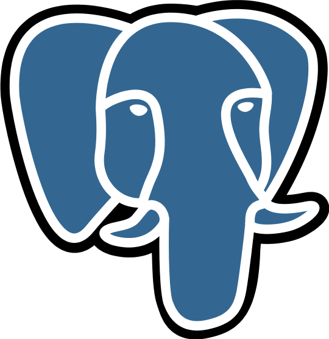</a><br />
      <sub>PostgreSQL</sub>
    </td>
    <td align="center" valign="middle" width="20%">
      <a href="https://github.com/redis/redis" title="Redis">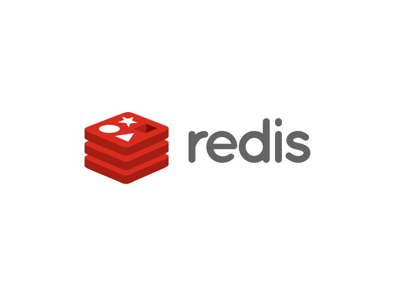</a><br />
      <sub>Redis</sub>
    </td>
    <td align="center" valign="middle" width="20%">
      <a href="https://github.com/gin-gonic/gin" title="Gin">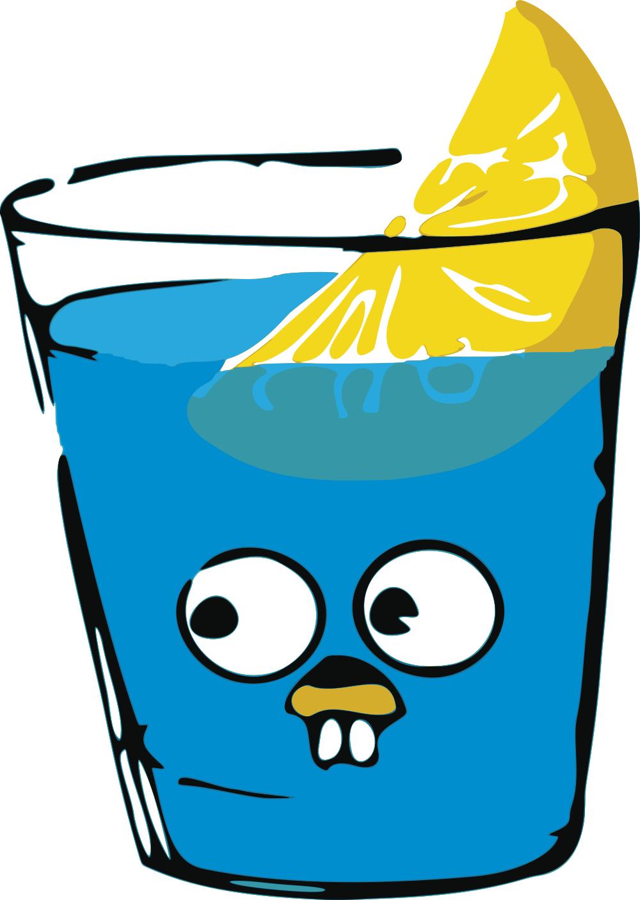</a><br />
      <sub>Gin</sub>
    </td>
    <td align="center" valign="middle" width="20%">
      <a href="https://github.com/sqlc-dev/sqlc" title="sqlc">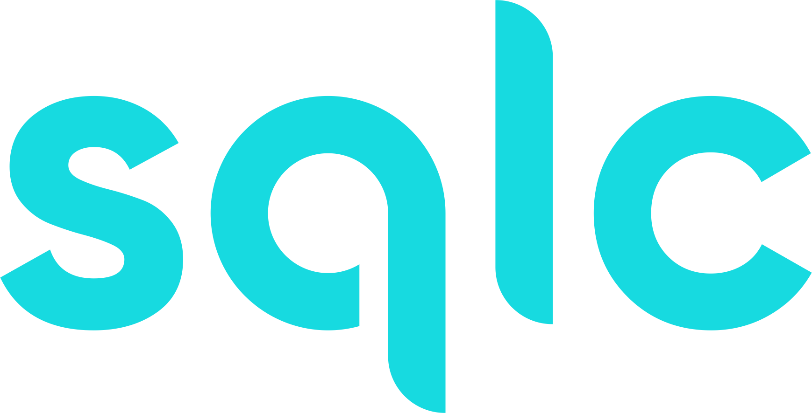</a><br />
      <sub>sqlc</sub>
    </td>
    <td align="center" valign="middle" width="20%">
      <a href="https://github.com/pressly/goose" title="Goose">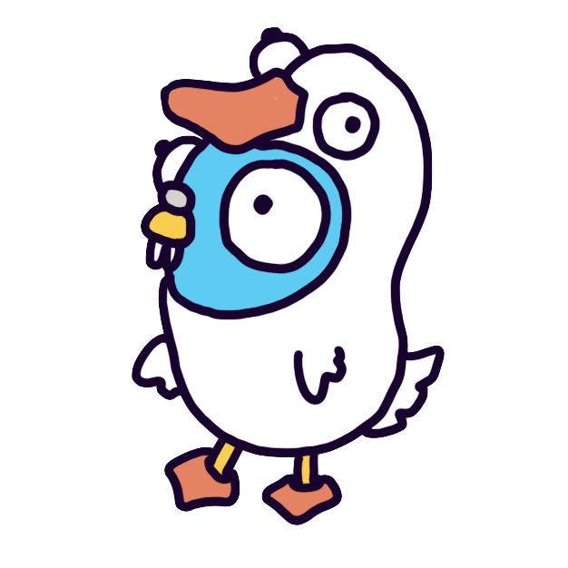</a><br />
      <sub>Goose</sub>
    </td>
  </tr>
  <tr>
    <td align="center" valign="middle" width="20%">
      <a href="https://github.com/spf13/viper" title="Viper">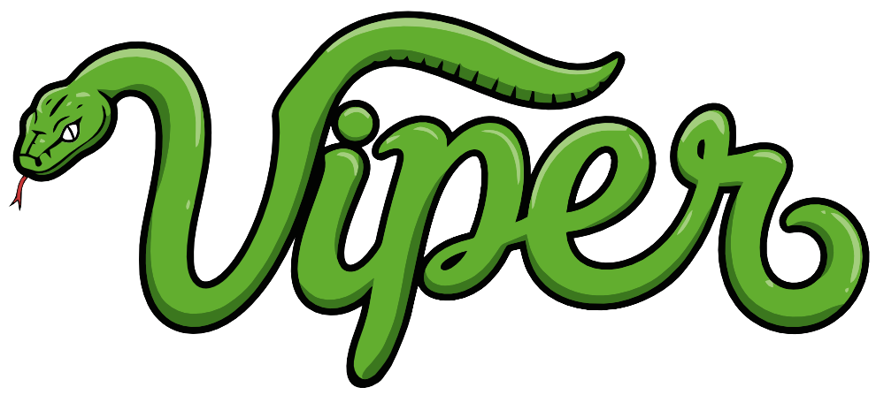</a><br />
      <sub>Viper</sub>
    </td>
    <td align="center" valign="middle" width="20%">
      <a href="https://github.com/spf13/cobra" title="Cobra"></a><br />
      <sub>Cobra</sub>
    </td>
    <td align="center" valign="middle" width="20%">
      <a href="https://github.com/gorilla/csrf" title="Gorilla CSRF"></a><br />
      <sub>Gorilla CSRF</sub>
    </td>
    <td align="center" valign="middle" width="20%">
      <a href="https://github.com/radix-ui/primitives" title="Radix UI"><picture>
      <source media="(prefers-color-scheme: dark)" srcset="docs/assets/radix-ui-dark.svg" />
      
    </picture></a><br />
      <sub>Radix UI</sub>
    </td>
    <td align="center" valign="middle" width="20%">
      <a href="https://github.com/mui/base-ui" title="Base UI"></a><br />
      <sub>Base UI</sub>
    </td>
  </tr>
  <tr>
    <td align="center" valign="middle" width="20%">
      <a href="https://github.com/lucide-icons/lucide" title="Lucide"><picture>
      <source media="(prefers-color-scheme: dark)" srcset="docs/assets/lucide-dark.svg" />
      
    </picture></a><br />
      <sub>Lucide</sub>
    </td>
    <td align="center" valign="middle" width="20%">
      <a href="https://tanstack.com" title="TanStack Query / Table">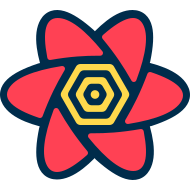</a><br />
      <sub>TanStack Query</sub>
    </td>
    <td align="center" valign="middle" width="20%">
      <a href="https://github.com/axios/axios" title="Axios"><picture>
      <source media="(prefers-color-scheme: dark)" srcset="docs/assets/axios-dark.svg" />
      
    </picture></a><br />
      <sub>Axios</sub>
    </td>
    <td align="center" valign="middle" width="20%">
      <a href="https://github.com/colinhacks/zod" title="Zod">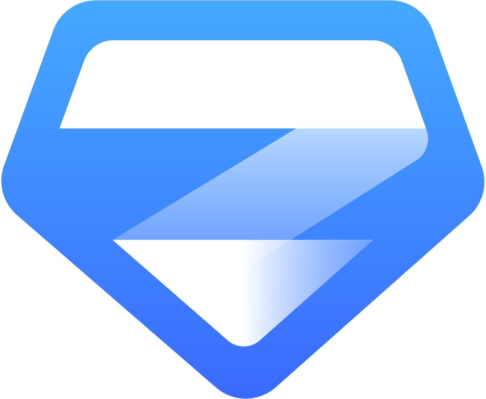</a><br />
      <sub>Zod</sub>
    </td>
    <td align="center" valign="middle" width="20%">
      <a href="https://github.com/react-hook-form/react-hook-form" title="React Hook Form"></a><br />
      <sub>React Hook Form</sub>
    </td>
  </tr>
  <tr>
    <td align="center" valign="middle" width="20%">
      <a href="https://github.com/amannn/next-intl" title="next-intl"><picture>
      <source media="(prefers-color-scheme: dark)" srcset="docs/assets/next-intl-mark-dark.png" />
      
    </picture></a><br />
      <sub>next-intl</sub>
    </td>
    <td align="center" valign="middle" width="20%">
      <a href="https://github.com/microsoft/playwright" title="Playwright"></a><br />
      <sub>Playwright</sub>
    </td>
    <td align="center" valign="middle" width="20%">
      <a href="https://github.com/vitest-dev/vitest" title="Vitest"></a><br />
      <sub>Vitest</sub>
    </td>
    <td align="center" valign="middle" width="20%">
      <a href="https://github.com/biomejs/biome" title="Biome"></a><br />
      <sub>Biome</sub>
    </td>
    <td align="center" valign="middle" width="20%">
      <a href="https://github.com/peteromallet/desloppify" title="Desloppify">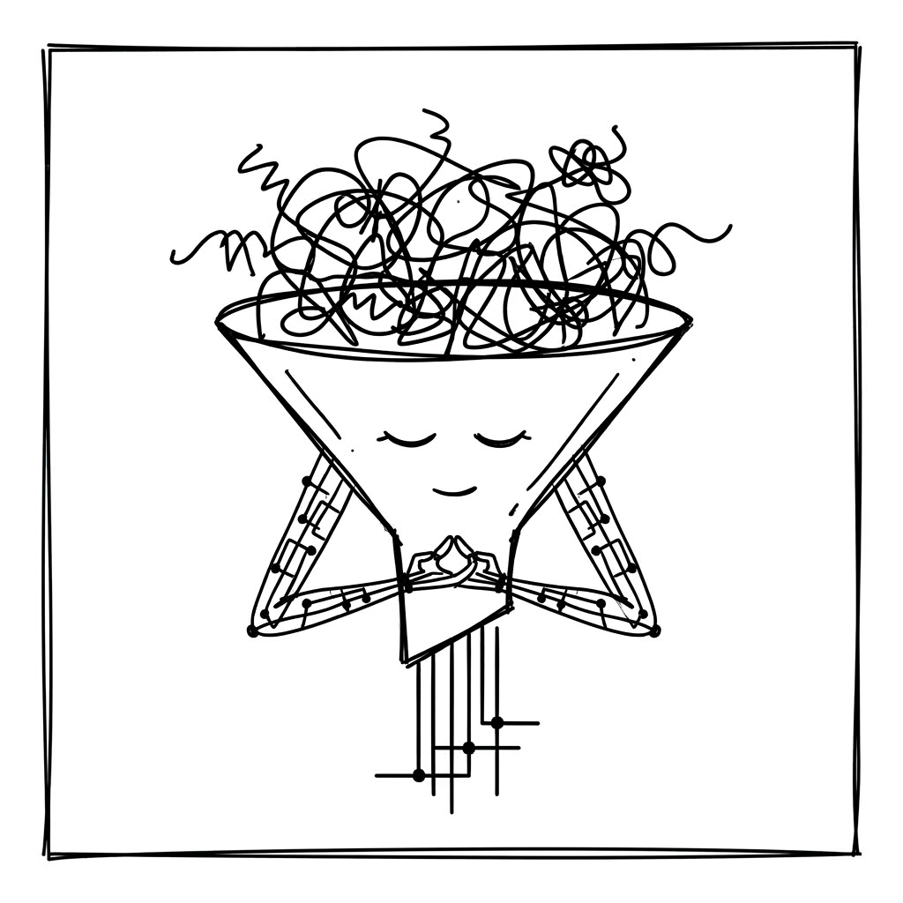</a><br />
      <sub>Desloppify</sub>
    </td>
  </tr>
  <tr>
    <td align="center" valign="middle" width="20%"></td>
    <td align="center" valign="middle" width="20%"></td>
    <td align="center" valign="middle" width="20%"></td>
    <td align="center" valign="middle" width="20%"></td>
    <td align="center" valign="middle" width="20%"></td>
  </tr>
</table>

## Contributors

Thanks to everyone who contributes to SecPlexus.

<p align="center">
  <a href="https://github.com/EayonLee/SecPlexus/graphs/contributors">
    
  </a>
</p>
