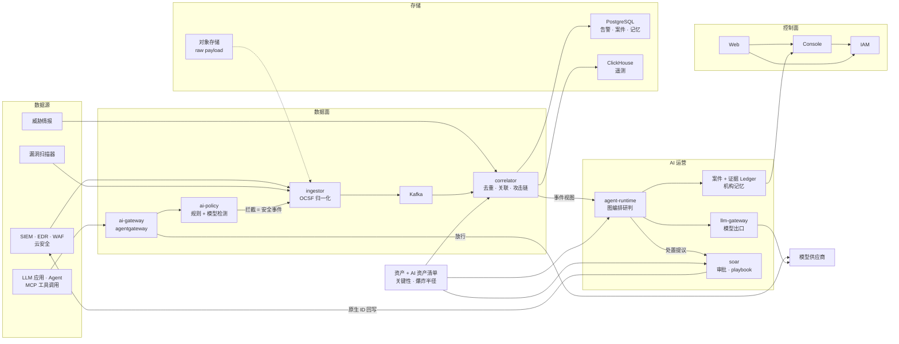

# SecPlexus

**One AI Security Platform: Protect, Operate, Respond.**

**一体化 AI 安全平台：防护、运营、响应。**

SecPlexus 是开源的 AI 安全运营平台，面向现代 SOC。它站在企业已有的 SIEM、EDR、WAF
与云安全之上：把不同厂商的告警还原成同一次攻击，用可审计的 AI 分析师研判事件组，
并通过受治理的响应在原有工具中完成闭环。

它也在同一平台内保护 AI 自身：LLM 流量、Agent、MCP 工具调用与模型 Key。护栏拦下的
Prompt 注入不是另一个控制台里的旁路告警，而是与 EDR 检测进入同一条案件流水线——
因为被防护的资产和被运营的资产本来就是同一批。

SecPlexus 不是另一个 SIEM，不是另一个 EDR，也不是在旧控制台上外挂的 copilot。
它替换的是大脑，不是手脚。

<p align="center">
  <a href="README.md">English</a> | <a href="README.zh-CN.md">简体中文</a> · <a href="docs/design/architecture/README.md">架构文档</a> · <a href="CONTRIBUTING.zh-CN.md">参与贡献</a>
</p>

<div align="center">
  <a href="LICENSE"></a>
  <a href="https://github.com/EayonLee/SecPlexus/actions/workflows/ci.yml"></a>
  
  
  
  
  <a href="https://github.com/EayonLee/SecPlexus/stargazers"></a>
</div>

## 防护 · 运营 · 响应

- **防护 AI 面。** 对 LLM 与 MCP 流量做内联护栏：Prompt 注入、DLP、权限滥用与模型
  Key 滥用；对 Agent 与 MCP 做能力契约、供应链准入与行为审计。AI 应用、Agent、
  MCP server 与模型 Key 是一等资产，不是事后补上的清单。
- **运营安全负载。** 接入企业现有栈里的告警与发现，归一化为 OCSF，跨厂商去重与关联，
  还原攻击链。AI 分析师研判的是事件组，不是一条条告警。漏洞发现、威胁情报与资产
  关键性进入同一套优先级判断。
- **用受治理的闭环响应。** Agent 提议，SOAR 在人审批后执行；执行前检查资产爆炸半径，
  动作幂等，并按上游厂商的原生 ID 回写。分析师只在三个队列里工作：待授权、需要人的
  判断、已闭环待抽查。

## 能力全景

| 能力 | 覆盖内容 |
| --- | --- |
| AI 告警运营 | 告警与发现接入、OCSF 归一化、去重、跨源关联、攻击链事件视图、AI 研判、分流、案件管理与三队列工作台。 |
| AI 运行时防护 | LLM 与 MCP 的内联护栏：Prompt 注入、DLP、权限滥用、模型 Key 滥用，以及 Agent/MCP 行为审计。 |
| Agent 与 MCP 安全 | 工具调用的能力契约、MCP/Skill 供应链准入，以及 Agent 实际行为的审计链。 |
| 漏洞运营 | 接入客户已有扫描器的发现，按 KEV/EPSS 与可利用性排序，并验证修复；SecPlexus 不自建扫描器。 |
| 威胁情报与资产 | IOC 生命周期、ATT&CK 映射、实体画像、资产关键性，以及覆盖应用、Agent、MCP server 与模型 Key 的 AI 资产清单。 |
| 响应与自动化 | SOAR playbook、审批、资产爆炸半径门控、幂等动作、通知与原生 ID 回写。 |
| 平台基座 | IAM、角色与权限、追加型审计、配置、共享契约与运营控制台。 |

这是产品地图。实现仍在进行中；下面的“建设状态”明确区分已存在与正在定义、开发的部分。

## 为什么是 SecPlexus

- **替换大脑，不替换手脚。** 企业已经拥有检测与执行能力。SecPlexus 站在它们之上，
  关联任何单一厂商看不到的部分，再把动作写回原生工具。
- **厂商 AI 看不到跨厂商的全局。** EDR 只看端点，WAF 只看流量，身份系统只看登录，
  而攻击同时穿过三者。只有中立层能把故事拼完整，并保留处置所需的上游原生 ID。
- **运营告警，不做第二个日志湖。** 处理单元是归一化后的告警，不是再建一套原始日志
  仓库。SIEM 仍是日志的事实源；SecPlexus 补上跨厂商关联、案件上下文与响应闭环。
- **AI-native 是架构，不是提示词。** 研判单元是事件组；流程是确定性图编排加边界清晰的
  模型节点，带 groundedness 门禁、证据级判定和三值结论：真阳性、假阳性或
  `insufficient_info`。工具返回空结果，永远不能当作“告警是良性的”证据。
- **闭环越用越准。** 分析师改结论必须填写原因，原因沉淀为机构记忆；影子模式先记录
  AI 会怎么做，某一类告警靠长期正确率“挣得”自动关闭的授权；规则建议走
  propose → review → eval → promote。
- **告警是事实，案件是产品。** 告警保持完整、可查询的事实层；事件视图是 AI 的工作集；
  案件是唯一持久的运营对象，承载时间线、证据、审批、处置与复盘。
- **防护与运营面对的是同一批对象。** AI 应用、Agent、MCP 工具与模型 Key 既是被护栏保护的
  对象，也是 SOC 要调查的对象。一次被拦下的 Prompt 注入就是一个案件，而不是另建一套
  AI 安全产品。
- **失败必须可见。** 关联能力降级时保留原始告警并显式标记；工具失败与“查无结果”分开；
  不确定队列是一等公民，而不是隐藏的积压。

## 架构

两个数据入口，一个大脑。告警、发现、威胁情报与 AI 流量进入平台；控制面独立存在，
人在这里授权工作，数据不穿过人。



这张图是目标架构，不代表每个服务今天都已交付。第一个已实现的切片是控制面；
数据面、AI 研判、响应与护栏服务正在开发。

## 技术栈

| 层次 | 选择 |
| --- | --- |
| 服务 | Go 1.27、Gin、sqlc、Goose、pgx；规划中的 correlator、agent-runtime、SOAR、ai-policy 使用 Python；Web 使用 Next.js 16 + React 19 |
| 数据 | PostgreSQL 16、Redis 7、Kafka、ClickHouse、S3 兼容对象存储 |
| AI | 图编排 agent runtime、`llm-gateway`（Bifrost core）、NeMo Guardrails、`ai-gateway`（agentgateway） |
| 工具 | pnpm、GNU Make、Biome、Vitest、Playwright、Go test |

## 快速开始

### 环境要求

| 工具 | 版本或要求 |
| --- | --- |
| Go | 1.27.3 |
| Node.js | 22.12 及以上；建议 24 |
| pnpm | 10.32.1 |
| GNU Make | 三个平台执行根命令都需要 |
| PostgreSQL / Redis | 可访问的实例，或使用仓库提供的 Compose |
| Docker 与 Compose | 仅在选择容器依赖时需要 |

Windows 可通过 w64devkit、Chocolatey、MSYS2 等安装 GNU Make，然后在 PowerShell
或 `cmd.exe` 中运行 `make`；不需要 POSIX shell。

### 本地运行

```sh
git clone https://github.com/EayonLee/SecPlexus.git
cd SecPlexus

# 1. 从模板生成 .env，随后停止以便检查
make config

# 2. 编辑 .env：
#    - 修改 SPX_IAM_BOOTSTRAP_PASSWORD（至少 12 个字符）
#    - 设置 SPX_IAM_CSRF_KEY（恰好 32 字节；openssl rand -hex 16）
#    - 设置 SPX_CONSOLE_IAM_TOKEN（32-512 字节；openssl rand -hex 32）
#    - 将 PostgreSQL/Redis 指向你的实例

# 3. 可选：启动仓库提供的 PostgreSQL 与 Redis
make compose-up SERVICES="postgres redis"

# 4. 执行 IAM 迁移，启动带热更新的 IAM、Console 与 Web
make dev
```

打开 <http://127.0.0.1:5173>，使用 `.env` 中配置的管理员登录。示例密码
`changeme-at-least-12` 只是占位符，首次启动前必须修改。配置托管管理员不能在页面中
编辑、停用或重置密码；请修改配置并重启 IAM。

`make dev` 只连接配置的依赖，不会启动 Docker；`make stop` 在 macOS、Linux 和
Windows 上精确停止它启动的进程树。全部配置项与反向代理设置见
[配置指南](docs/development/configuration.md)。

## 常用命令

| 命令 | 用途 |
| --- | --- |
| `make config [MODULES="..."]` | 离线校验配置；首次运行生成 `.env` 后停止。 |
| `make dev [MODULES="..."]` | 迁移并启动 IAM、Console、Web，支持热更新。 |
| `make build` | 构建两个 Go 服务和 Web 生产产物。 |
| `make preview [MODULES="..."]` | 启动后端并预览已构建的 Web。 |
| `make compose-up [SERVICES="..."]` | 构建并启动整套 Compose 服务。 |
| `make stop` | 停止当前工作区应用与容器，保留数据。 |
| `make test` | 运行脚本、Go 与 Web 单元测试。 |
| `make test-e2e ARGS="--docker"` | 运行 Playwright 浏览器套件。 |
| `make integration ARGS="--docker --race"` | 运行 Go 集成测试。 |
| `make typecheck` / `make lint` | TypeScript 类型检查 / Biome lint。 |
| `make vet` / `make lint-go` / `make vuln-go` | Go vet、golangci-lint、govulncheck。 |
| `make catalogs` / `make catalogs-generate` | 检查 / 生成共享结果码与权限目录。 |

## 项目结构

```text
src/apps/
  iam/            Go IAM 服务：cmd、internal、migrations、config.yaml
  console/        Go Console 服务：cmd、internal、config.yaml
  web/            Next.js 应用：app、spx、messages、scripts、tests
src/packages/go/
  logging/        结构化 slog 与安全错误字段
  result/         共享 HTTP 结果码
  httpx/          Gin 帮助函数、中间件、请求 ID
  iamclient/      类型化 IAM 客户端与权限常量
scripts/          根开发、构建、测试与迁移工具
deploy/           Compose 与 Dockerfile
docs/             架构、开发指南与计划
```

每个 Go 模块遵循[后端工程结构](docs/development/backend-structure.md)的分层与依赖规则；
表结构、注释、枚举、索引与迁移遵循[数据库设计](docs/development/database-design.md)。

## 文档

| 文档 | 内容 |
| --- | --- |
| [架构](docs/design/architecture/README.md) | 系统上下文、技术架构与部署视图。 |
| [配置](docs/development/configuration.md) | 环境变量、启动、日志与反向代理。 |
| [测试](docs/development/testing.md) | 测试分层、命令、隔离与清理。 |
| [数据库设计](docs/development/database-design.md) | 命名、类型、枚举、注释、索引、迁移与规模规则。 |
| [后端工程结构](docs/development/backend-structure.md) | 仓库布局、模块分层、命名与评审清单。 |
| [计划](docs/plans/README.md) | 已批准的规格、实施计划与验证证据。 |
| [更新日志](CHANGELOG.md) | 重要变更、修复与安全相关更新。 |
| [支持](SUPPORT.md) | 提问渠道与需要提供的信息。 |
| [IAM](src/apps/iam/README.md) · [Console](src/apps/console/README.md) · [Web](src/apps/web/README.md) | 模块契约与职责。 |

## 建设状态

SecPlexus 处于 pre-1.0，公开开发中。仓库当前包含第一个已实现的切片：控制面
（IAM、Web、Console）。数据面、AI 研判、响应编排、AI 运行时防护、漏洞运营、
Agent 安全与威胁情报已经在 [docs/plans](docs/plans/README.md) 中定义，正在开发。
规划中的服务不作为已交付能力。

## 安全

发现疑似漏洞时不要开公开 Issue。请使用
[GitHub 私密漏洞报告](https://github.com/EayonLee/SecPlexus/security/advisories/new)
并遵循 [SECURITY.md](SECURITY.md)。请提供受影响版本、影响、复现步骤与脱敏日志；
不要包含凭据或私有数据。

## 参与贡献

欢迎贡献代码、测试、文档、可复现的缺陷报告和体验改进。开发环境、架构边界、
测试要求与 PR 流程见[贡献指南](CONTRIBUTING.zh-CN.md)。所有参与者需遵守
[行为准则](CODE_OF_CONDUCT.md)。

适合新贡献者的问题标记为 `good first issue`；安全问题请走上面的私密渠道。

## 开源协议

SecPlexus 使用 [MIT License](LICENSE)。

## 致谢

SecPlexus 建立在大量开源工作之上。下面的徽标标明了应用及其开发流程所使用的
框架、库和工具；它们归各自所有者所有，仅用于署名。每个徽标的来源与许可证见
[docs/assets/README.md](docs/assets/README.md)。


<table align="center" width="100%" border="0" cellspacing="0" cellpadding="8" role="presentation">
  <tr>
    <td align="center" valign="middle" width="20%">
      <a href="https://github.com/vercel/next.js" title="Next.js"></a><br />
      <sub>Next.js</sub>
    </td>
    <td align="center" valign="middle" width="20%">
      <a href="https://github.com/facebook/react" title="React"></a><br />
      <sub>React</sub>
    </td>
    <td align="center" valign="middle" width="20%">
      <a href="https://github.com/tailwindlabs/tailwindcss" title="Tailwind CSS"></a><br />
      <sub>Tailwind CSS</sub>
    </td>
    <td align="center" valign="middle" width="20%">
      <a href="https://github.com/shadcn-ui/ui" title="shadcn/ui"></a><br />
      <sub>shadcn/ui</sub>
    </td>
    <td align="center" valign="middle" width="20%">
      <a href="https://github.com/arhamkhnz/next-shadcn-admin-dashboard" title="next-shadcn-admin-dashboard"></a><br />
      <sub>Admin template</sub>
    </td>
  </tr>
  <tr>
    <td align="center" valign="middle" width="20%">
      <a href="https://github.com/postgres/postgres" title="PostgreSQL"></a><br />
      <sub>PostgreSQL</sub>
    </td>
    <td align="center" valign="middle" width="20%">
      <a href="https://github.com/redis/redis" title="Redis"></a><br />
      <sub>Redis</sub>
    </td>
    <td align="center" valign="middle" width="20%">
      <a href="https://github.com/gin-gonic/gin" title="Gin"></a><br />
      <sub>Gin</sub>
    </td>
    <td align="center" valign="middle" width="20%">
      <a href="https://github.com/sqlc-dev/sqlc" title="sqlc"></a><br />
      <sub>sqlc</sub>
    </td>
    <td align="center" valign="middle" width="20%">
      <a href="https://github.com/pressly/goose" title="Goose"></a><br />
      <sub>Goose</sub>
    </td>
  </tr>
  <tr>
    <td align="center" valign="middle" width="20%">
      <a href="https://github.com/spf13/viper" title="Viper"></a><br />
      <sub>Viper</sub>
    </td>
    <td align="center" valign="middle" width="20%">
      <a href="https://github.com/spf13/cobra" title="Cobra"></a><br />
      <sub>Cobra</sub>
    </td>
    <td align="center" valign="middle" width="20%">
      <a href="https://github.com/gorilla/csrf" title="Gorilla CSRF"></a><br />
      <sub>Gorilla CSRF</sub>
    </td>
    <td align="center" valign="middle" width="20%">
      <a href="https://github.com/radix-ui/primitives" title="Radix UI"><picture>
      <source media="(prefers-color-scheme: dark)" srcset="docs/assets/radix-ui-dark.svg" />
      
    </picture></a><br />
      <sub>Radix UI</sub>
    </td>
    <td align="center" valign="middle" width="20%">
      <a href="https://github.com/mui/base-ui" title="Base UI"></a><br />
      <sub>Base UI</sub>
    </td>
  </tr>
  <tr>
    <td align="center" valign="middle" width="20%">
      <a href="https://github.com/lucide-icons/lucide" title="Lucide"><picture>
      <source media="(prefers-color-scheme: dark)" srcset="docs/assets/lucide-dark.svg" />
      
    </picture></a><br />
      <sub>Lucide</sub>
    </td>
    <td align="center" valign="middle" width="20%">
      <a href="https://tanstack.com" title="TanStack Query / Table"></a><br />
      <sub>TanStack Query</sub>
    </td>
    <td align="center" valign="middle" width="20%">
      <a href="https://github.com/axios/axios" title="Axios"><picture>
      <source media="(prefers-color-scheme: dark)" srcset="docs/assets/axios-dark.svg" />
      
    </picture></a><br />
      <sub>Axios</sub>
    </td>
    <td align="center" valign="middle" width="20%">
      <a href="https://github.com/colinhacks/zod" title="Zod"></a><br />
      <sub>Zod</sub>
    </td>
    <td align="center" valign="middle" width="20%">
      <a href="https://github.com/react-hook-form/react-hook-form" title="React Hook Form"></a><br />
      <sub>React Hook Form</sub>
    </td>
  </tr>
  <tr>
    <td align="center" valign="middle" width="20%">
      <a href="https://github.com/amannn/next-intl" title="next-intl"><picture>
      <source media="(prefers-color-scheme: dark)" srcset="docs/assets/next-intl-mark-dark.png" />
      
    </picture></a><br />
      <sub>next-intl</sub>
    </td>
    <td align="center" valign="middle" width="20%">
      <a href="https://github.com/microsoft/playwright" title="Playwright"></a><br />
      <sub>Playwright</sub>
    </td>
    <td align="center" valign="middle" width="20%">
      <a href="https://github.com/vitest-dev/vitest" title="Vitest"></a><br />
      <sub>Vitest</sub>
    </td>
    <td align="center" valign="middle" width="20%">
      <a href="https://github.com/biomejs/biome" title="Biome"></a><br />
      <sub>Biome</sub>
    </td>
    <td align="center" valign="middle" width="20%">
      <a href="https://github.com/peteromallet/desloppify" title="Desloppify"></a><br />
      <sub>Desloppify</sub>
    </td>
  </tr>
  <tr>
    <td align="center" valign="middle" width="20%"></td>
    <td align="center" valign="middle" width="20%"></td>
    <td align="center" valign="middle" width="20%"></td>
    <td align="center" valign="middle" width="20%"></td>
    <td align="center" valign="middle" width="20%"></td>
  </tr>
</table>

## 贡献者

感谢每一位为 SecPlexus 做出贡献的开发者。

<p align="center">
  <a href="https://github.com/EayonLee/SecPlexus/graphs/contributors">
    
  </a>
</p>
