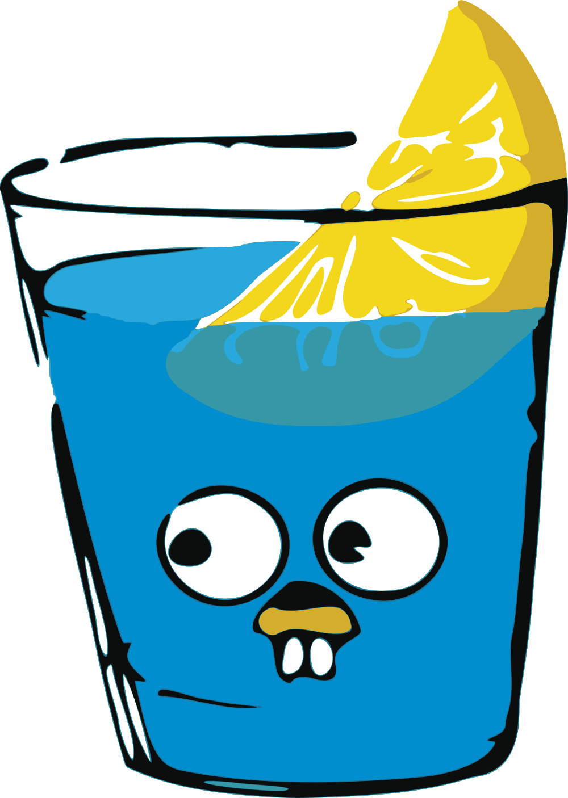
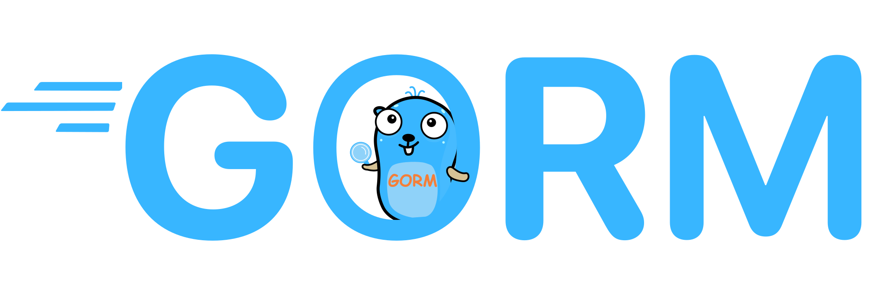
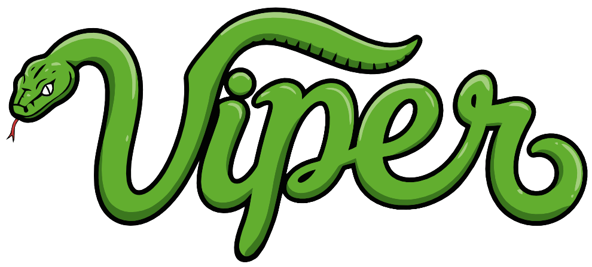
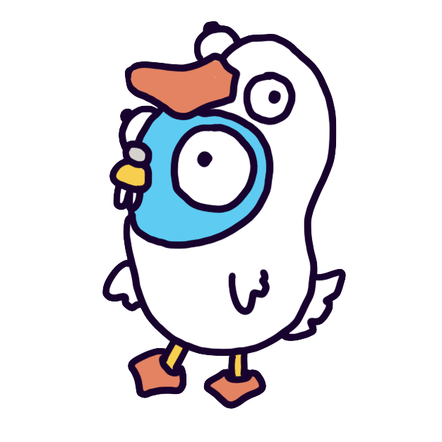
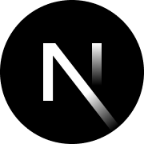
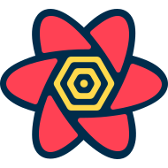
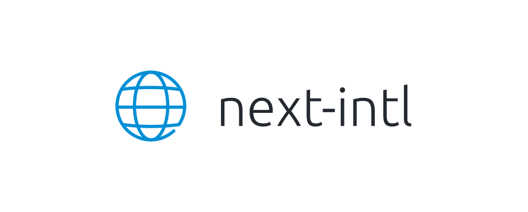
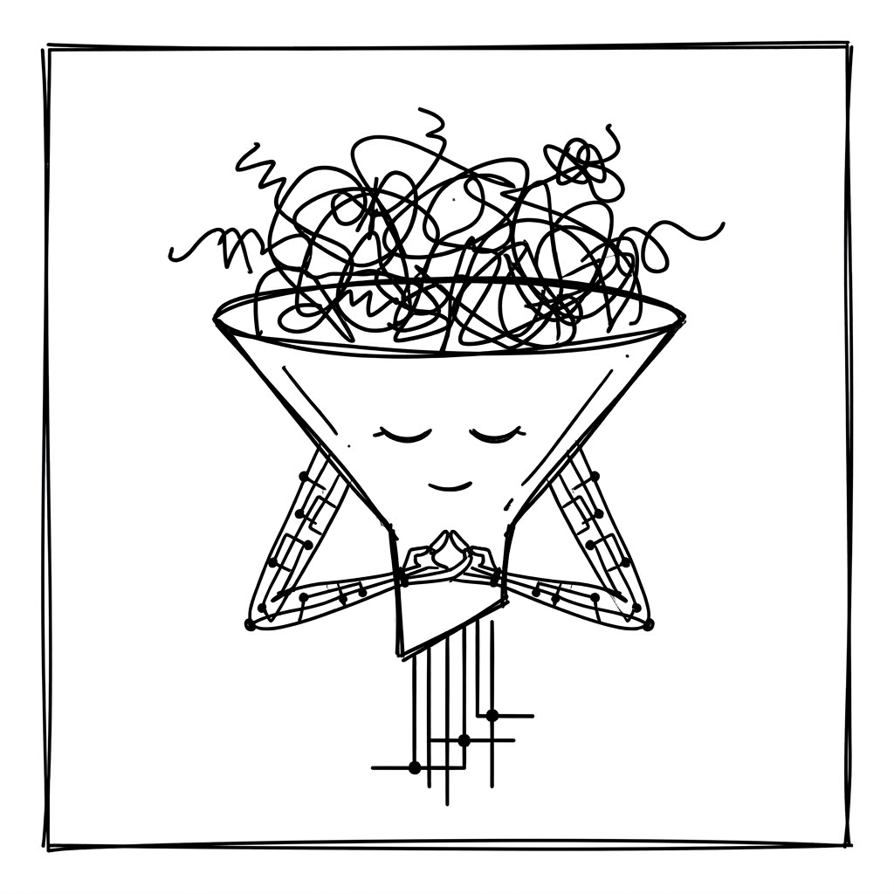

# SecPlexus

AI 原生安全运营平台。

[English](README.md) | [简体中文](README.zh-CN.md)

<div align="center">
  
  
  
  
  
  
  
  <a href="https://github.com/EayonLee/SecPlexus/stargazers">
    
  </a>
</div>

## 本地开发

准备Go 1.27.3、Node.js 22.12+（建议24）和pnpm 10.32.1。

```sh
cp .env.example .env
chmod 600 .env
# 填写.env中的数据库/管理员密码、CSRF密钥与服务凭证。
# 可以连接已有PG/Redis，也可以显式部署本项目的基础组件：
pnpm compose:up postgres redis
pnpm config:check
make dev
```

`make dev`启动IAM、Console与Web并支持热更新，只连接配置的依赖，不调用Docker。
缺少`.env`时会从示例生成并提示检查后重试，不覆盖已有文件。

```sh
make build       # 构建两个Go服务及Web
pnpm preview     # 启动后端并预览Web产物；公共origin须与实际地址一致
pnpm compose:up  # 显式构建并部署整套服务
make stop        # 停止本工作区应用与容器，保留数据
```

IAM已提供真实登录、主动改密、可撤销会话、组织、自定义角色和审计。首位管理员默认是`admin`，
唯一超级管理员默认 `admin/secplexus`，身份与密码由 `SPX_IAM_BOOTSTRAP_USERNAME` / `SPX_IAM_BOOTSTRAP_PASSWORD` 持续管理，修改后重启全部 IAM 副本，不能在页面中修改。管理中心和个人设置已接入真实API。
Console当前提供组织访问与SSE鉴权，还没有业务工作流；Web基于Next.js/shadcn，仅保留`/dashboard`的CRM V1安全智驾工作台和`/login`、`/settings/profile`、`/settings/account`、`/management`真实IAM页面；其他模板页面及菜单已删除，工作台当前展示示例数据；Web通过next-intl支持英文与简体中文切换。

启动方式、配置优先级和维护步骤见[配置指南](docs/configuration.md)。
测试入口见[测试指南](docs/testing.md)，模块设计见[IAM README](src/apps/iam/README.md)与
[Web README](src/apps/web/README.md)。

Go模块在`config.yaml`中声明环境变量和默认值，使用成熟参数组件展开，再由Viper/mapstructure严格解码，命令入口采用Cobra。
本机轮转JSON日志统一放在根`logs/`；容器默认stdout。

## 项目结构

```text
src/apps/       应用代码（web、iam、console）
src/packages/   共享库，按需添加
deploy/         部署配置
scripts/        开发与发布脚本
docs/           项目文档
```

## 参与贡献

开发环境、架构边界、测试要求与 PR 流程见[贡献指南](CONTRIBUTING.zh-CN.md)。

## 贡献者

感谢每一位为 SecPlexus 做出贡献的开发者。

<p align="center">
  <a href="https://github.com/EayonLee/SecPlexus/graphs/contributors">
    
  </a>
</p>

## 鸣谢

感谢 SecPlexus 及其开发工具所使用项目的开发者和维护者。

<p>
  <a href="https://github.com/arhamkhnz/next-shadcn-admin-dashboard" title="next-shadcn-admin-dashboard">
    
  </a>
  &nbsp;&nbsp;
  <a href="https://github.com/shadcn-ui/ui" title="shadcn/ui">
    
  </a>
  &nbsp;&nbsp;
  <a href="https://github.com/postgres/postgres" title="PostgreSQL">
    
  </a>
  &nbsp;&nbsp;
  <a href="https://github.com/redis/redis" title="Redis">
    
  </a>
</p>

<p>
  <a href="https://github.com/gin-gonic/gin" title="Gin">
    
  </a>
  &nbsp;&nbsp;
  <a href="https://github.com/go-gorm/gorm" title="GORM">
    
  </a>
  &nbsp;&nbsp;
  <a href="https://github.com/spf13/viper" title="Viper">
    
  </a>
  &nbsp;&nbsp;
  <a href="https://github.com/spf13/cobra" title="Cobra">
    
  </a>
  &nbsp;&nbsp;
  <a href="https://github.com/pressly/goose" title="Goose">
    
  </a>
  &nbsp;&nbsp;
  <a href="https://github.com/gorilla/csrf" title="Gorilla CSRF">
    
  </a>
</p>

<p>
  <a href="https://github.com/facebook/react" title="React">
    
  </a>
  &nbsp;&nbsp;
  <a href="https://github.com/vercel/next.js" title="Next.js">
    
  </a>
  &nbsp;&nbsp;
  <a href="https://github.com/tailwindlabs/tailwindcss" title="Tailwind CSS">
    
  </a>
  &nbsp;&nbsp;
  <a href="https://github.com/radix-ui/primitives" title="Radix UI">
    <picture>
      <source media="(prefers-color-scheme: dark)" srcset="docs/assets/radix-ui-dark.svg" />
      
    </picture>
  </a>
  &nbsp;&nbsp;
  <a href="https://github.com/mui/base-ui" title="Base UI">
    
  </a>
  &nbsp;&nbsp;
  <a href="https://github.com/lucide-icons/lucide" title="Lucide">
    <picture>
      <source media="(prefers-color-scheme: dark)" srcset="docs/assets/lucide-dark.svg" />
      
    </picture>
  </a>
</p>

<p>
  <a href="https://tanstack.com" title="TanStack Query / Table">
    
  </a>
  &nbsp;&nbsp;
  <a href="https://github.com/axios/axios" title="Axios">
    <picture>
      <source media="(prefers-color-scheme: dark)" srcset="docs/assets/axios-dark.svg" />
      
    </picture>
  </a>
  &nbsp;&nbsp;
  <a href="https://github.com/colinhacks/zod" title="Zod">
    
  </a>
  &nbsp;&nbsp;
  <a href="https://github.com/react-hook-form/react-hook-form" title="React Hook Form">
    
  </a>
  &nbsp;&nbsp;
  <a href="https://github.com/amannn/next-intl" title="next-intl">
    <picture>
      <source media="(prefers-color-scheme: dark)" srcset="docs/assets/next-intl-dark.svg" />
      
    </picture>
  </a>
</p>

<p>
  <a href="https://github.com/microsoft/playwright" title="Playwright">
    
  </a>
  &nbsp;&nbsp;
  <a href="https://github.com/vitest-dev/vitest" title="Vitest">
    
  </a>
  &nbsp;&nbsp;
  <a href="https://github.com/biomejs/biome" title="Biome">
    
  </a>
  &nbsp;&nbsp;
  <a href="https://github.com/peteromallet/desloppify" title="Desloppify">
    
  </a>
</p>
