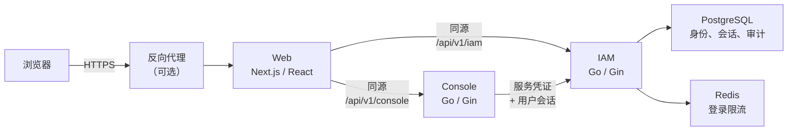
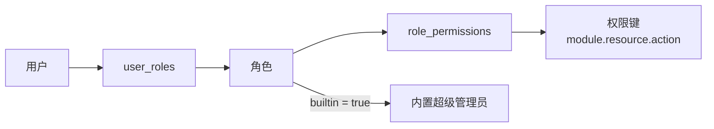

# SecPlexus

**以身份为中心的 AI 原生安全运营平台。**

SecPlexus 是一个开源安全运营平台。它把身份、授权、审计与运营控制台放在同一套
系统里，让安全团队在一个地方回答“谁、用什么权限、做了什么、为什么”。

项目处于**早期开发阶段（pre-1.0）**。IAM 服务与 Web 的 IAM 页面已经可用；
运营工作流、数据接入、关联分析和模型接入仍在公开开发中。

<p align="center">
  <a href="README.md">English</a> | <a href="README.zh-CN.md">简体中文</a> · <a href="docs/design/architecture/README.md">架构文档</a> · <a href="CONTRIBUTING.zh-CN.md">参与贡献</a>
</p>

<div align="center">
  <a href="LICENSE"></a>
  <a href="https://github.com/EayonLee/SecPlexus/actions/workflows/ci.yml"></a>
  
  
  
  
  <a href="https://github.com/EayonLee/SecPlexus/stargazers"></a>
</div>

## 为什么是 SecPlexus

安全产品通常各自生长：身份一套、检测一套、处置一套，每套都有自己的权限模型和
审计日志。SecPlexus 从相反的方向开始：

- **身份是地基。** 用户、角色、权限和会话由唯一的 IAM 服务拥有；其他模块向 IAM
  询问，而不是各自发明第二套答案。
- **只有一条授权路径。** 用户持有角色，角色持有权限，权限是 `iam.users.read` 这样的
  稳定键。当前模型没有组织作用域、超级管理员旁路或隐藏的第二条路径。
- **默认可审计。** 安全相关变更在同一事务里写入追加型审计事件；审计行不能被更新，
  删除只允许保留期清理执行。
- **模块边界是强制的。** 每个应用拥有自己的配置、启动和表；跨模块访问走 HTTP
  契约，不导入私有包，也不读别人的表。
- **三个平台一个开发入口。** `make dev`、`make test`、`make stop` 在 macOS、Linux、
  Windows PowerShell 与 `cmd.exe` 中一致可用。

## 当前状态

| 区域 | 状态 | 说明 |
| --- | --- | --- |
| IAM | 可用 | 登录、可撤销会话、改密/重置密码、用户、全局角色、扁平权限、授权、追加型审计；包含表注释和版本化迁移。 |
| Web | IAM 页面可用 | 真实的 `/login`、`/settings`、`/settings/users`、`/settings/roles`、`/settings/audit`；中英文双语。工作台仍是示例数据。 |
| Console | 早期 | 身份上下文与带授权的 SSE 连接；业务工作流尚未实现。 |
| 接入与归一化 | 计划中 | 见[接入与归一化](docs/plans/ingest-and-normalization/spec.md)。 |
| 关联分析与响应 | 计划中 | 尚未开始。 |
| `llm-gateway` | 计划中 | 所有出站模型调用统一经过该模块；IAM、Console、Web 不持有供应商密钥。 |

1.0 之前 API、数据库结构和界面都可能变化。标记为计划中的部分不是已交付能力。

## 架构



| 组件 | 技术 | 职责 |
| --- | --- | --- |
| **Web** | Next.js、React、TypeScript、Tailwind CSS、shadcn/ui | 浏览器入口、同源 API 代理、产品页面、中英文界面。 |
| **IAM** | Go、Gin、GORM、Goose | 账号、Argon2id 凭据、SCS 逻辑会话、用户、角色、扁平权限、授权、审计。 |
| **Console** | Go、Gin | 安全运营入口；通过 IAM 校验身份并授权 SSE 流；业务工作流开发中。 |
| **PostgreSQL** | PostgreSQL 16 | IAM 表与会话；每个模块拥有自己的 schema 和迁移。 |
| **Redis** | Redis 7 | 登录限流与共享缓存键。 |

请求先到 Web 同源入口，由 Web 服务端把 `/api/v1/iam` 和 `/api/v1/console` 转发给
所属服务；部署时可选反向代理终止 HTTPS。当前只有 IAM 直接访问 PostgreSQL 和 Redis。

### 授权模型



- 权限键是 `module.resource.action` 形式的稳定标识；数据库只存键，三段由键派生。
- 配置托管管理员是唯一的 `configured` 账号：由配置创建，页面不能删除、停用或改密，
  密码只随配置更新。
- 会话是 PostgreSQL 中的逻辑行。改密、账号状态变化和配置变化会推进 `auth_epoch`，
  让所有旧会话立即失效。
- 审计只追加：触发器拒绝 `UPDATE`；只有保留期清理在 `iam.audit_purge` 事务标记下
  才允许 `DELETE`。

## 技术栈

| 层次 | 选择 |
| --- | --- |
| 后端 | Go 1.27.3、Gin、GORM、Goose、Cobra、Viper、SCS、Argon2id、Gorilla CSRF |
| 前端 | Next.js 16、React 19、TypeScript、Tailwind CSS 4、shadcn/ui、TanStack Query/Table、Zod、React Hook Form、next-intl |
| 数据 | PostgreSQL 16、Redis 7 |
| 工具 | pnpm、GNU Make、Biome、Vitest、Playwright、Go test |

## 快速开始

### 环境要求

| 工具 | 版本或要求 |
| --- | --- |
| Go | 1.27.3 |
| Node.js | 22.12 及以上；建议 24 |
| pnpm | 10.32.1 |
| GNU Make | 三个平台执行根命令都需要 |
| PostgreSQL / Redis | 可访问的实例，或使用仓库提供的 Compose |
| Docker 与 Compose | 仅在选择容器依赖时需要 |

Windows 可通过 w64devkit、Chocolatey、MSYS2 等安装 GNU Make，然后在 PowerShell
或 `cmd.exe` 中运行 `make`；不需要 POSIX shell。

### 本地运行

```sh
git clone https://github.com/EayonLee/SecPlexus.git
cd SecPlexus

# 1. 从模板生成 .env，随后停止以便检查
make config

# 2. 编辑 .env：
#    - 修改 SPX_IAM_BOOTSTRAP_PASSWORD（至少 12 个字符）
#    - 设置 SPX_IAM_CSRF_KEY（恰好 32 字节；openssl rand -hex 16）
#    - 设置 SPX_CONSOLE_IAM_TOKEN（32-512 字节；openssl rand -hex 32）
#    - 将 PostgreSQL/Redis 指向你的实例

# 3. 可选：启动仓库提供的 PostgreSQL 与 Redis
make compose-up SERVICES="postgres redis"

# 4. 执行 IAM 迁移，启动带热更新的 IAM、Console 与 Web
make dev
```

打开 <http://127.0.0.1:5173>，使用 `.env` 中配置的管理员登录。示例密码
`changeme-at-least-12` 只是占位符，首次启动前必须修改。配置托管管理员不能在页面中
编辑、停用或重置密码；请修改配置并重启 IAM。

`make dev` 只连接配置的依赖，不会启动 Docker；`make stop` 在 macOS、Linux 和
Windows 上精确停止它启动的进程树。全部配置项与反向代理设置见
[配置指南](docs/development/configuration.md)。

## 常用命令

| 命令 | 用途 |
| --- | --- |
| `make config [MODULES="..."]` | 离线校验配置；首次运行生成 `.env` 后停止。 |
| `make dev [MODULES="..."]` | 迁移并启动 IAM、Console、Web，支持热更新。 |
| `make build` | 构建两个 Go 服务和 Web 生产产物。 |
| `make preview [MODULES="..."]` | 启动后端并预览已构建的 Web。 |
| `make compose-up [SERVICES="..."]` | 构建并启动整套 Compose 服务。 |
| `make stop` | 停止当前工作区应用与容器，保留数据。 |
| `make test` | 运行脚本、Go 与 Web 单元测试。 |
| `make test-e2e ARGS="--docker"` | 运行 Playwright 浏览器套件。 |
| `make integration ARGS="--docker --race"` | 运行 Go 集成测试。 |
| `make typecheck` / `make lint` | TypeScript 类型检查 / Biome lint。 |
| `make vet` / `make lint-go` / `make vuln-go` | Go vet、golangci-lint、govulncheck。 |
| `make catalogs` / `make catalogs-generate` | 检查 / 生成共享结果码与权限目录。 |

## 项目结构

```text
src/apps/
  iam/            Go IAM 服务：cmd、internal、migrations、config.yaml
  console/        Go Console 服务：cmd、internal、config.yaml
  web/            Next.js 应用：app、spx、messages、scripts、tests
src/packages/go/
  logging/        结构化 slog 与安全错误字段
  result/         共享 HTTP 结果码
  httpx/          Gin 帮助函数、中间件、请求 ID
  iamclient/      类型化 IAM 客户端与权限常量
scripts/          根开发、构建、测试与迁移工具
deploy/           Compose 与 Dockerfile
docs/             架构、开发指南与计划
```

每个 Go 模块遵循[后端工程结构](docs/development/backend-structure.md)的分层与依赖规则；
表结构、注释、枚举、索引与迁移遵循[数据库设计](docs/development/database-design.md)。

## 文档

| 文档 | 内容 |
| --- | --- |
| [架构](docs/design/architecture/README.md) | 系统上下文、技术架构与部署视图。 |
| [配置](docs/development/configuration.md) | 环境变量、启动、日志与反向代理。 |
| [测试](docs/development/testing.md) | 测试分层、命令、隔离与清理。 |
| [数据库设计](docs/development/database-design.md) | 命名、类型、枚举、注释、索引、迁移与规模规则。 |
| [后端工程结构](docs/development/backend-structure.md) | 仓库布局、模块分层、命名与评审清单。 |
| [计划](docs/plans/README.md) | 已批准的规格、实施计划与验证证据。 |
| [更新日志](CHANGELOG.md) | 重要变更、修复与安全相关更新。 |
| [支持](SUPPORT.md) | 提问渠道与需要提供的信息。 |
| [IAM](src/apps/iam/README.md) · [Console](src/apps/console/README.md) · [Web](src/apps/web/README.md) | 模块契约与职责。 |

## 安全

发现疑似漏洞时不要开公开 Issue。请使用
[GitHub 私密漏洞报告](https://github.com/EayonLee/SecPlexus/security/advisories/new)
并遵循 [SECURITY.md](SECURITY.md)。请提供受影响版本、影响、复现步骤与脱敏日志；
不要包含凭据或私有数据。

## 参与贡献

欢迎贡献代码、测试、文档、可复现的缺陷报告和体验改进。开发环境、架构边界、
测试要求与 PR 流程见[贡献指南](CONTRIBUTING.zh-CN.md)。所有参与者需遵守
[行为准则](CODE_OF_CONDUCT.md)。

适合新贡献者的问题标记为 `good first issue`；安全问题请走上面的私密渠道。

## 开源协议

SecPlexus 使用 [MIT License](LICENSE)。

## 致谢

SecPlexus 建立在大量开源工作之上。下面的徽标标明了应用及其开发流程所使用的
框架、库和工具；它们归各自所有者所有，仅用于署名。每个徽标的来源与许可证见
[docs/assets/README.md](docs/assets/README.md)。


<p align="center">
  <a href="https://github.com/arhamkhnz/next-shadcn-admin-dashboard" title="next-shadcn-admin-dashboard">
    
  </a>
  &nbsp;&nbsp;
  <a href="https://github.com/shadcn-ui/ui" title="shadcn/ui">
    
  </a>
  &nbsp;&nbsp;
  <a href="https://github.com/postgres/postgres" title="PostgreSQL">
    
  </a>
  &nbsp;&nbsp;
  <a href="https://github.com/redis/redis" title="Redis">
    
  </a>
</p>

<p align="center">
  <a href="https://github.com/gin-gonic/gin" title="Gin">
    
  </a>
  &nbsp;&nbsp;
  <a href="https://github.com/go-gorm/gorm" title="GORM">
    
  </a>
  &nbsp;&nbsp;
  <a href="https://github.com/spf13/viper" title="Viper">
    
  </a>
  &nbsp;&nbsp;
  <a href="https://github.com/spf13/cobra" title="Cobra">
    
  </a>
  &nbsp;&nbsp;
  <a href="https://github.com/pressly/goose" title="Goose">
    
  </a>
  &nbsp;&nbsp;
  <a href="https://github.com/gorilla/csrf" title="Gorilla CSRF">
    
  </a>
</p>

<p align="center">
  <a href="https://github.com/facebook/react" title="React">
    
  </a>
  &nbsp;&nbsp;
  <a href="https://github.com/vercel/next.js" title="Next.js">
    
  </a>
  &nbsp;&nbsp;
  <a href="https://github.com/tailwindlabs/tailwindcss" title="Tailwind CSS">
    
  </a>
  &nbsp;&nbsp;
  <a href="https://github.com/radix-ui/primitives" title="Radix UI">
    <picture>
      <source media="(prefers-color-scheme: dark)" srcset="docs/assets/radix-ui-dark.svg" />
      
    </picture>
  </a>
  &nbsp;&nbsp;
  <a href="https://github.com/mui/base-ui" title="Base UI">
    
  </a>
  &nbsp;&nbsp;
  <a href="https://github.com/lucide-icons/lucide" title="Lucide">
    <picture>
      <source media="(prefers-color-scheme: dark)" srcset="docs/assets/lucide-dark.svg" />
      
    </picture>
  </a>
</p>

<p align="center">
  <a href="https://tanstack.com" title="TanStack Query / Table">
    
  </a>
  &nbsp;&nbsp;
  <a href="https://github.com/axios/axios" title="Axios">
    <picture>
      <source media="(prefers-color-scheme: dark)" srcset="docs/assets/axios-dark.svg" />
      
    </picture>
  </a>
  &nbsp;&nbsp;
  <a href="https://github.com/colinhacks/zod" title="Zod">
    
  </a>
  &nbsp;&nbsp;
  <a href="https://github.com/react-hook-form/react-hook-form" title="React Hook Form">
    
  </a>
  &nbsp;&nbsp;
  <a href="https://github.com/amannn/next-intl" title="next-intl">
    <picture>
      <source media="(prefers-color-scheme: dark)" srcset="docs/assets/next-intl-dark.svg" />
      
    </picture>
  </a>
</p>

<p align="center">
  <a href="https://github.com/microsoft/playwright" title="Playwright">
    
  </a>
  &nbsp;&nbsp;
  <a href="https://github.com/vitest-dev/vitest" title="Vitest">
    
  </a>
  &nbsp;&nbsp;
  <a href="https://github.com/biomejs/biome" title="Biome">
    
  </a>
  &nbsp;&nbsp;
  <a href="https://github.com/peteromallet/desloppify" title="Desloppify">
    
  </a>
</p>

## 贡献者

感谢每一位为 SecPlexus 做出贡献的开发者。

<p align="center">
  <a href="https://github.com/EayonLee/SecPlexus/graphs/contributors">
    
  </a>
</p>
