# SecPlexus

**One AI Security Platform: Protect, Operate, Respond.**

**一体化 AI 安全平台：防护、运营、响应。**

SecPlexus 是开源的、以身份为底座的安全运营平台，面向已经部署 SIEM、EDR、WAF 与云安全的企业。
它不替换这些系统，而是做它们之上的中立大脑：把不同厂商的告警还原成同一次攻击，
用可审计的 AI 分析师研判事件组，并通过受治理的响应在企业原有工具中完成闭环。

行业不缺“在旧控制台上外挂一个聊天框”的产品：人发起会话，模型一次只看一条告警，
研判方法论活在提示词里。SecPlexus 反过来设计：告警作为数据流入，关联决定哪些告警
属于同一起事件，确定性图编排加上受限模型调用，产出证据、结论和完整审计链。

<p align="center">
  <a href="README.md">English</a> | <a href="README.zh-CN.md">简体中文</a> · <a href="docs/design/architecture/README.md">架构文档</a> · <a href="CONTRIBUTING.zh-CN.md">参与贡献</a>
</p>

<div align="center">
  <a href="LICENSE"></a>
  <a href="https://github.com/EayonLee/SecPlexus/actions/workflows/ci.yml"></a>
  
  
  
  
  <a href="https://github.com/EayonLee/SecPlexus/stargazers"></a>
</div>

## 防护 · 运营 · 响应

产品方向是用一个平台覆盖三类结果：

- **防护新的攻击面**：LLM 应用、Agent、MCP 工具调用与模型 Key。身份与运行时策略在
  同一平台内，护栏拦下的 Prompt 注入不是另一个产品的告警，而是与 EDR 检测进入同一条
  案件流水线。
- **把告警洪水当成一个整体来运营**：把厂商告警归一化为 OCSF，折叠重复与同源噪音，
  交给 AI 的不是单条告警，而是一个带攻击链的事件视图。分析师只在三个队列里工作：
  待授权、需要人的判断、已闭环待抽查。
- **用受治理的闭环完成响应**：Agent 提议，SOAR 在人审批后执行；执行前检查资产爆炸
  半径，动作幂等，并按上游厂商的原生 ID 回写。AI 不拥有直接隔离主机或禁用账号的权力。

今天已交付的是身份与控制面底座。接入、关联、研判与响应服务正在公开开发中；下面的
状态表明确区分“已交付”与“规划中”。

## 为什么是 SecPlexus

- **替换大脑，不替换手脚。** 企业已有的 SIEM、EDR、WAF 与云安全继续工作。
  SecPlexus 站在它们之上，关联任何单一厂商看不到的部分，再把处置动作写回原生工具。
- **运营告警，不做第二个日志湖。** 处理单元是归一化后的告警，而不是再建一套原始
  日志仓库。用户的 SIEM 仍是日志的事实源，SecPlexus 补上跨厂商关联、案件上下文与
  响应闭环——这是厂商各自为战的栈给不了的。
- **AI-native 是架构，不是提示词。** 研判单元是事件组；流程是确定性图编排加边界清晰的
  模型节点，带 groundedness 门禁、证据级判定和三值结论：真阳性、假阳性或
  `insufficient_info`。工具返回空结果，永远不能当作“告警是良性的”证据。
- **每一次纠正都沉淀为机构记忆。** 分析师改结论时必须填写原因；原因、证据与结果成为
  下一次研判可检索的上下文。影子模式先记录 AI 会怎么做，某一类告警靠长期正确率
  “挣得”自动关闭的授权，而不是靠一个全局置信度阈值。
- **告警是事实，案件是产品。** 告警保持完整、可查询的事实层；事件视图是 AI 的工作集；
  案件是唯一持久的运营对象，承载时间线、证据、审批、处置与复盘。
- **身份是底座，不是补丁。** 唯一的 IAM 拥有用户、会话、角色、权限与审计；只有一条
  授权路径：用户 → 角色 → 权限。审计只追加，改密或状态变化通过 `auth_epoch` 立即
  失效所有旧会话。
- **失败必须可见。** 关联能力降级时保留原始告警并显式标记；工具失败与“查无结果”分开；
  不确定队列是一等公民，而不是隐藏的积压。

## 当前状态

SecPlexus 处于 pre-1.0。规划中的服务是设计承诺，不是已交付能力。

| 能力 | 状态 | 说明 |
| --- | --- | --- |
| 身份与访问（IAM） | 已交付 | 登录、可撤销会话、改密/重置密码、用户、全局角色、扁平权限、授权、追加型审计、版本化迁移与表注释。 |
| Web 与 Console 控制面 | 底座已交付 | Web 提供中英文 IAM 页面；Console 提供身份上下文与带授权的 SSE。案件与工作台尚未实现。 |
| 告警接入与归一化 | 规划中 | Go `ingestor`、Kafka 缓冲、OCSF 2004 归一化、厂商连接器注册表。 |
| 关联与事件视图 | 规划中 | Python `correlator`：精确去重、窗口抑制、跨源实体关联与攻击链滚动聚合。 |
| AI 研判与记忆 | 规划中 | Python `agent-runtime`、图编排研判、证据 Ledger、机构记忆与规则建议；所有模型调用经 `llm-gateway`。 |
| 响应编排 | 规划中 | Python `soar`：审批、资产爆炸半径门控、幂等 playbook 与原生 ID 回写。 |
| AI 运行时防护 | 规划中 | `ai-gateway`（agentgateway）与 `ai-policy`：Prompt 注入、DLP、模型 Key 滥用、MCP 工具治理与 Agent 行为审计。 |

1.0 之前 API、数据库结构与界面都可能变化。

## 架构

目标是数据驱动的运营流水线，控制面独立：告警与 AI 流量从左侧进入，人通过 Web、
Console 与 IAM 授权工作，数据不穿过人。

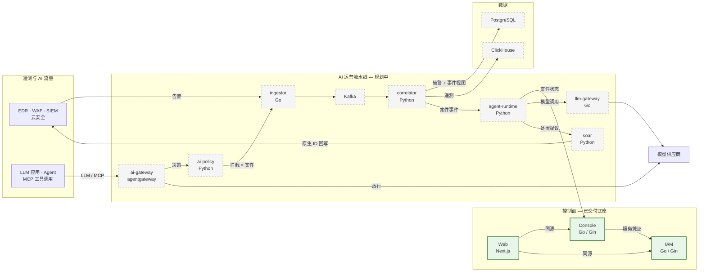

绿色为今天已交付的模块，虚线为规划中模块。当前已实现的路径只有
Web → IAM/Console，PostgreSQL 与 Redis 目前服务于 IAM；流水线是下一步建设，
不是对现状的宣称。

| 层次 | 组件 | 状态 |
| --- | --- | --- |
| 身份与访问 | IAM、PostgreSQL、Redis | 已交付 |
| 控制面 | Web、Console | 底座已交付 |
| 接入 | `ingestor`、Kafka、连接器注册表 | 规划中 |
| 关联 | `correlator`、PostgreSQL 告警、ClickHouse 遥测 | 规划中 |
| 研判 | `agent-runtime`、`llm-gateway`、证据 Ledger、机构记忆 | 规划中 |
| 响应 | `soar`、审批、原生 ID 回写 | 规划中 |
| AI 运行时防护 | `ai-gateway`、`ai-policy` | 规划中 |

### 身份与授权（已交付）

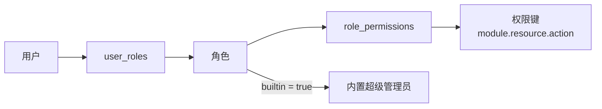

- 权限键是 `module.resource.action` 形式的稳定标识；数据库只存键，三段由键派生。
- 配置托管管理员是唯一的 `configured` 账号：由配置创建，页面不能删除、停用或改密，
  密码只随配置更新。
- 会话是 PostgreSQL 中的逻辑行。改密、账号状态变化和配置变化会推进 `auth_epoch`，
  让所有旧会话立即失效。
- 审计只追加：触发器拒绝 `UPDATE`；只有保留期清理在 `iam.audit_purge` 事务标记下
  才允许 `DELETE`。

## 技术栈

| 层次 | 选择 |
| --- | --- |
| 已交付服务 | Go 1.27、Gin、GORM、Goose、pgx、SCS、Argon2id、Gorilla CSRF；Next.js 16、React 19、TypeScript、Tailwind CSS 4、shadcn/ui、TanStack Query/Table、Zod、React Hook Form、next-intl |
| 已交付数据 | PostgreSQL 16、Redis 7 |
| 规划中服务 | `ingestor`（Go）；`correlator`、`agent-runtime`、`soar`、`ai-policy`（Python）；`llm-gateway`（Go）；`ai-gateway`（agentgateway，Rust） |
| 规划中数据面 | Kafka、ClickHouse、S3 兼容对象存储 |
| 工具 | pnpm、GNU Make、Biome、Vitest、Playwright、Go test |

## 快速开始

### 环境要求

| 工具 | 版本或要求 |
| --- | --- |
| Go | 1.27.3 |
| Node.js | 22.12 及以上；建议 24 |
| pnpm | 10.32.1 |
| GNU Make | 三个平台执行根命令都需要 |
| PostgreSQL / Redis | 可访问的实例，或使用仓库提供的 Compose |
| Docker 与 Compose | 仅在选择容器依赖时需要 |

Windows 可通过 w64devkit、Chocolatey、MSYS2 等安装 GNU Make，然后在 PowerShell
或 `cmd.exe` 中运行 `make`；不需要 POSIX shell。

### 本地运行

```sh
git clone https://github.com/EayonLee/SecPlexus.git
cd SecPlexus

# 1. 从模板生成 .env，随后停止以便检查
make config

# 2. 编辑 .env：
#    - 修改 SPX_IAM_BOOTSTRAP_PASSWORD（至少 12 个字符）
#    - 设置 SPX_IAM_CSRF_KEY（恰好 32 字节；openssl rand -hex 16）
#    - 设置 SPX_CONSOLE_IAM_TOKEN（32-512 字节；openssl rand -hex 32）
#    - 将 PostgreSQL/Redis 指向你的实例

# 3. 可选：启动仓库提供的 PostgreSQL 与 Redis
make compose-up SERVICES="postgres redis"

# 4. 执行 IAM 迁移，启动带热更新的 IAM、Console 与 Web
make dev
```

打开 <http://127.0.0.1:5173>，使用 `.env` 中配置的管理员登录。示例密码
`changeme-at-least-12` 只是占位符，首次启动前必须修改。配置托管管理员不能在页面中
编辑、停用或重置密码；请修改配置并重启 IAM。

`make dev` 只连接配置的依赖，不会启动 Docker；`make stop` 在 macOS、Linux 和
Windows 上精确停止它启动的进程树。全部配置项与反向代理设置见
[配置指南](docs/development/configuration.md)。

## 常用命令

| 命令 | 用途 |
| --- | --- |
| `make config [MODULES="..."]` | 离线校验配置；首次运行生成 `.env` 后停止。 |
| `make dev [MODULES="..."]` | 迁移并启动 IAM、Console、Web，支持热更新。 |
| `make build` | 构建两个 Go 服务和 Web 生产产物。 |
| `make preview [MODULES="..."]` | 启动后端并预览已构建的 Web。 |
| `make compose-up [SERVICES="..."]` | 构建并启动整套 Compose 服务。 |
| `make stop` | 停止当前工作区应用与容器，保留数据。 |
| `make test` | 运行脚本、Go 与 Web 单元测试。 |
| `make test-e2e ARGS="--docker"` | 运行 Playwright 浏览器套件。 |
| `make integration ARGS="--docker --race"` | 运行 Go 集成测试。 |
| `make typecheck` / `make lint` | TypeScript 类型检查 / Biome lint。 |
| `make vet` / `make lint-go` / `make vuln-go` | Go vet、golangci-lint、govulncheck。 |
| `make catalogs` / `make catalogs-generate` | 检查 / 生成共享结果码与权限目录。 |

## 项目结构

```text
src/apps/
  iam/            Go IAM 服务：cmd、internal、migrations、config.yaml
  console/        Go Console 服务：cmd、internal、config.yaml
  web/            Next.js 应用：app、spx、messages、scripts、tests
src/packages/go/
  logging/        结构化 slog 与安全错误字段
  result/         共享 HTTP 结果码
  httpx/          Gin 帮助函数、中间件、请求 ID
  iamclient/      类型化 IAM 客户端与权限常量
scripts/          根开发、构建、测试与迁移工具
deploy/           Compose 与 Dockerfile
docs/             架构、开发指南与计划
```

每个 Go 模块遵循[后端工程结构](docs/development/backend-structure.md)的分层与依赖规则；
表结构、注释、枚举、索引与迁移遵循[数据库设计](docs/development/database-design.md)。

## 文档

| 文档 | 内容 |
| --- | --- |
| [架构](docs/design/architecture/README.md) | 系统上下文、技术架构与部署视图。 |
| [配置](docs/development/configuration.md) | 环境变量、启动、日志与反向代理。 |
| [测试](docs/development/testing.md) | 测试分层、命令、隔离与清理。 |
| [数据库设计](docs/development/database-design.md) | 命名、类型、枚举、注释、索引、迁移与规模规则。 |
| [后端工程结构](docs/development/backend-structure.md) | 仓库布局、模块分层、命名与评审清单。 |
| [计划](docs/plans/README.md) | 已批准的规格、实施计划与验证证据。 |
| [更新日志](CHANGELOG.md) | 重要变更、修复与安全相关更新。 |
| [支持](SUPPORT.md) | 提问渠道与需要提供的信息。 |
| [IAM](src/apps/iam/README.md) · [Console](src/apps/console/README.md) · [Web](src/apps/web/README.md) | 模块契约与职责。 |

## 安全

发现疑似漏洞时不要开公开 Issue。请使用
[GitHub 私密漏洞报告](https://github.com/EayonLee/SecPlexus/security/advisories/new)
并遵循 [SECURITY.md](SECURITY.md)。请提供受影响版本、影响、复现步骤与脱敏日志；
不要包含凭据或私有数据。

## 参与贡献

欢迎贡献代码、测试、文档、可复现的缺陷报告和体验改进。开发环境、架构边界、
测试要求与 PR 流程见[贡献指南](CONTRIBUTING.zh-CN.md)。所有参与者需遵守
[行为准则](CODE_OF_CONDUCT.md)。

适合新贡献者的问题标记为 `good first issue`；安全问题请走上面的私密渠道。

## 开源协议

SecPlexus 使用 [MIT License](LICENSE)。

## 致谢

SecPlexus 建立在大量开源工作之上。下面的徽标标明了应用及其开发流程所使用的
框架、库和工具；它们归各自所有者所有，仅用于署名。每个徽标的来源与许可证见
[docs/assets/README.md](docs/assets/README.md)。


<p align="center">
  <a href="https://github.com/arhamkhnz/next-shadcn-admin-dashboard" title="next-shadcn-admin-dashboard">
    
  </a>
  &nbsp;&nbsp;
  <a href="https://github.com/shadcn-ui/ui" title="shadcn/ui">
    
  </a>
  &nbsp;&nbsp;
  <a href="https://github.com/postgres/postgres" title="PostgreSQL">
    
  </a>
  &nbsp;&nbsp;
  <a href="https://github.com/redis/redis" title="Redis">
    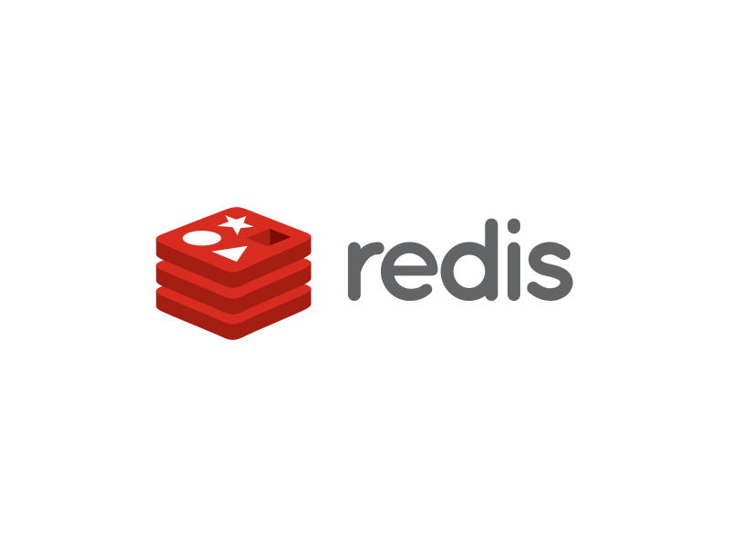
  </a>
</p>

<p align="center">
  <a href="https://github.com/gin-gonic/gin" title="Gin">
    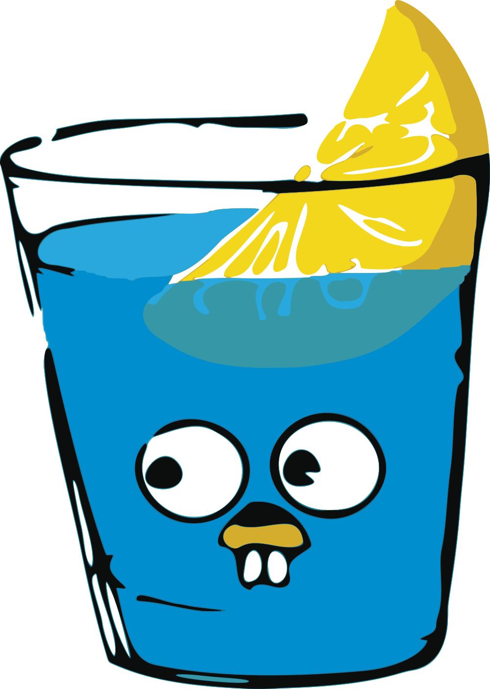
  </a>
  &nbsp;&nbsp;
  <a href="https://github.com/go-gorm/gorm" title="GORM">
    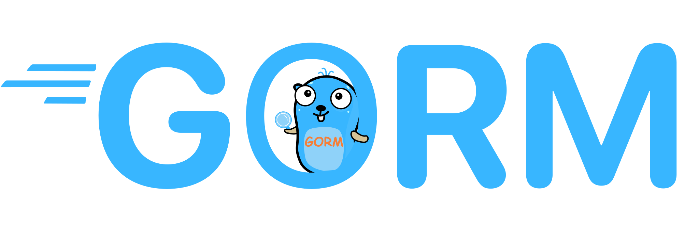
  </a>
  &nbsp;&nbsp;
  <a href="https://github.com/spf13/viper" title="Viper">
    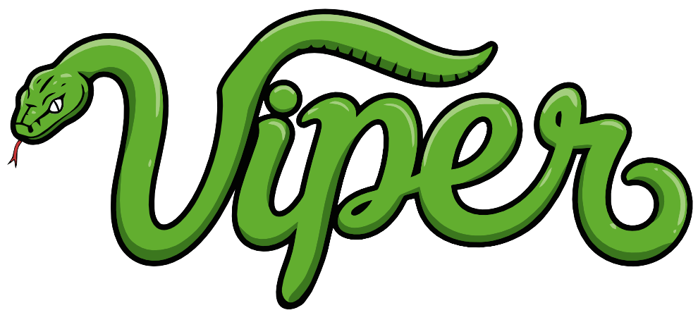
  </a>
  &nbsp;&nbsp;
  <a href="https://github.com/spf13/cobra" title="Cobra">
    
  </a>
  &nbsp;&nbsp;
  <a href="https://github.com/pressly/goose" title="Goose">
    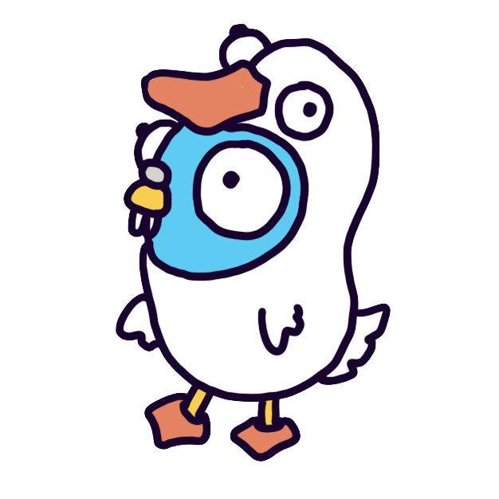
  </a>
  &nbsp;&nbsp;
  <a href="https://github.com/gorilla/csrf" title="Gorilla CSRF">
    
  </a>
</p>

<p align="center">
  <a href="https://github.com/facebook/react" title="React">
    
  </a>
  &nbsp;&nbsp;
  <a href="https://github.com/vercel/next.js" title="Next.js">
    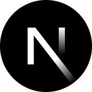
  </a>
  &nbsp;&nbsp;
  <a href="https://github.com/tailwindlabs/tailwindcss" title="Tailwind CSS">
    
  </a>
  &nbsp;&nbsp;
  <a href="https://github.com/radix-ui/primitives" title="Radix UI">
    <picture>
      <source media="(prefers-color-scheme: dark)" srcset="docs/assets/radix-ui-dark.svg" />
      
    </picture>
  </a>
  &nbsp;&nbsp;
  <a href="https://github.com/mui/base-ui" title="Base UI">
    
  </a>
  &nbsp;&nbsp;
  <a href="https://github.com/lucide-icons/lucide" title="Lucide">
    <picture>
      <source media="(prefers-color-scheme: dark)" srcset="docs/assets/lucide-dark.svg" />
      
    </picture>
  </a>
</p>

<p align="center">
  <a href="https://tanstack.com" title="TanStack Query / Table">
    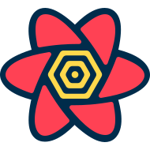
  </a>
  &nbsp;&nbsp;
  <a href="https://github.com/axios/axios" title="Axios">
    <picture>
      <source media="(prefers-color-scheme: dark)" srcset="docs/assets/axios-dark.svg" />
      
    </picture>
  </a>
  &nbsp;&nbsp;
  <a href="https://github.com/colinhacks/zod" title="Zod">
    
  </a>
  &nbsp;&nbsp;
  <a href="https://github.com/react-hook-form/react-hook-form" title="React Hook Form">
    
  </a>
  &nbsp;&nbsp;
  <a href="https://github.com/amannn/next-intl" title="next-intl">
    <picture>
      <source media="(prefers-color-scheme: dark)" srcset="docs/assets/next-intl-dark.svg" />
      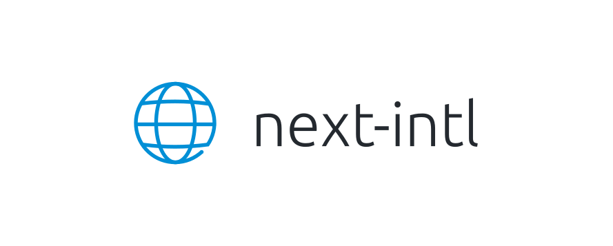
    </picture>
  </a>
</p>

<p align="center">
  <a href="https://github.com/microsoft/playwright" title="Playwright">
    
  </a>
  &nbsp;&nbsp;
  <a href="https://github.com/vitest-dev/vitest" title="Vitest">
    
  </a>
  &nbsp;&nbsp;
  <a href="https://github.com/biomejs/biome" title="Biome">
    
  </a>
  &nbsp;&nbsp;
  <a href="https://github.com/peteromallet/desloppify" title="Desloppify">
    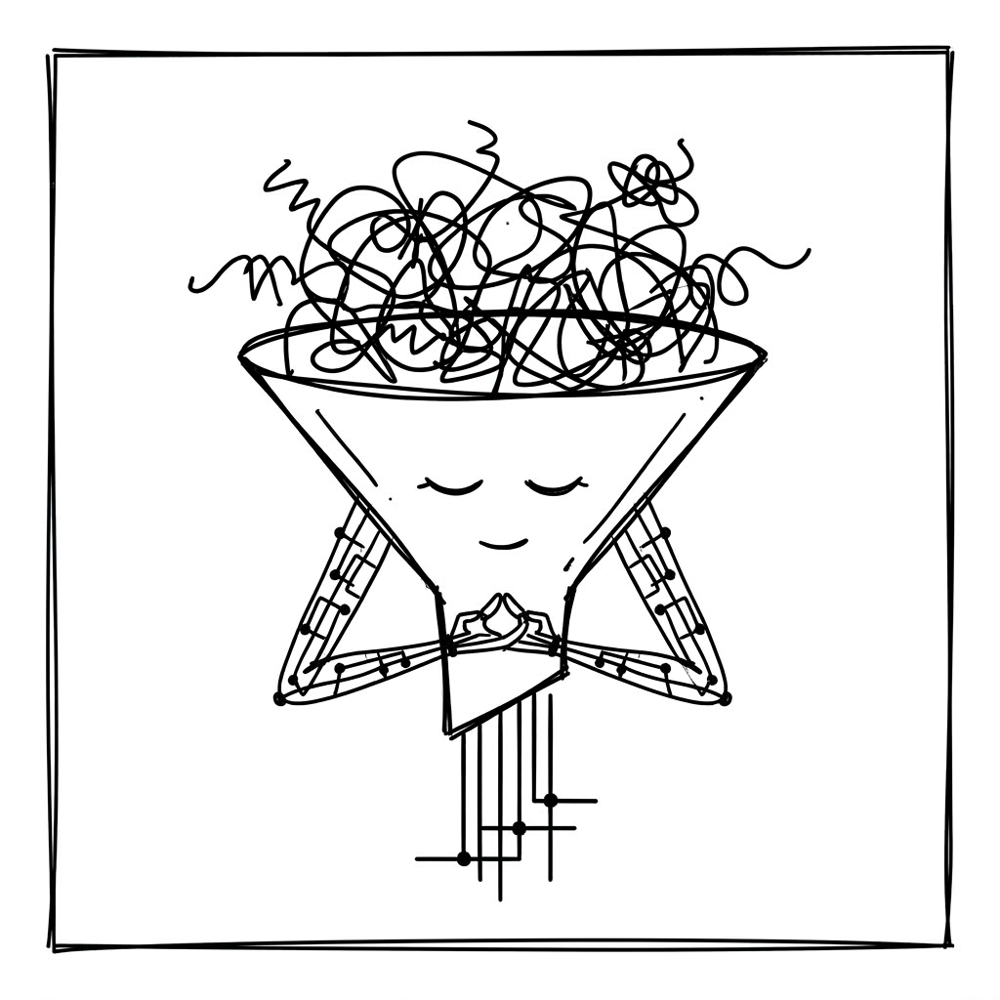
  </a>
</p>

## 贡献者

感谢每一位为 SecPlexus 做出贡献的开发者。

<p align="center">
  <a href="https://github.com/EayonLee/SecPlexus/graphs/contributors">
    
  </a>
</p>
