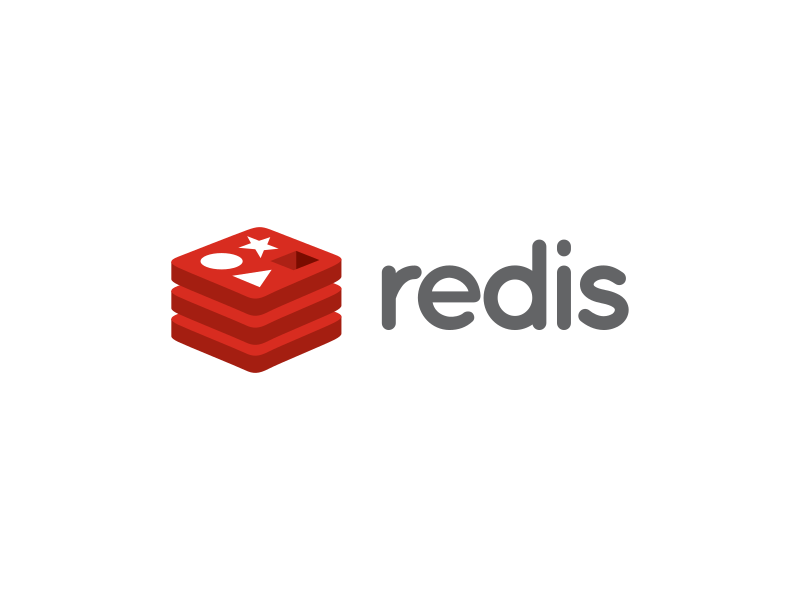
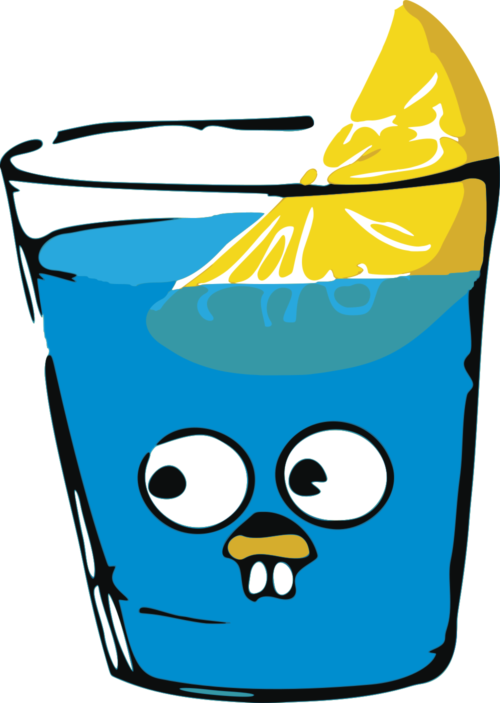
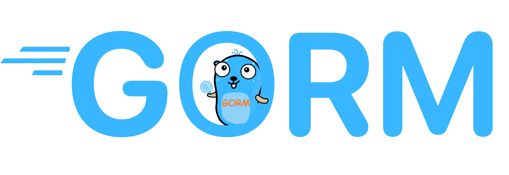
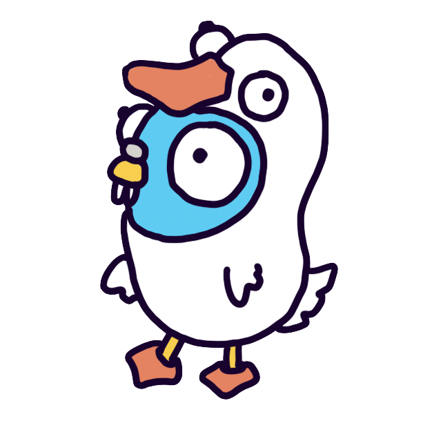
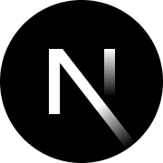
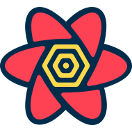
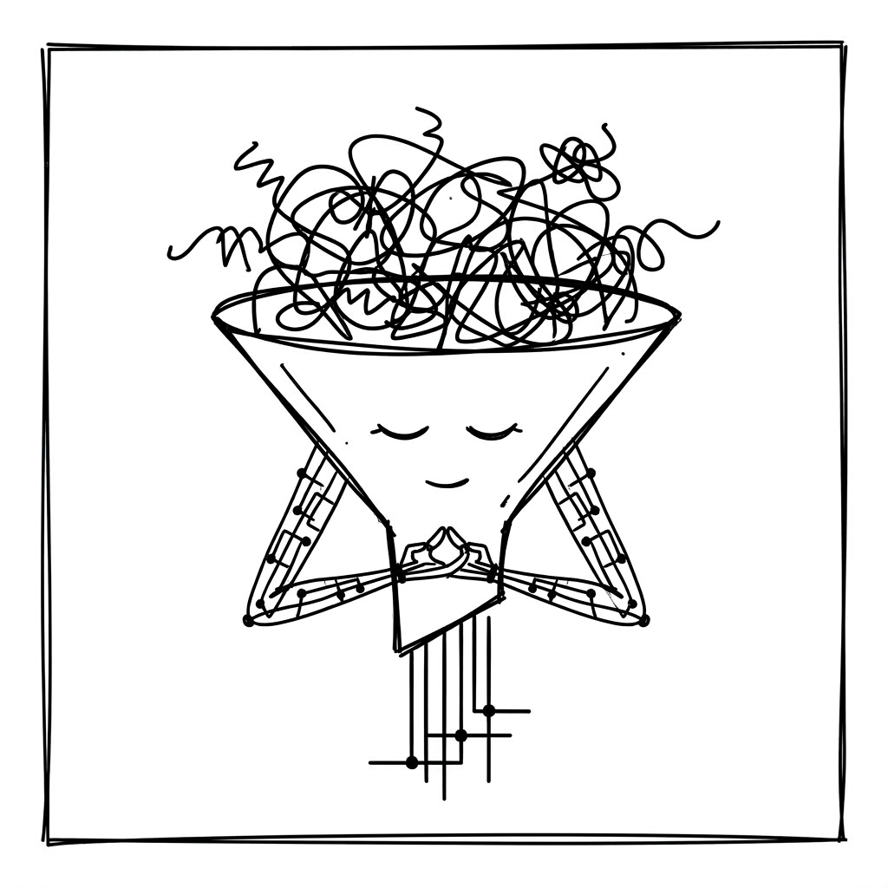

# Acknowledgements

SecPlexus is built on the work of many open-source projects. The logos below
identify the frameworks, libraries and tools used by the application or its
development workflow. They remain the property of their respective owners and
are used only for attribution; see [assets/README.md](assets/README.md) for the
source and license of each mark.

Thanks to the maintainers and contributors of the projects used in SecPlexus and its development tools.

  
  &nbsp;&nbsp;
  
  &nbsp;&nbsp;
  
  &nbsp;&nbsp;
  

  
  &nbsp;&nbsp;
  
  &nbsp;&nbsp;
  
  &nbsp;&nbsp;
  
  &nbsp;&nbsp;
  
  &nbsp;&nbsp;
  

  
  &nbsp;&nbsp;
  
  &nbsp;&nbsp;
  
  &nbsp;&nbsp;
  <a href="https://github.com/radix-ui/primitives" title="Radix UI">
    <picture>
      <source media="(prefers-color-scheme: dark)" srcset="assets/radix-ui-dark.svg" />
      
    </picture>
  </a>
  &nbsp;&nbsp;
  
  &nbsp;&nbsp;
  <a href="https://github.com/lucide-icons/lucide" title="Lucide">
    <picture>
      <source media="(prefers-color-scheme: dark)" srcset="assets/lucide-dark.svg" />
      
    </picture>
  </a>

  
  &nbsp;&nbsp;
  <a href="https://github.com/axios/axios" title="Axios">
    <picture>
      <source media="(prefers-color-scheme: dark)" srcset="assets/axios-dark.svg" />
      
    </picture>
  </a>
  &nbsp;&nbsp;
  
  &nbsp;&nbsp;
  
  &nbsp;&nbsp;
  <a href="https://github.com/amannn/next-intl" title="next-intl">
    <picture>
      <source media="(prefers-color-scheme: dark)" srcset="assets/next-intl-dark.svg" />
      
    </picture>
  </a>

  
  &nbsp;&nbsp;
  
  &nbsp;&nbsp;
  
  &nbsp;&nbsp;
  

