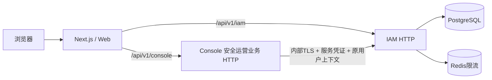

# 部署架构

更新于2026-10-28。本文说明已实现的Web、IAM与Console；其他业务模块按各自规格增加，不把未来设想写成当前部署能力。

## 仓库与运行单元

```text
src/apps/web/            Next.js/React/shadcn，Node进程提供页面及公开API代理
src/apps/iam/            Go身份与授权服务，config.yaml
src/apps/console/        Go安全运营业务服务，config.yaml
src/contracts/          HTTP契约与权限目录
src/packages/go/        两个Go应用实际复用的实现
scripts/                根启动、构建、停止及配置工具
deploy/compose/          显式整套部署与基础组件
deploy/docker/           Go、Web 镜像定义及配套入口脚本
logs/                   本机应用日志，Git忽略
certs/                  内部TLS材料，Git忽略
```

各应用保留自身语言/框架惯例，不用单个镜像通过角色开关启动所有模块。Go镜像按APP参数构建模块独立二进制及配置；Web独立执行next build，由next start提供服务。PG直接使用官方镜像，不增加创建模块用户的脚本。



公开入口不代理/internal路径。IAM内部端口使用TLS及独立服务凭证；内部凭证不能替代用户会话。Console不能读取IAM私表。

## 本地源码与独立进程

根`make dev`启动三个应用并热更新，只连接配置的PG/Redis；不会根据是否填写连接字段来猜测或部署基础组件。开发编译使用系统临时目录并清理。

模块可独立启动，显式`--config`选择自己的config.yaml；省略时读取工作目录下config.yaml。根.env只是统一入口加载的环境，不要求模块依赖根脚本。`make build`产出两个Go二进制及Next.js的`.next/`服务端与客户端产物。停止按工作区归属识别进程，不依赖某个dev标记文件。

Go配置按app、实际依赖、业务策略与logging分组，文件中的环境占位声明覆盖及默认值。密码和凭证直接通过进程环境或部署Secret注入；只有TLS等实际文件材料保留文件形式。Web使用Next.js原生环境配置，NEXT_PUBLIC_*仅用于公开值。

## Compose

`pnpm compose:up`显式部署PG、Redis、一次性迁移、IAM、Console、Web；`pnpm compose:up postgres redis`仅启动基础组件。两者使用同一项目名和数据卷；可通过Docker原生COMPOSE_PROJECT_NAME管理部署命名，不引入应用instance_id。

PG/Redis仅绑定本机端口并持久化卷；内部IAM/Console不映射宿主端口，浏览器通过Web同源入口访问。服务按真实健康检查和迁移成功依赖启动；没有“连接为空则改用捆绑组件”的隐式行为。

迁移、运行和维护使用同一组PostgreSQL连接。账号需要本项目建表/迁移权限；schema版本校验和应用层鉴权继续执行。`make stop`停止工作区拥有的进程/容器，保留数据卷，不停止外部组件。

## 日志与运行目录

源码和本机二进制从仓库根运行时，统一写logs/iam.log与logs/console.log，支持JSON、级别及轮转。二进制部署通过工作目录固定部署根，或显式指定日志绝对路径。

容器默认stdout，由Docker local驱动按10MB、3份轮转；采集器可进一步收集。需要文件日志时由部署显式挂载可写目录，每个模块/副本使用不同文件。不要让Lumberjack和外部logrotate同时管理同一文件，也不要让多个副本写同一轮转文件。

## 运维边界

- 备份恢复后先撤销旧Session，再开放流量；不自动down迁移或清卷。
- 同平台副本共享PG/Redis和认证参数，不使用权限允许缓存隐藏撤权。
- 不同平台部署通过PG/Redis连接及部署原生资源隔离，不要求应用实例ID。
- 现有Compose是可执行交付。Kubernetes/Helm、多架构发布及其他业务镜像尚未交付，有明确需求后单独设计和验证。

字段、初始化、独立启动及日志示例统一见[配置指南](../configuration.md)，身份与备份恢复见[IAM README](../../src/apps/iam/README.md)，测试入口见[测试指南](../testing.md)。

## Web 上游与项目接入

Web 使用 Next.js 与统一 shadcn 组件和视觉配置。项目实际入口是 `/login`、`/dashboard`、`/management`、`/account`，工作台仅保留CRM V1原版卡片、图表与表格，其他模板页面和菜单已删除。当前示例数据不代表业务已落地。

Web 镜像使用 Node 24，以非特权用户运行 Next.js，容器监听 8080。公开 API 由新增的 Next Route Handler 流式转发至 IAM/Console；内部 API 不代理，服务凭证不进入 Web 进程。容器通过 SPX_WEB_IAM_PROXY_TARGET 与 SPX_WEB_CONSOLE_PROXY_TARGET 指定服务地址。Next 需要服务端运行时，不使用静态导出或旧 Nginx 静态镜像。

Console 的业务与接口归属见 [Console README](../../src/apps/console/README.md)。同源入口按模块路由，IAM API 不经 Console 重写；后续模板功能按需接入，不恢复整套演示导航。
