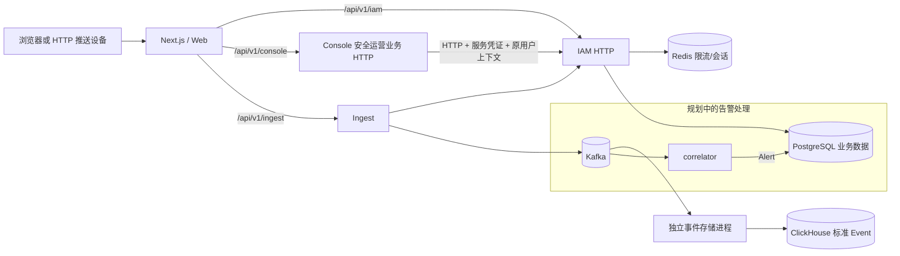

# 部署架构

## 当前部署与规划链路

| 范围 | 运行单元与依赖 |
|---|---|
| 本地源码启动 | Web、IAM、Console、Ingest。Ingest 连接 PostgreSQL、Redis、Kafka，通过 IAM 鉴权。 |
| 开发 Compose | Web、IAM、Console、Ingest、事件写入进程、PostgreSQL、Redis、Kafka、ClickHouse 与一次性初始化任务。 |
| 独立事件存储 | Ingest 通过 `store-events` 命令运行独立消费组，将已校验的 Kafka 事件写入 ClickHouse。使用专用连接和已应用的事件表。 |
| 规划中的告警处理 | correlator 在独立消费组处理标准 Event，生成 Alert 并写 PostgreSQL。 |
| 规划中的模型出口 | 业务模块通过 llm-gateway 调用供应商，供应商凭据归网关管理。 |

[源码启动入口](../../../scripts/start.mjs) · [开发 Compose](../../../deploy/compose/compose.yaml) · [事件表设计](../../plans/event-contract/storage.md)

## 仓库与运行单元

```text
src/apps/web/            Next.js/React/shadcn，Node进程提供页面及公开API代理
src/apps/iam/            Go身份与授权服务，config.yaml
src/apps/console/        Go安全运营业务服务，config.yaml
src/apps/ingest/         Go数据接入服务，发布事件到 Kafka，含独立的事件写入命令
src/apps/llm-gateway/    Go模型网关：供应商凭据、模型清单、统一调用出口（规划中）
src/packages/go/        多个Go应用实际复用的实现
scripts/                根启动、构建、停止及配置工具
deploy/compose/          开发 Compose 与基础组件
deploy/docker/           Go、Web 镜像定义及配套入口脚本
logs/                   本机应用日志，Git忽略
```

各应用保留自身语言和框架惯例。Go 镜像按 `APP` 构建模块独立二进制及配置，Web 由 `next build` 构建并用 `next start` 提供服务。下图包含独立运行的 Ingest 和事件存储，以及规划中的告警处理。



IAM单端口、统一 `/api/v1/iam` 前缀；用户接口与服务鉴权按路由分别认证。应用HTTP，HTTPS由Nginx等入口负责；服务凭证不能替代用户会话，用户Cookie不能替代服务凭证。Console不能读取IAM私表。

## 本地源码与独立进程

根 `make dev` 默认启动 IAM、Console、Ingest 和 Web，连接已配置的 PostgreSQL、Redis 和 Kafka。可通过 `MODULES` 选择本次启动的应用。开发编译使用系统临时目录并清理。

模块可独立启动，显式`--config`选择自己的config.yaml；省略时读取工作目录下config.yaml。根.env只是统一入口加载的环境，不要求模块依赖根脚本。`make build`按模块产出Go二进制及Next.js的`.next/`服务端与客户端产物。停止优先读取启动器写入的`.spx/run.json`进程登记并终止进程树；无登记时按工作区监听器识别（Windows 使用 Next 开发锁）回退，不依赖长期运行的标记服务。

Go配置按app、实际依赖、业务策略与logging分组，YAML 内声明环境参数及默认值，通过成熟组件逐值展开，再由 Viper/mapstructure 严格解码和校验。密码和凭证直接通过进程环境或部署Secret注入；只有TLS等实际文件材料保留文件形式。Web使用Next.js原生环境配置，NEXT_PUBLIC_*仅用于公开值。

## 开发 Compose

`make compose-up` 启动全栈并等待就绪；`make compose-up SERVICES="postgresql redis"`仅启动基础组件。两者使用同一项目名和数据卷；可通过Docker原生COMPOSE_PROJECT_NAME管理部署命名，不引入应用instance_id。

PostgreSQL 和 Redis 仅绑定本机端口并持久化卷。仅启动它们时无需 IAM 凭证。内部 IAM/Console 监听容器网卡，浏览器通过 Web 同源入口访问。管理员初始化凭据仅由 IAM 初始化任务读取，常驻进程启动时核对数据库迁移和权限目录。

需要直接调用 Compose 时，从仓库根目录指定相同的项目目录和环境。手工调用时 `SPX_WEB_ORIGIN` 必须与浏览器实际访问的地址一致。

```sh
docker compose --project-directory . --env-file .env -f deploy/compose/compose.yaml up -d --build --wait
```

正式环境的 PostgreSQL、Redis、Kafka 和 ClickHouse 用服务网络连接，HTTPS 由反代提供。需要对外接收 Syslog 时，在部署覆盖文件中只发布已登记的 TCP 或 UDP 接入端口。 [反代可信范围](../../development/configuration.md#可信代理)

开发环境可共用 PostgreSQL 账号。`make stop` 停止工作区拥有的进程和容器并保留数据卷。

## 日志与运行目录

源码和本机二进制从仓库根运行时，统一写logs/iam.log与logs/console.log，支持JSON、级别及轮转。二进制部署通过工作目录固定部署根，或显式指定日志绝对路径。

容器默认stdout，由Docker local驱动按10MB、3份轮转；采集器可进一步收集。需要文件日志时由部署显式挂载可写目录，每个模块/副本使用不同文件。不要让Lumberjack和外部logrotate同时管理同一文件，也不要让多个副本写同一轮转文件。

## 运维边界

- 备份恢复后先撤销旧Session，再开放流量；不自动down迁移或清卷。
- 同平台副本共享PG/Redis和认证参数，不使用权限允许缓存隐藏撤权。
- 不同平台部署通过PG/Redis连接及部署原生资源隔离，不要求应用实例ID。
- 开发阶段以源码启动和开发 Compose 验收。安装包、Kubernetes、Helm 和多架构发布待有交付需求时安排。

字段、初始化、独立启动及日志示例统一见[配置指南](../../development/configuration.md)，身份与备份恢复见[IAM README](../../../src/apps/iam/README.md)，测试入口见[测试指南](../../development/testing.md)。

## Web 上游与项目接入

Web 使用 Next.js 与统一 shadcn 组件和视觉配置。项目实际入口包括 `/login`、`/dashboard`、`/settings/profile`、`/ingest/inputs` 和 `/ingest/parsing-rules`，工作台仅保留CRM V1原版卡片、图表与表格，其他模板页面和菜单已删除。当前示例数据不代表业务已落地。

Web 镜像使用 Node 24，以非特权用户运行 Next.js，容器监听 8080。Next Route Handler 在运行时连接 IAM、Console 及可选的 Ingest。管理 API 转发会话和 CSRF，设备推送路由转发设备令牌。容器用 `SPX_IAM_HOST/PORT` 与 `SPX_CONSOLE_HOST/PORT` 指定服务位置，可通过 `SPX_INGEST_ORIGIN` 接入独立部署的 Ingest。规划中的 `llm-gateway` 将沿用同源入口。

Console 的业务与接口归属见 [Console README](../../../src/apps/console/README.md)。同源入口按模块路由，IAM API 不经 Console 重写；后续模板功能按需接入，不恢复整套演示导航。
