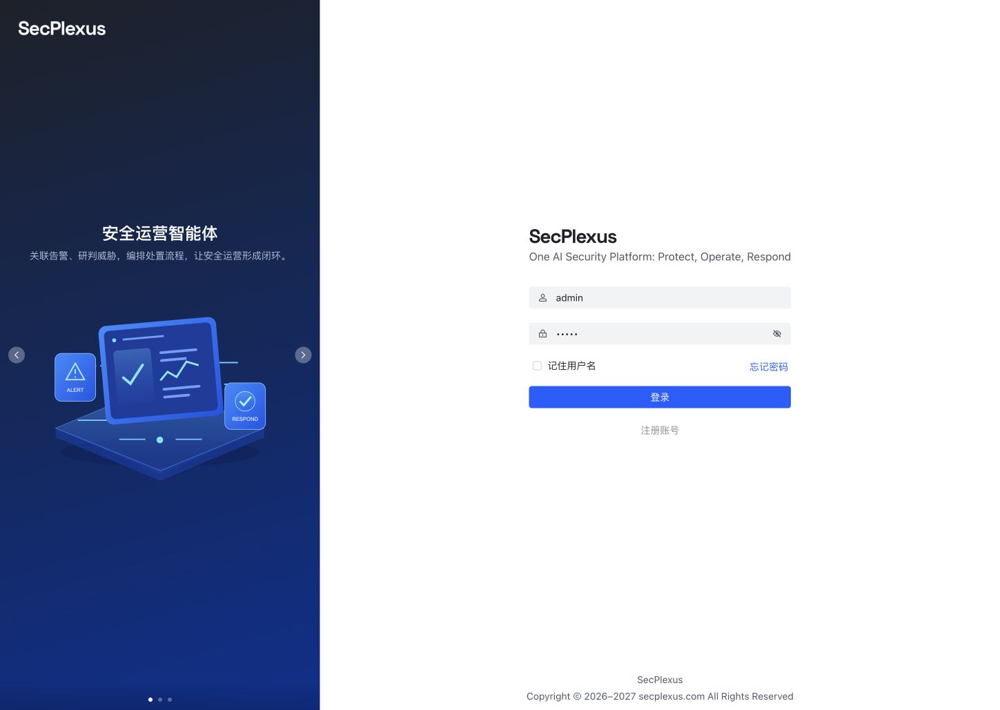
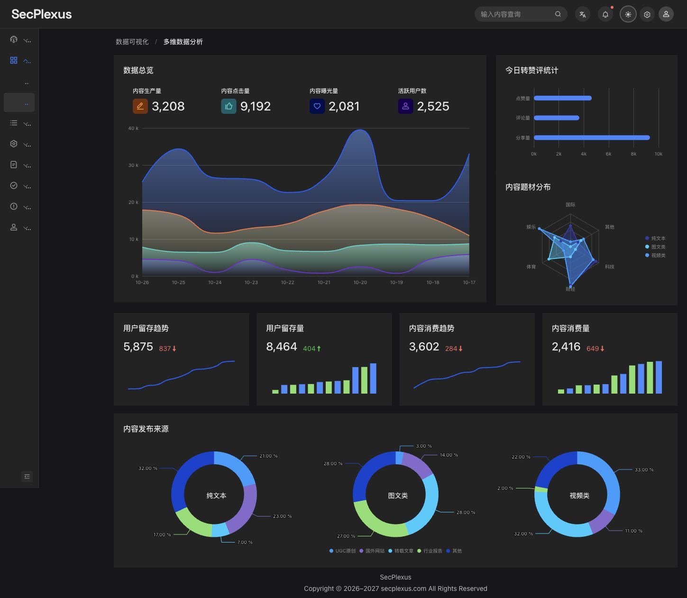
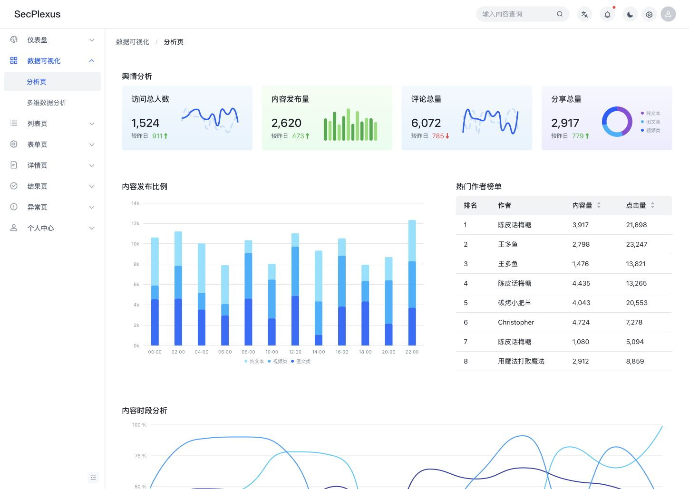
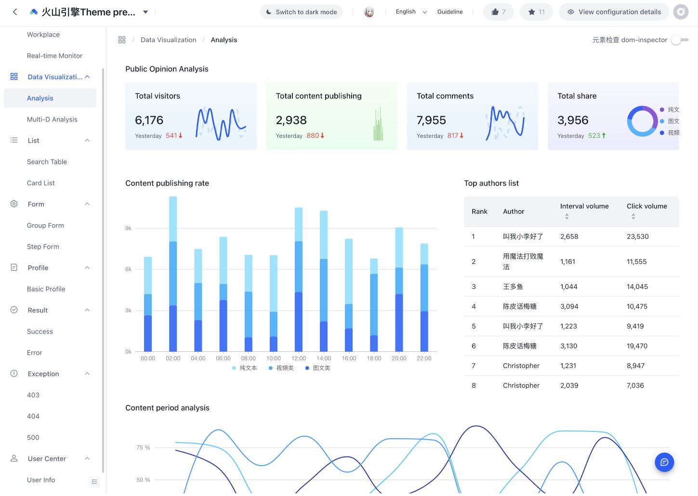
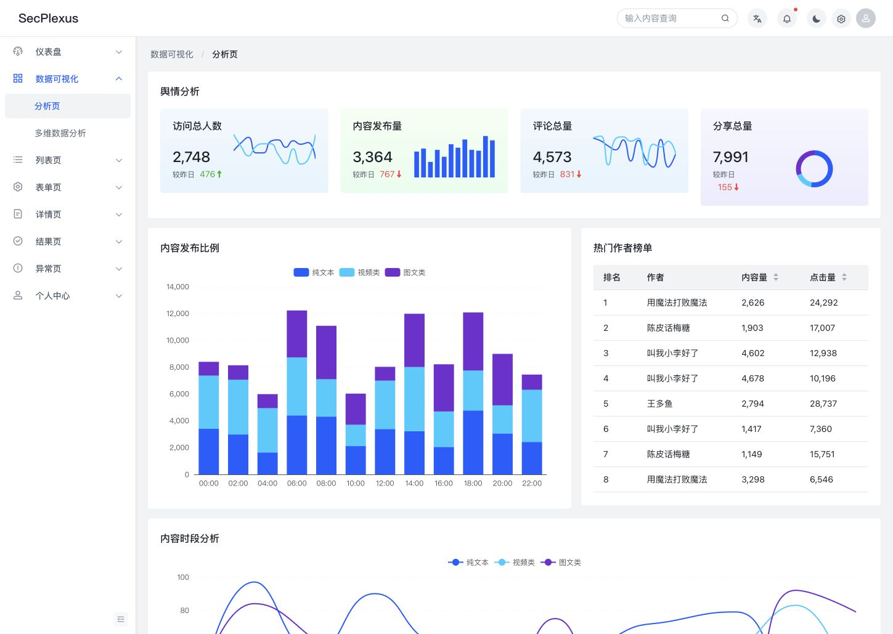

# 火山引擎主题 1376：适配差异审查

审查及适配日期：2026-10-27。

## 细节复核更新

按官方预览页的最终样式重新测量：预览还加载了模板样式，普通 Card 内容内边距为 20px，标题 margin 为 `0 0 16px`。此前只比组件配置页的样式层，遗漏了这层覆盖。本轮已通过共享 token 修正到所有页面。

- 图表提示框恢复原始分层结构：外层白色 80% 透明度与模糊，内层白色 90%、32px 行高、12px 字号；日期与数值权重 500；折线加入悬浮白心圆点及辅助线。
- 修复 Less 全量运算误解现代 RGB 透明度斜杠的问题；应用样式统一用逗号形式 RGBA，避免颜色或阴影被算错。
- 深色雷达网格及轴标签改用当前模式的语义颜色；分面环图分别限制在自身区域、统一两位小数标签、中心文字和底部图例间距；迷你柱图恢复绿/蓝交替配色与独立数值提示。
- 登录与导航使用共用 `Brand` 组件：本地 Space Grotesk 700、28px、统一字距；登录页标语固定单行。字体 OFL 许可随文件保留。
- 三张登录轮播分别展示安全运营智能体、智能体安全防护平台、大模型安全测评，配图为本地 SVG。
- 重新打开 16 个业务路由，确认统一品牌和最终边距；375px 窄屏无横向溢出、标语为单行。个人信息区的标签字号、字重及列结构已与官方核对；参考站部分用户数据为空，自动表格列宽不能作为固定像素尺寸照抄。

## 当前适配结果

- 已实际修改 Web 源码：移除 `@arco-themes/react-arco-pro` 组件主题依赖和 15563 的输入框参数，改用当前 Arco React Less 基础样式及 1376 的主题参数。
- 主色恢复 `#165DFF`，基础圆角为 4/6/12px；普通无边框卡片为直角、20px 内容内边距（按预览页最终叠加样式）。独立的有边框卡片仍保留 4px 圆角。
- 全站内容画布改为主题背景色。Input、Select、Picker 等继承 Arco 的灰底、聚焦边框、错误、警告和禁用状态，不再加白底浅边框和额外焦点光晕。
- 原始 Arco Pro 图表源码作为对照，分别调整迷你图、堆叠柱图、时序图、工作台面积图、多维面积图、横向条形图、雷达图和分面环图；包括图例、坐标轴格式、调色板、圆顶、渐变、百分比和缩放条。
- Less 使用 `math: 'always'`，避免组件中的旧式尺寸除法表达式未被计算。
- 16 个已有业务路由均重新打开验证；临时组件验收页检查了普通/复合输入、错误/警告/禁用、选择器、弹窗、抽屉及深色模式，并验证三个旧参考没有演示的新版组件能够渲染。临时验收页已移除。
- 开发与生产登录页均确认灰底输入框、32px 高度及相同圆角；类型检查、Biome 检查及生产构建通过。
- 仍保留当前 Arco 版本的组件行为修复，未复制 2.24.1 的旧 CSS。切换动画、树节点引导线、嵌套表格、部分小尺寸 Tabs 等版本差异没有强行覆盖；这不是所有组件、所有状态的逐像素复刻。目标站没有参考的 ColorPicker、VerificationCode、Watermark 使用当前 React 组件及共享主题参数。
- React 19 下的上游 element.ref 提示、部分模板 key/空图片地址提示仍存在；没有将这些控制台提示描述成已修复。

**采样纠正：** 初轮报告里按钮 2px、选择框 0px 的数据包含目标站主题尚未编译完成或复合控件局部圆角的采样。等待主题编译完成后，普通按钮和独立选择框均为 4px。初轮逐项数据保留作历史记录，不能作为最终视觉金样。

下面保留的是适配前的差异分析；其中“本地”指适配前状态。当前验收记录见 [theme-1376-verification.json](theme-1376-verification.json)。

## 结论

当前页面混用了三套来源：Arco Pro 的组件主题和页面壳、15563 Vue 主题的部分参数、重新实现的 ECharts 图表。它们叠加后，不能得到 1376 的预览效果。上一次宣称主题适配完成不准确。

目标应统一为 [1376 火山引擎主题](https://arco.design/themes/preview/1376)，以它的[配置详情](https://arco.design/themes/design/1376/setting/base/Color?from=%2Fthemes%2Fpreview%2F1376)和最终渲染为依据。15563 的主题包不再作为本次比对依据。

## 检查范围与证据边界

- 逐项访问左侧 67 个分类：7 项基础样式、60 个组件。
- 57 个组件演示取得渲染样式；ColorPicker、VerificationCode、Watermark 的配置页为空白，不能标记为已验证。主题站演示出现 React #130 错误，访问不受支持的组件后需要刷新才能恢复其他演示。
- 开启并使用了主题站 dom-inspector；同时记录每个可用组件演示中的不同 class 组合及计算样式，避免仅凭截图猜变量。
- 16 个业务预览页面均与本地对应路由逐页打开并记录样式，路由逐一校验。登录页不在目标预览菜单中，没有对应参考。
- 完整主题组件 CSS 与本地组件 CSS 有 4,426 个同名规则；发现 185 条原始声明差异。这包括版本变化和等价写法，不能解释为 185 个视觉缺陷。
- 本次覆盖演示的默认渲染状态及演示中显式给出的状态；没有穷举每个弹层、所有 hover/focus、所有尺寸、响应式断点和全部深色交互状态。下文的“已采样”不等于完成适配或全部状态验收。
- 机器可读的逐项记录见 [theme-audit-1376.json](theme-audit-1376.json)。原始浏览器快照与 CSS 留在本机 `/tmp/secplexus-theme-1376-audit/`，不是项目依赖。

## 已确认的具体差异

| 项目 | 1376 参考值或行为 | 当前本地 | 原因 |
|---|---|---|---|
| 主色 | `#165DFF` | `#1664FF` | 上次用了 15563 的输入框蓝色 |
| 基础圆角 | 配置页为 `0 / 4 / 6 / 12px / 50%` | `0 / 4 / 4 / 8px / 50%` | 中、大圆角取值不一致 |
| 按钮最终圆角 | 加载完成后为 4px | 默认方形按钮 4px | 初轮 2px 是提前采样，已纠正 |
| 普通卡片 | 直角；默认内容区 16px 内边距 | 4px 圆角；20px 内边距 | React Pro 主题仍在覆盖组件基线 |
| 卡片标题 | 有 1px 底部分隔线 | 分隔线为 0 | Pro 主题覆盖 |
| 普通输入框 | 默认灰底、透明边框；聚焦蓝边，不扩展光晕 | 默认白底、浅色边框；聚焦额外 2px 光晕 | 上次新增的 Input 参数并非 1376 |
| 选择器 | 默认灰底；普通独立选择框 4px 圆角 | 白底、浅边框、4px 圆角 | 上次额外推导并覆盖了 Select 参数 |
| 弹窗 | 最终圆角 6px | 使用 4px 中圆角 | 基础 medium 圆角不同 |
| 全站内容背景 | 白色内容画布 | `--color-fill-2` 灰色内容背景 | 页面壳写死在 `layout.module.less`，组件主题不控制它 |
| 图表 | 每类图有独立的颜色、柱宽、图例和坐标轴 | 通用 `cartesian()` / `donut()` 默认参数 | 更换图表引擎时只保留了数据映射，未保留视觉规范 |

配置详情与实际组件都应核对，且必须等主题编译完成。复合输入框中间部分的 0px 圆角不代表独立组件也是直角。

## 分析页：为什么两张图明显不同

页面源码的大体结构都是 Card、Grid、Table，但参考主题的普通 Card 无圆角，页面外层也是白底，相邻区域因此呈连续白色画布。本地外层灰底加 4px 圆角卡片，再加 20px 卡片内边距，产生了明显的灰色分块与不同留白；不能只在这一个页面抹掉背景。

图表还有独立差异：

- 迷你柱状图：目标为绿色、窄柱、圆顶；本地沿用通用蓝色柱图。
- 迷你折线图：目标有浅色虚线对照；本地是两条实线，填充与线条设置也不同。
- 小环图：目标保留右侧分类图例；本地 `compact` 分支关闭了图例。
- 堆叠柱图：目标为窄柱和蓝色梯度层次，图例在底部、图例符号小、纵轴使用 k；本地宽柱、蓝青紫配色、顶部图例、原始数值。
- 时段折线：目标纵轴为百分数，图例与缩放条在底部；本地没有百分号格式化，图例在顶部。
- 数字和曲线形状：两边均使用随机演示数据，不能用不同数值或曲线形状本身判断样式是否一致。

两张截图使用相同的 1449×1029 视口；目标为英文、本地为中文，数据为独立随机样本。因此这里只用于核对容器和图表风格，不用于逐像素差异评分。

## 基础样式与组件逐项清单

“规则候选差异”仅统计同名 CSS 规则中涉及该组件前缀的声明差异；可能包含版本差异或其他组件内部的嵌套引用。0 不表示一致：所有组件仍可能继承不同的主色、圆角或页面样式。

| 分类 | 参考渲染采样 class 数 | 规则候选差异 | 本轮结果 |
|---|---:|---:|---|
| Color | — | 0 | 已读取基础配置 |
| Font | — | 0 | 已读取基础配置 |
| Border | — | 0 | 已读取基础配置 |
| Shadow | — | 0 | 已读取基础配置 |
| Size | — | 0 | 已读取基础配置 |
| Icon | 297 | 4 | 已取得参考渲染；尚未完成适配验收 |
| Hover icon | 10 | 0 | 已取得参考渲染；尚未完成适配验收 |
| Button | 64 | 12 | 已取得参考渲染；尚未完成适配验收 |
| Link | 22 | 1 | 已取得参考渲染；尚未完成适配验收 |
| Typography | 20 | 12 | 已取得参考渲染；尚未完成适配验收 |
| Divider | 13 | 0 | 已取得参考渲染；尚未完成适配验收 |
| Avatar | 30 | 1 | 已取得参考渲染；尚未完成适配验收 |
| Badge | 40 | 0 | 已取得参考渲染；尚未完成适配验收 |
| Card | 32 | 10 | 已取得参考渲染；尚未完成适配验收 |
| Calendar | 54 | 0 | 已取得参考渲染；尚未完成适配验收 |
| Collapse | 27 | 0 | 已取得参考渲染；尚未完成适配验收 |
| Comment | 22 | 0 | 已取得参考渲染；尚未完成适配验收 |
| Descriptions | 32 | 4 | 已取得参考渲染；尚未完成适配验收 |
| Empty | 12 | 0 | 已取得参考渲染；尚未完成适配验收 |
| Image | 59 | 0 | 已取得参考渲染；尚未完成适配验收 |
| List | 36 | 0 | 已取得参考渲染；尚未完成适配验收 |
| Popover | 16 | 0 | 已取得参考渲染；尚未完成适配验收 |
| Statistic | 22 | 0 | 已取得参考渲染；尚未完成适配验收 |
| Table | 86 | 9 | 已取得参考渲染；尚未完成适配验收 |
| Tabs | 67 | 12 | 已取得参考渲染；尚未完成适配验收 |
| Tag | 59 | 0 | 已取得参考渲染；尚未完成适配验收 |
| Timeline | 35 | 0 | 已取得参考渲染；尚未完成适配验收 |
| Tooltip | 14 | 1 | 已取得参考渲染；尚未完成适配验收 |
| Tree | 55 | 17 | 已取得参考渲染；尚未完成适配验收 |
| AutoComplete | 24 | 0 | 已取得参考渲染；尚未完成适配验收 |
| Cascader | 50 | 13 | 已取得参考渲染；尚未完成适配验收 |
| Checkbox | 20 | 0 | 已取得参考渲染；尚未完成适配验收 |
| 颜色选择器 ColorPicker | — | 0 | 目标演示缺失，不能验收 |
| DatePicker | 75 | 11 | 已取得参考渲染；尚未完成适配验收 |
| Form | 133 | 0 | 已取得参考渲染；尚未完成适配验收 |
| Input | 42 | 28 | 已取得参考渲染；尚未完成适配验收 |
| InputNumber | 40 | 0 | 已取得参考渲染；尚未完成适配验收 |
| 验证码输入 VerificationCode | — | 0 | 目标演示缺失，不能验收 |
| InputTag | 31 | 8 | 已取得参考渲染；尚未完成适配验收 |
| Rate | 16 | 0 | 已取得参考渲染；尚未完成适配验收 |
| Radio | 27 | 0 | 已取得参考渲染；尚未完成适配验收 |
| Select | 56 | 7 | 已取得参考渲染；尚未完成适配验收 |
| Slider | 33 | 2 | 已取得参考渲染；尚未完成适配验收 |
| Switch | 29 | 3 | 已取得参考渲染；尚未完成适配验收 |
| Transfer | 58 | 0 | 已取得参考渲染；尚未完成适配验收 |
| TimePicker | 31 | 0 | 已取得参考渲染；尚未完成适配验收 |
| TreeSelect | 55 | 7 | 已取得参考渲染；尚未完成适配验收 |
| Upload | 67 | 1 | 已取得参考渲染；尚未完成适配验收 |
| Alert | 27 | 0 | 已取得参考渲染；尚未完成适配验收 |
| Drawer | 19 | 0 | 已取得参考渲染；尚未完成适配验收 |
| Message | 23 | 0 | 已取得参考渲染；尚未完成适配验收 |
| Modal | 21 | 0 | 已取得参考渲染；尚未完成适配验收 |
| Notification | 30 | 0 | 已取得参考渲染；尚未完成适配验收 |
| Popconfirm | 20 | 0 | 已取得参考渲染；尚未完成适配验收 |
| Progress | 53 | 0 | 已取得参考渲染；尚未完成适配验收 |
| Result | 35 | 0 | 已取得参考渲染；尚未完成适配验收 |
| Spin | 15 | 0 | 已取得参考渲染；尚未完成适配验收 |
| Skeleton | 20 | 0 | 已取得参考渲染；尚未完成适配验收 |
| 水印 Watermark | — | 0 | 目标演示缺失，不能验收 |
| Anchor | 13 | 3 | 已取得参考渲染；尚未完成适配验收 |
| Breadcrumb | 14 | 0 | 已取得参考渲染；尚未完成适配验收 |
| Dropdown | 19 | 0 | 已取得参考渲染；尚未完成适配验收 |
| Menu | 49 | 5 | 已取得参考渲染；尚未完成适配验收 |
| PageHeader | 28 | 0 | 已取得参考渲染；尚未完成适配验收 |
| Pagination | 45 | 0 | 已取得参考渲染；尚未完成适配验收 |
| Steps | 32 | 0 | 已取得参考渲染；尚未完成适配验收 |
| ResizeBox | 16 | 0 | 已取得参考渲染；尚未完成适配验收 |

## 全部业务页面

以下页面均已核对两侧路由并采样。共同受页面背景、卡片和主题基础值影响；采样数量不同不是视觉错误数量。

| 本地路由 | 额外需要处理的部分 |
|---|---|
| `dashboard/workplace` | 统计图、饼图、图表图例和坐标轴 |
| `dashboard/monitor` | 复合输入、聊天区、直播信息卡片 |
| `visualization/data-analysis` | 迷你图、堆叠柱图、百分比时序图、图例、页面留白 |
| `visualization/multi-dimension-data-analysis` | 雷达图、图表与地图区域需分别核对 |
| `list/search-table` | 筛选表单、输入、选择、日期、表格与分页 |
| `list/card` | 卡片边界、标题区、按钮和列表间距 |
| `form/group` | 复合输入的单位附加区、选择器、表单分组留白 |
| `form/step` | 步骤条、表单、校验状态；不能只验默认第一步 |
| `profile/basic` | Descriptions、Tab、详情区边界 |
| `result/success` | 结果图标、操作按钮、结果卡片留白 |
| `result/error` | 错误结果、提示列表、链接和按钮 |
| `exception/403` | 结果图形与按钮；品牌信息按本项目保留 |
| `exception/404` | 结果图形与按钮；品牌信息按本项目保留 |
| `exception/500` | 结果图形与按钮；品牌信息按本项目保留 |
| `user/info` | 头像、列表、Tab、标签和信息卡片 |
| `user/setting` | 表单、地区级联、上传、Tab 与安全设置子页 |

## 源码定位

- `src/apps/web/vite.config.ts`：当前仍加载 `@arco-themes/react-arco-pro`，之后叠加少量自定义变量。
- `src/apps/web/src/theme.ts`：只有上次手工映射的 38 个参数，且来源为 15563。
- `src/apps/web/src/settings.json`：主色被设为 `#1664FF`。
- `src/apps/web/src/style/global.less`：新增了 1376 不使用的输入框边框颜色。
- `src/apps/web/src/style/layout.module.less`：内容区背景为 `var(--color-fill-2)`。
- `src/apps/web/src/components/Chart/options.ts`：图表默认配色、图例位置、网格线与坐标轴使用统一参数。
- `src/apps/web/src/components/Chart/{multi-stack-interval,period-legend-line}.tsx`：分析页柱图和时序图缺少参考预览的独立视觉配置。
- `src/apps/web/src/pages/visualization/data-analysis/public-opinion/card.tsx`：迷你柱图没有绿色/圆顶参数，小环图因 compact 模式关闭图例。

## 后续适配方式

1. 将 1376 固定为唯一对照。先去掉 15563 推导参数，避免继续叠加混用。
2. 完整提取 1376 的基础变量和各组件最终取值，映射到当前 React 组件的 Less token。组件样式不应继续以 Pro 主题为底再随意打补丁；Pro 的页面源码可以继续保留。
3. 页面壳单独对齐背景、间距、边界。品牌、版权等本项目已明确要求的内容保留。
4. 保留现有 ECharts 时，每类图分别配置柱宽、圆角、调色板、图例、轴格式和缩放条；共用基础工具，不再用同一个默认图表选项替代所有图。
5. 针对缺失的三个新版组件，使用当前 Arco API 并明确采用的样式，不声称复刻了目标站不存在的演示。
6. 验收矩阵必须补齐 hover/focus/error/warning/disabled、弹层打开、各尺寸、深色模式、同视口与开发/生产两种构建。随机演示数据应固定后再做截图比较。

目标站标示的组件库为 `@arco-design/web-react@2.24.1`，本地为 `2.66.18`。这是另一条独立差异来源，不宜为了截图接近就盲目降级；新版组件和结构应逐项适配。

**初轮审查状态已由本文顶部的适配结果更新。当前代码已完成共享主题、页面画布及上述图表的适配；仍不声明所有旧版交互状态逐像素一致。**
