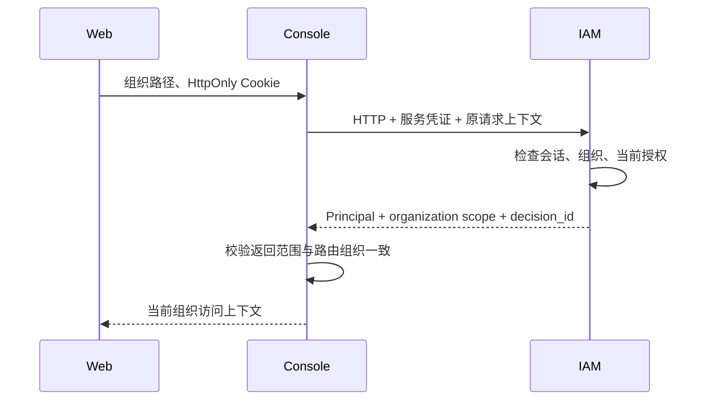

# SecPlexus Console

Console 是安全运营业务后端，承载自身业务及有实际需要的跨域查询汇总。身份、会话和授权由 IAM 提供；Console 不读取 IAM 表，也不导入 IAM 的 internal 包。当前仅提供组织访问上下文和带持续授权检查的 SSE 连接，案件与业务工作台尚未实现，现有事件流不是业务事件总线。

## 职责与接口归属

以下是后续功能的接入边界，不代表这些功能已经交付：

| 能力 | 归属 |
|---|---|
| 登录、账号、组织、角色、权限和 Session | IAM；经同源入口访问，不增加 Console 包装接口 |
| 案件创建、分派、状态与人工调查记录 | Console；业务规则、数据、事务及审计归本模块 |
| 三队列工作台、运营查询和必要的跨域只读汇总 | Console；通过公开契约或明确的数据投影取得其他模块信息，不查询私表 |
| 数据接入、归一化、关联计算与 AI 执行 | 对应处理模块；Console 只在自身业务需要时调用其能力 |
| 长期工作流、审批状态机与高危执行 | SOAR；Console 展示、提交操作，不复制最终状态和执行规则 |
| 同源路由与通用反向代理 | HTTP 入口；本机 Next 直接提供页面和服务端窄转发；不接收客户端任意来源头，不以 Console 作为所有模块的强制中转站 |

新增 Console 接口必须实现本域资源的业务行为，或完成一个实际需要的运营查询汇总。其他模块已有接口不因页面归属而在 Console 重写 DTO、校验、CRUD 和权限规则。单纯转发按模块前缀统一路由；真正的聚合接口形成独立的运营视图。跨域修改仍交给资源所属模块做最终校验和事务提交，不在 Console 维护第二份状态。

模块独立拆分依据扩容、故障、安全与变更边界，不为每个资源预建一个服务。当前 Console 没有数据库依赖；实现其自有持久化业务时再增加实际配置与存储。



## 代码与接入边界

- `cmd`：启动参数和配置加载。
- `internal/bootstrap`：IAM 客户端、HTTP 生命周期与优雅退出。
- `internal/config`：独立YAML配置及环境变量覆盖。
- `internal/handler`：声明路由所需action、解析组织并检查结构化scope；不使用浏览器的身份或角色头。
- [`iamclient`](../../packages/go/iamclient/client.go)：复用的IAM客户端，统一API路径、标准HTTP传输、有界请求、错误契约；不接受浏览器指定所需action。
- [原生路由](internal/router/routes.go)、[响应模型](internal/handler/models.go)及[IAM 客户端](../../packages/go/iamclient/client.go)定义实际边界；服务凭证不进入 Web。

## API

| API | 权限 | 行为 |
|---|---|---|
| GET `/api/v1/console/orgs/{org_id}/context` | `iam.organizations.read` | 返回请求组织、当前用户及决策ID |
| GET `/api/v1/console/orgs/{org_id}/events` | 同上 | 建连及每25秒重新授权（单次IAM请求最多5秒）；撤权或IAM不可用即关闭，不继续发送业务数据 |

401为会话失效，403为权限或CSRF拒绝，503为身份服务故障。客户端不会把503当作退出，不缓存允许结果，不透传内部Set-Cookie。未来资源仓储必须根据真实组织归属查询，不能把本层capability判断当作对象ACL；高危执行点须重新校验，异步任务保存发起者/决策信息而不保存Cookie。

## 配置与运行

直接维护[config.yaml](config.yaml)：app为监听host及port；iam为连接host/port及服务token；logging为JSON日志与轮转。没有数据库、Redis或空业务配置占位。

```sh
# 从仓库根执行；进程环境提供私有凭证。
go run ./src/apps/console/cmd --config src/apps/console/config.yaml
```

YAML字段直接声明环境变量和默认值，参数组件逐值展开，Viper/mapstructure严格解码。根连接变量为`SPX_IAM_HOST/PORT`，本机监听用`SPX_CONSOLE_BIND_HOST`及`SPX_CONSOLE_PORT`；服务凭证用`SPX_CONSOLE_IAM_TOKEN`。专用 IAM host/port 环境覆盖仅用于调用方确有不同目标的场景。HTTPS由Nginx等入口处理，应用无scheme或证书配置。token直接来自环境，不通过凭证文件。

默认本机日志为`logs/console.log`，同时输出stdout；容器默认仅stdout，由Docker轮转。与IAM及其他副本使用不同日志文件，不能共写同一个轮转文件。

源码、二进制和Compose的路径/配置规则见[配置指南](../../../docs/configuration.md)。

### 启动与路由代码

`cmd/main.go` 读取配置，`internal/bootstrap/serve.go` 初始化 IAM 客户端和 HTTP 服务，并负责服务关闭。Gin接口统一在 `internal/router/routes.go` 注册，普通路由显式注册，SSE使用原生SSEvent/Writer.Flush，处理函数通过显式依赖访问 IAM；配置加载器负责环境变量解析。


普通接口通过 `src/packages/go/result` 返回统一 Result，SSE 直接使用流协议。公共请求标识、日志和异常恢复在共享 HTTP middleware；组织访问由 IAM 内部客户端校验，不读取 IAM 私表。config 只解析/校验文件，bootstrap 按配置创建客户端并负责关闭空闲连接。Console 没有实际 DB/cache 依赖，不增加占位配置。

运行诊断见 [日志与错误定位](../../../docs/observability.md)。内部 IAM 调用记录 upstream_request_id 和受控失败阶段，SSE 记录建立/结束及撤权原因，不记录请求凭据。

## 离线配置检查

运行 `go run ./src/apps/console/cmd check-config --config src/apps/console/config.yaml` 校验完整运行配置；不连接依赖、不执行迁移、不创建业务日志。根目录 `pnpm config:check` 按模块注入统一环境并校验所有选中模块；必须先填写根 `.env`。配置字段、优先级、默认值与重启要求见[配置指南](../../../docs/configuration.md)。
