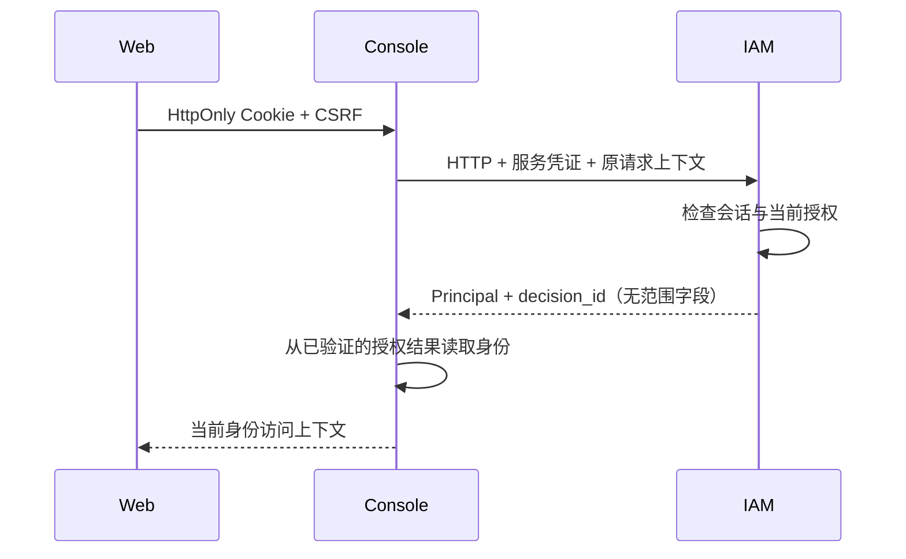

# SecPlexus Console

Console 是安全运营业务后端，承载自身业务及有实际需要的跨域查询汇总。身份、会话和授权由 IAM 提供；Console 不读取 IAM 表，也不导入 IAM 的 internal 包。当前提供授权上下文和健康检查。案件和运营工作台属于后续功能。

## 职责与接口归属

以下是后续功能的接入边界，不代表这些功能已经交付：

| 能力 | 归属 |
|---|---|
| 登录、账号、角色、权限和 Session | IAM；经同源入口访问，不增加 Console 包装接口 |
| 案件创建、分派、状态与人工调查记录 | Console；业务规则、数据、事务及审计归本模块 |
| 三队列工作台、运营查询和必要的跨域只读汇总 | Console；通过公开契约或明确的数据投影取得其他模块信息，不查询私表 |
| 数据接入、归一化、关联计算与 AI 执行 | 对应处理模块；Console 只在自身业务需要时调用其能力 |
| 长期工作流、审批状态机与高危执行 | SOAR；Console 展示、提交操作，不复制最终状态和执行规则 |
| 同源路由与通用反向代理 | HTTP 入口；本机 Next 直接提供页面和服务端窄转发；不接收客户端任意来源头，不以 Console 作为所有模块的强制中转站 |

新增 Console 接口必须实现本域资源的业务行为，或完成一个实际需要的运营查询汇总。其他模块已有接口不因页面归属而在 Console 重写 DTO、校验、CRUD 和权限规则。单纯转发按模块前缀统一路由；真正的聚合接口形成独立的运营视图。跨域修改仍交给资源所属模块做最终校验和事务提交，不在 Console 维护第二份状态。

模块独立拆分依据扩容、故障、安全与变更边界，不为每个资源预建一个服务。当前 Console 没有数据库依赖；实现其自有持久化业务时再增加实际配置与存储。



## 代码与接入边界

- `cmd`：启动参数和配置加载。
- `internal/bootstrap`：IAM 客户端、HTTP 生命周期与优雅退出。
- `internal/config`：独立YAML配置及环境变量覆盖。
- `internal/router` 声明路由所需权限。`internal/handler` 读取已授权的身份。
- [`iamclient`](../../packages/go/iamclient/client.go)：复用的IAM客户端，统一API路径、标准HTTP传输、有界请求、错误契约；不接受浏览器指定所需action。
- [原生路由](internal/router/routes.go)、[响应模型](internal/model/context.go)及[IAM 客户端](../../packages/go/iamclient/client.go)定义实际边界；服务凭证不进入 Web。

## API

| API | 权限 | 行为 |
|---|---|---|
| GET `/api/v1/console/context` | `console.context.read` | 返回经 IAM 验证的用户和授权决策 ID |
| GET `/health/live` | 公共探针 | HTTP 进程可响应 |
| GET `/health/ready` | 公共探针 | IAM 凭据可用，所需权限已登记 |

401 表示会话失效，403 表示权限拒绝，503 表示 IAM 不可用。每次上下文请求使用当前会话和授权结果。

## 配置与运行

根 [环境模板](../../../.env.example) 的 Console 分组列出端口、IAM 服务凭据、日志级别和独立运行选项。[config.yaml](config.yaml) 提供默认值。Compose 通过服务名连接 IAM，日志由 Docker 管理。独立运行使用 `SPX_IAM_HOST/PORT` 连接 IAM，Web 使用 `SPX_CONSOLE_HOST/PORT` 连接 Console。文件日志可按需设置。

```sh
go run ./src/apps/console/cmd check-config --config src/apps/console/config.yaml
go run ./src/apps/console/cmd --config src/apps/console/config.yaml
```

排查时先看存活与就绪探针，再用有效账号访问授权上下文。结合请求 ID 和上游请求 ID 定位 IAM 失败。安全事件的存储和回查由 Ingest 所有。 [配置指南](../../../docs/development/configuration.md) · [日志与错误定位](../../../docs/development/observability.md)
