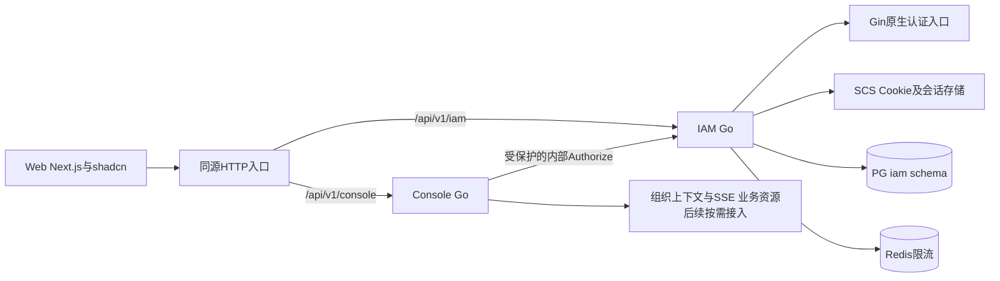
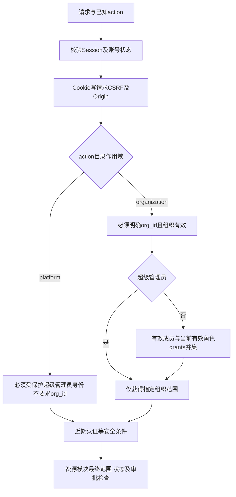
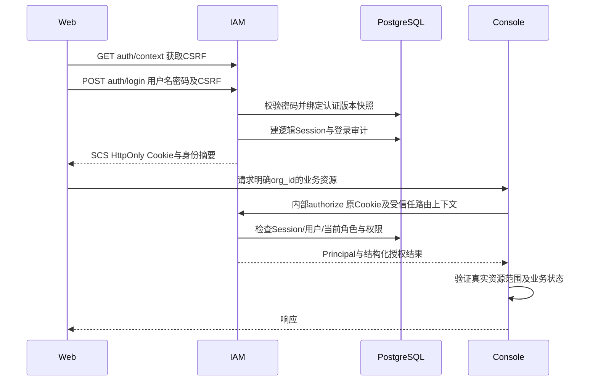
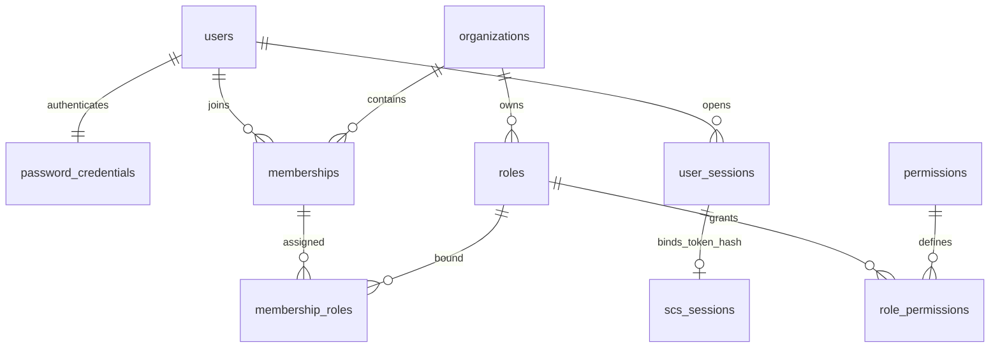
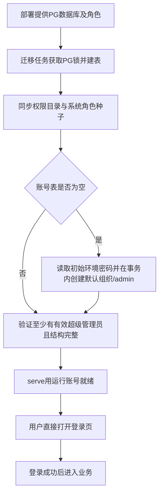
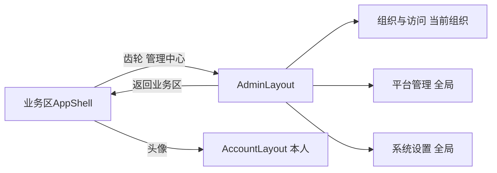

# SecPlexus IAM

> 已实现Go IAM、真实PG会话和组织授权，统一Web管理中心已接入。当前交付范围与验证证据见实施计划；MFA、SSO、公开注册和对象ACL不在本版范围。

[需求规格](../../../docs/plans/user-authentication-and-access-control/spec.md) · [实施计划、审计与参考代码](../../../docs/plans/user-authentication-and-access-control/plan.md)

## 1. 产品与服务边界

IAM负责账号、组织、密码、Session、自定义角色/授权和身份审计；Web提供统一界面；Console负责安全运营业务与必要的查询汇总，未来业务模块拥有各自资源、状态和执行规则；Console不是IAM API的必经中转层。Gin、Argon2id、SCS和CSRF组件嵌入Go进程，不部署独立身份产品。AI Gateway不承担这些控制面HTTP路由。



PG是身份、角色、授权、Session真源；Redis只存分布式限流等短期计数。Console不能读IAM表或导入IAM internal。公开API固定`/api/v1/{module}`，内部固定`/internal/v1/{module}`，API路径不是可任意修改的环境变量。

## 2. 授权模型：身份、角色、权限和资源分开

### 2.1 三类基础身份与用户自定义角色

| 身份/角色 | 数据表达 | 边界 |
|---|---|---|
| 超级管理员 | users.is_super_admin=true | 平台全局管理和明确指定组织的业务访问；不跳过账号状态、CSRF、业务状态、审批或审计 |
| 组织管理员 | 绑定本组织受保护系统角色org_admin | 本组织管理、自定义角色和授权；不能授予超级管理员或系统org_admin身份 |
| 普通成员 | 有效成员关系；默认绑定系统角色member | 基础本人服务；业务权限来自分配的自定义角色 |
| 用户自定义角色 | roles.kind=custom + role_permissions + membership_roles | 如审计员、安全分析师，由用户自己创建，不预置这些业务角色；一个成员可绑定多个 |

系统member只提供组织身份/界面入口，不附赠任何业务读取、修改、执行或导出权限；本人资料/改密/退出按明确的self-service接口检查本人，不取决于角色是否为空。自定义“审计员”不会因为member默认读写而失去只读意义。没有任何业务角色绑定时业务权限为空，绝不回退静态角色映射。

组织成员不是资源所有者，created_by用于归因，不自动令成员只能看本人创建的告警/Case。数据范围由权限及业务模型定义。超级管理员跨组织也必须提供目标org_id，查询仍带org_id，不能一条无范围查询返回所有组织。

### 2.2 权限目录是代码能力，自定义角色是数据组合

业务模块随实现声明稳定action，例如：

| 模块/资源 | 权限示例 | 作用 |
|---|---|---|
| IAM组织 | iam.organizations.read / manage | 当前组织概览与展示信息管理，不改变平台级组织生命周期 |
| IAM成员 | iam.members.read / manage | 查看、管理普通成员 |
| IAM自定义角色 | iam.roles.read / manage / assign | 查看、编辑角色定义、为成员绑定角色；编辑与分配是不同动作 |
| IAM审计 | iam.audit.read | 读取本组织审计 |
| Console案件 | console.cases.read / update / respond / export | 读、编辑、响应处置、导出独立授权，写不隐含读或导出 |

这是命名示例，不声称尚未实现的Console能力已可授予。只有真实落地的模块动作进入有效目录。权限目录包含模块、资源类型、动作、说明、风险、是否允许组织内委派、近期认证要求；权限key不包含API版本、角色名或菜单ID。当前15个动作见`src/apps/iam/internal/authorization/permissions.json`，其中7个平台动作、8个组织动作。

- **模块开发者定义能做什么，组织管理员决定谁能做。** 用户可创建/改名/组合角色，不能凭空创建后端不存在的权限key。
- 权限目录在 IAM `internal/authorization/` 中以版本化清单维护，迁移同步到IAM目录表；存储表是运行时投影，禁止管理API修改目录语义。每个业务路由引用生成/校验的action常量，本地业务目录检查及访问测试核对引用和目录；不是每个服务各写一张ROLE_PERMISSIONS表。
- 自定义角色授权关系只有PG一份。普通成员的决策仅从当前有效绑定/有效角色/精确permission key读取，不存在静态兜底、按角色名称特判或从Cookie取权限。
- org_admin持有本版全部已实现且有效的organization权限，完整key清单由目录种子显式写入系统角色grants；它可以包含后续新增组织管理能力，但仅在版本升级中显式更新。自定义角色默认不获得新增权限。没有用户可写的`*`通配授权。
- 平台超级管理员标识与“能否授予org_admin”是受保护管理行为，不把这些能力开放为可勾选的自定义组织权限。用户创建一个叫“超级管理员”的角色也不能改变此规则；保留系统角色code不能复用。
- 菜单与按钮引用action，只用于体验；一个菜单可以依赖多个action，不能反过来用菜单授权代替API授权。读取、修改、执行、删除、导出、授权管理分别建模，避免笼统的“能看页面就能做所有动作”。

### 2.3 唯一授权入口及求值语义

所有服务通过类型化`Authorize(subject, action, org_id, resource, request_context)`求值。路由的action/目标组织提取由服务端声明，不能由浏览器选择。允许结果含allowed、decision_id、Principal和结构化scope；拒绝使用统一HTTP错误契约。组织authz_version由本人组织列表及权限概要返回，供编辑并发控制使用。



成员多角色取允许集合并集；首版不引入deny优先级、角色继承或用户直接授权。这不是把将来写死：统一接口隔离求值实现，角色/绑定/权限分表，后续按需求扩展；现在不为假想功能先做脚本语言和插件框架。

目录scope决定求值分支：platform动作不接受org_id或组织角色grants，只允许当前有效超级管理员，输出`{kind:platform}`；organization动作必须显式org_id，先检查组织有效，超级管理员的该组织能力从同一目录的有效organization动作派生，其他用户再检查成员/当前grants。受保护全局身份不是另一份静态ROLE_PERMISSIONS。未知action先拒绝，超级管理员也不能跳过。平台及组织能力只由此中央规则计算。

首版组织数据scope只有organization，返回结构化`{kind:organization,org_id:...}`；platform只是管理动作范围，不可拿来绕过业务组织过滤。业务仓储必须应用此过滤，详情验证真实resource.type/id的组织，批量逐项检查；统计、搜索、导出、异步任务和SSE也覆盖。未知scope拒绝，不吞掉限制当作全组织允许。以后增加“指定项目/对象、本人、用户组继承”时，扩展中央解析和仓储范围适配器，不改每个接口的角色判断；需要独立规格/迁移，不能说当前已支持ABAC/ACL。

这里的“组下面的角色”当前落在组织范围。若实际引入用户组，组是成员集合，角色是权限集合，二者不能合成一个实体；届时增加group_members/group_role_bindings与解析逻辑，不提前建空表或允许无外键的subject_type+subject_id万能绑定。

### 2.4 授权管理自身也要防越权

- 组织管理员通过其系统角色grants管理本组织普通成员、自定义角色及授权；被委派的普通成员也可在持有对应members/roles actions及转授上限内管理，不按角色名称特判；将成员升级/降级为系统org_admin仅超级管理员可做。不能从其他组织的role_id获得权限。
- 可委派集合统一为“操作者当前有效组织权限 ∩ 目录delegable=true权限”；不存在因持有角色管理权限就自动持有全部业务权限的规则。自定义委派管理员持有iam.roles.manage/assign时，也只能操作此集合内的自定义角色。既有角色和提交的新角色权限都须在其可委派上限内；manage不自动等于assign，assign不等于编辑角色。
- 角色改名、编辑说明不改变权限；权限替换使用完整集合+version乐观锁，冲突409。停用角色立即停止其授权；在用角色删除409，先明确解绑/替换并展示影响人数，不能静默级联清掉权限。
- 角色/绑定/成员/账号状态变更与审计同事务，递增组织authz_version。首版每次决策读PG，只做请求内合并，不跨请求缓存允许结果；不存在Redis故障后继续用旧权限15秒的降级。
- 为保证授权时操作者尚有授予资格及最后管理员保护，管理员写用例使用统一事务边界：取得固定IAM管理写advisory事务锁→按UUID顺序锁涉及用户→按UUID顺序锁涉及组织→重新验证操作者Session版本/当前权限→校验目标→提交变更/审计。首版串行化低频管理写，比在多个入口遗漏竞态更简单；登录/普通业务读不持该锁。未来仅在压测证明瓶颈后再细化锁。
- 至少保留一位有效超级管理员，以及每个active组织的一位有效org_admin；判定含用户状态、成员状态和系统角色绑定。全局停用用户须检查其所有受影响组织，不给另一个入口绕过规则。
- 系统角色grants清空/替换请求同样拒绝；自定义角色清空grants则成功并使其业务权限归零。系统角色不可编辑、停用或删除；普通自定义角色不能授予平台权限、修改超级管理员标识、跳过审批或重置他人的全局密码。

## 3. 认证、Session及跨服务链路

### 3.1 复用库，但不扩成身份产品

Gin承接全部公开和内部HTTP入口，路由在 internal/router 原生注册。中间件负责请求标识、受控Recovery、IAM会话提交屏障、统一错误、CSRF/Origin、限流及输入边界；Handler单次绑定模块DTO。内部监听只挂内部契约，要求TLS、服务凭证和action白名单，不暴露给Web代理。

登录和二次认证使用`authentication.Authenticator`的类型化用例。Argon2id负责密码哈希与比较，SCS负责Token、编码、Cookie及PG store；gorilla/csrf负责CSRF机制。IAM保留失败锁定/审计、逻辑会话注册表、身份版本和撤销规则。ulule/limiter的Redis Store负责双桶原子计数及TTL，项目只维护摘要键与策略；故障503并拒绝放行，计数操作禁用自动重试。

Gin使用原生路由、代理IP、错误收集及Recovery，不再保留Chi或Authboss适配栈。HTTP Handler通过Gin Binding/validator绑定并校验结构，再调用业务用例；不重新构造登录JSON请求。SCS的LoadAndSave不能直接保证提交失败后正文不继续写出，因此仅IAM非流式响应保留提交屏障：缓存失败或panic时不发送认证Cookie/成功正文，并补偿撤销新逻辑会话。Console SSE不经过此屏障。

版本以根`go.mod/go.sum`和[框架能力记录](../../../docs/plans/gin-service-refactor/framework-capabilities.md)为准。GORM的泛型投影、回调事务、批量关联与错误翻译和现有pgx池共用连接；Goose Provider执行显式迁移。`serve`和`status`先只读确认版本表已初始化，不因状态查询隐式建表。密码保存含参数的PHC格式，比较前限制输入及哈希参数资源。



### 3.2 精简后的会话存储与竞态

首版使用SCS官方PG Store，不再先写一整套自定义CtxStore/generation引擎。保留两张各司其职的表：`scs_sessions`是库的序列化存储，`user_sessions`是可枚举、可撤销的逻辑授权记录。逻辑会话才是身份有效性的依据，不能只看SCS里是否有uid。

- SCS显式启用Store键哈希（HashTokenInStore=true，固定版本验证）；token_hash按该版本的SHA-256/base64url格式映射。SCS中保存user_sessions.id，逻辑行绑定user_id、Token摘要和验证时auth_version。每次授权同时检查绑定、active状态、用户状态/版本、SCS实际expiry与逻辑idle/absolute。
- IAM的idle默认30分钟、absolute默认8小时，两个期限由user_sessions统一负责；SCS IdleTimeout=0、Lifetime作为存储期限，不另做一套空闲判断。每次有效授权用条件UPDATE检查原idle/absolute仍有效、账号版本及state，再将idle_expires_at推进到min(DB判定时刻+idle,absolute)，使用取得行锁后的数据库实际时钟校验期限，idle/last_seen单调更新；包括后台轮询，不做前台活动识别或activity接口。SCS加载/延迟保存本身不能推进逻辑idle；过期后旧请求写回字节也无法延长身份。SCS RenewToken不改逻辑absolute。
- 登录/重新认证轮换时创建新逻辑会话、撤销旧逻辑会话，不复用旧逻辑ID；重新认证提交必须条件确认旧逻辑会话及Token绑定仍有效，两个并发重新认证最多一个消费旧逻辑会话，旧请求失败不清新Cookie。重新认证继承原authenticated_at/absolute，并单独更新reauthenticated_at；近期认证按后者或原登录时间判断。旧请求即使把旧SCS存储行写回，其中绑定的旧逻辑会话仍已撤销，不能恢复认证。验收关注身份不可复活，不要求第三方存储绝无垃圾行。
- 密码验证读取user.auth_version及密码快照；建逻辑会话时锁用户并比较同一版本、当前状态和密码是否仍有效。重置/停用竞态失败必须重新登录，不能读取新版本替旧密码请求签发会话。
- 逻辑会话/成功审计可在一事务，SCS实际保存与响应Cookie不伪称跨步骤原子。保存失败返回503，不发送成功Cookie，并撤销已建逻辑行；失败补偿未完成时孤立行也不具备可用凭证，按期限清理。传输层缓冲响应，确认SCS保存后才发送成功头及Cookie；相关失败路径有真实数据库集成测试。
- 退出先提交逻辑撤销，再Destroy SCS；Destroy失败也不能再次授权。改密/重置/全局停用递增auth_version并撤销会话。普通统计更新不能把state改回active。
- 设备列表联查token_hash对应SCS实际expiry及逻辑idle/absolute，仅列可用会话，last_seen_at仅展示，idle_expires_at是唯一空闲真源。当前设备ID以逻辑会话为准，认证轮换后刷新列表。

Cookie按配置的公共URL协议确定：HTTPS使用`__Host-spx_session`、Secure、Path=/、HttpOnly、SameSite=Lax、无Domain；本机HTTP使用`spx_session`并保留HttpOnly等约束，不用环境模式决定连接或安全行为。认证响应no-store。CSRF可有辅助Cookie，但不是另一认证系统；登录/轮换后更新CSRF材料。浏览器不存JWT或refresh token。

### 3.3 Console和未来服务接入

Console以自己的TLS内部地址+服务凭证调用`POST /internal/v1/iam/authorize`。凭证由进程环境注入、每服务独立，只能调用内部端点，不能作为用户登录。内部入口不经公网路由；代理清除外部伪造身份头，仅信任配置代理提供的来源IP。

请求传原Cookie、原method、规范化path、Origin、CSRF header及服务端确定的action/org_id。v1仅进行能力与组织范围求值，不接受非空resource上下文；具体对象检查由资源所属模块负责。IAM同时验证CSRF和业务身份；可信外部Origin来自配置，不能用浏览器自报Host。Console不转发IAM内部响应Set-Cookie，不自行刷新或生成认证Cookie；组织内部authorize路径的续活是IAM对逻辑Session行的条件更新，不依赖浏览器收到新的Set-Cookie；日常不轮换，登录/重新认证经IAM公开路由完成。

Principal仅包含user_id、session_id、authenticated_at等真实身份摘要；组织权限从本次请求求值，不把完整授权写进Session。Authorize对调用服务限制可检查action命名空间；PG或IAM不可用503，不返回allow；调用方不能传入“已允许”标志绕过。

高危业务提交前复核；跨服务授权和业务事务不是分布式原子事务，不声称已执行请求可倒退撤销。SSE建连及每25秒复查（单次IAM请求最多5秒），任务保存actor/decision_id并在危险执行点重新检查，不保存用户Cookie。

## 4. 数据模型和字段字典

### 4.1 约定与关系

一个逻辑PG数据库（默认名称`secplexus`），模块按表/schema管理各自数据，默认共用数据库账号；模块内部强FK，模块之间不跨schema JOIN。主键uuid（应用UUIDv4）；时间timestamptz/UTC，API RFC3339；版本bigint，JSON一律返回十进制字符串，避免JS精度丢失；状态text+CHECK。表名复数snake_case，JSON字段snake_case。

以下`?`为可空，其他NOT NULL；`C/U`分别为created_at/updated_at timestamptz，C默认now、U由更新SQL维护。未列出的字段不隐式存在；文本有明确输入上限。除库管理存储外，业务主键均uuid。



最后的Token关联是逻辑关联，不加外键，避免SCS清理/保存顺序与业务事务耦合。审计保存actor/target快照，不能级联删除历史。

### 4.2 身份、角色及授权

| 表 | 全部字段/类型 | 约束与索引 |
|---|---|---|
| users | id uuid PK; username text; username_normalized text; display_name text; email text?; status text; is_super_admin boolean default false; auth_version bigint default 1; C/U | UNIQUE(username_normalized)；status=active/disabled；用户名3..64、ASCII字母开头且仅字母数字_.-，规范化去首尾空格并小写；展示名1..100、邮箱<=320；版本>0 |
| password_credentials | user_id uuid PK/FK users; password_hash text; changed_at timestamptz; failed_attempts integer default 0; locked_until timestamptz?; U | 次数>=0；哈希仅仓储/认证可见；改密/次数递增原子化 |
| organizations | id uuid PK; slug text; name text; status text; authz_version bigint default 1; C/U | UNIQUE(slug)；slug3..63小写字母数字连字符且首尾字母数字；名称1..100；status=active/suspended，版本>0 |
| memberships | id uuid PK; org_id uuid FK organizations; user_id uuid FK users; status text; C/U | UNIQUE(org_id,user_id)、UNIQUE(org_id,id)；status=active/disabled；索引(user_id,status)；不存一个会与绑定表冲突的role字符串 |
| roles | id uuid PK; org_id uuid FK; code text; name text; description text; kind text; status text; version bigint default 1; created_by uuid? FK users; C/U | UNIQUE(org_id,code)、UNIQUE(org_id,id)；kind=system/custom，status=active/disabled；code3..64小写标识符，name1..100，说明<=1000；custom禁止保留code；系统org_admin/member不可编辑/删除/停用；code创建后不可改，仅custom的显示name可改 |
| permissions | key text PK; module text; resource_type text; action text; description text; scope text; risk_level text; delegable boolean; requires_recent_auth boolean; status text; C/U | key<=128；scope=platform/organization，risk=normal/sensitive/high，status=active/deprecated/retired；目录由发布维护，管理API只读；platform项不能加入组织自定义角色 |
| role_permissions | org_id uuid; role_id uuid; permission_key text FK permissions; created_at timestamptz | PK(role_id,permission_key)；复合FK(org_id,role_id)→roles；索引(permission_key,role_id)；只允许organization权限，retired拒绝求值，deprecated兼容期维持既有授权但禁止新授予 |
| membership_roles | org_id uuid; membership_id uuid; role_id uuid; created_by uuid FK users; created_at timestamptz | PK(membership_id,role_id)；复合FK(org_id,membership_id)→memberships、(org_id,role_id)→roles；索引(org_id,role_id)；无跨组织绑定 |

权限引用默认RESTRICT；目录废弃先停止新增授权并标注替代项，迁移明确处理既有grants，不把旧key复用于新含义。deprecated在兼容窗口继续生效但不新增；retired拒绝且需上线前清理使用点。action语义变化需要版本化迁移，不能静默将“读取”改成“执行”。系统角色由种子维护，自定义角色和绑定不被启动脚本覆盖。

### 4.3 会话与审计

| 表 | 全部字段/类型 | 约束与索引 |
|---|---|---|
| user_sessions | id uuid PK; user_id uuid FK users; token_hash text; auth_version bigint; state text; authenticated_at timestamptz; reauthenticated_at timestamptz?; absolute_expires_at timestamptz; idle_expires_at timestamptz; last_seen_at timestamptz; revoked_at timestamptz?; revoke_reason text?; client_ip inet?; user_agent text; created_at timestamptz | UNIQUE(token_hash)；state=active/revoked；版本>0、absolute>authenticated、idle<=absolute；索引(user_id,state)、(absolute_expires_at)；UA<=512，原因<=100；过期由期限判定，无需另跑状态机才能失效 |
| scs_sessions | token text PK; data bytea; expiry timestamptz | 官方Store表的token字段实际为配置后的Store键摘要；索引(expiry)；具体表名/SQL以P0验证的固定版本为准，不擅自增加Store不维护的字段 |
| audit_events | id uuid PK; occurred_at timestamptz; org_id uuid?; actor_type text; actor_id uuid?; actor_name text?; action text; target_type text; target_id uuid?; outcome text; reason_code text?; request_id text; decision_id uuid?; metadata jsonb default '{}'; created_at timestamptz | actor_type=user/system/deployment_operator；outcome=success/denied/failure；索引(org_id,occurred_at,id)、(actor_id,occurred_at)、(request_id)；metadata白名单、<=8KiB；不存密码/Cookie/原始请求体 |

共11张业务/库适配表，不建installation、invitations、TOTP、API Key、outbox或security_policies表。Goose版本表由工具维护，不算业务实体。审计写入与维护清理由应用分别控制；默认数据库账号同时具备迁移与维护所需权限。

## 5. 初始化、账号生命周期及配置

### 5.1 没有安装页面的启动流程



数据库由Compose或运维准备。应用迁移只操作本项目schema及版本表，迁移、运行、维护使用同一组数据库连接。迁移/种子/首账号初始化均可重试，并发取锁；初始管理员与默认组织在同一业务事务创建。账号表非空而无管理员属于异常，不把第一个普通账号自动提权。

默认组织slug=default、name=默认组织；初始管理员默认 admin/secplexus，可通过 SPX_IAM_BOOTSTRAP_PASSWORD 覆盖；接收后生成哈希，严禁打印/写出明文。已初始化时即使迁移进程仍提供该变量也不重置或新增账号。没有公开setup/status/bootstrap接口、安装令牌、安装状态表或额外安装CLI产品。

新组织创建必须指定有效管理员并原子建立成员/系统角色绑定。超级管理员创建/重置密码可直接指定密码，不在服务端保存可恢复明文；密码由操作者安全交付，未配置邮件也可工作。账号丢失由具备部署维护权限的人员运行`iam reset-password --user-id ...`交互命令恢复，密码从安全输入读取、不进命令参数；同一改密用例撤销Session并审计，不跳过密码认证或自动增加超级管理员。

密码要求 8–128 个 Unicode 字符；初始化管理员也遵循同一密码策略。创建、重置和主动改密均遵循普通密码策略，登录后直接按实际权限使用平台。主动改密仍验证旧密码并撤销已有会话。

### 5.2 结构化配置与日志

模块实际读取[config.yaml](config.yaml)，没有example复制步骤。app配置名字、host和整数port；db/cache配置连接字段；internal配置内部TLS及服务凭证；auth/bootstrap/retention配置业务策略；logging配置结构化日志和轮转。

环境变量及默认值直接在文件中声明`${NAME:default}`，不另维护Go环境映射或重复默认值。显式空值保留，未知字段和非法类型拒绝；不同模块只声明自身需要的能力。数据库/密码/token直接通过环境或私有.env注入，不使用连接/密码文件。完整规则和启动说明见[配置指南](../../../docs/configuration.md)。

默认从运行目录写`logs/iam.log`，同时输出JSON到stdout；Go slog提供结构化日志，Lumberjack执行50MB、5份、14天压缩轮转。二进制通过工作目录或显式日志路径接入；容器默认stdout，由运行时轮转。多副本不能共享同一个日志文件。

不配置instance_id；限流key由共享 cache/key 模板生成，固定为`spx:iam:ratelimit:<kind>:<sha256-bucket>`，不同平台部署通过独立 Redis 数据库或实例隔离。同平台副本共享PG/Redis，确保会话和限流一致。

## 6. API与Web接入

HTTP 行为以原生 Go DTO、Gin 路由和用例为准，由真实 HTTP 测试核对消费者。公开API以/api/v1/iam为下表根，内部路径另列；普通响应统一为 `{code,message,data,request_id}`，失败 data 为 null。身份失效401、授权拒绝403、冲突409、限流429、依赖故障503；限流含Retry-After。登录API不接受返回地址字段；前端只使用自身固定落点。

| 路径/动作 | 边界 |
|---|---|
| GET auth/context；POST auth/login、logout、logout-all、reauthenticate | CSRF上下文、登录、退出及近期认证；无register/forgot/activity占位端点 |
| GET me、me/organizations；GET me/permissions?org_id=... | me返回本人摘要及platform_actions（普通用户为空）；指定组织权限接口返回organization actions和authz_version，无组织成员资格时拒绝（超级管理员显式目标组织除外） |
| PATCH me | 仅本人、完整登录+CSRF，只允许display_name/email联系信息，不修改用户名/角色/密码/验证标记 |
| GET/PATCH orgs/{org_id} | 分别iam.organizations.read/manage；PATCH仅name等本组织展示信息，需近期认证；生命周期status仅平台组织管理接口可改 |
| GET security/overview | 平台iam.platform.security.read，仅超级管理员；脱敏只读概览，不要求近期认证，不返回Secret |
| POST me/password；GET me/sessions；DELETE me/sessions/{id} | 本人改密/设备管理；敏感操作近期密码认证 |
| GET/POST users；GET/PATCH users/{id}；POST users/{id}/reset-password | 仅超级管理员管理全局账号；DTO明确允许字段，不能通用更新任意列 |
| GET/POST organizations；PATCH organizations/{id} | 超级管理员，创建含指定组织管理员；不能绕过最后管理员规则 |
| GET orgs/{org_id}/members；POST同路径；PATCH/DELETE同路径/{membership_id} | 读/管理普通成员需要对应action；持iam.members.manage的组织操作者POST只创建全新普通账号+本组织成员，不接管已有账号；超级管理员另可按user_id加入已有账号 |
| GET/POST orgs/{org_id}/roles；GET/PATCH/DELETE同路径/{role_id} | 自定义角色CRUD，系统角色只读；PATCH元数据带version；在用删除409 |
| GET permissions?org_id=... | 返回可见/可委派权限目录与分组、风险、说明，平台权限不进入组织勾选项 |
| GET orgs/{org_id}/roles/{role_id}/members | iam.roles.read与iam.members.read均满足，同组织分页返回；只有角色读取权时不泄露成员个人资料 |
| PUT users/{id}/super-admin | 平台iam.platform.super_admins.manage，近期认证+明确原因，受保护用例和最后管理员检查；普通用户PATCH不接收此字段 |
| PUT orgs/{org_id}/roles/{role_id}/permissions | 全量替换grants+预期version；同事务权限上限校验、审计和版本更新 |
| PUT orgs/{org_id}/members/{membership_id}/roles | 全量替换角色集+预期authz_version；系统org_admin仅超级管理员能增删；默认业务权限为空，不把清空理解为恢复默认 |
| POST orgs/{org_id}/permission-preview | 校验同组织、管理权限及候选角色，返回成员有效权限和变化/影响人数；需iam.roles.read、iam.members.read和相应manage/assign；只读评估不落库，不可探测其他组织用户 |
| GET orgs/{org_id}/audit-events；GET audit-events | 本组织审计action/平台审计；跨组织访问需超级管理员并明确目标，不返回隐式混合列表 |
| POST /internal/v1/iam/authorize | TLS+每服务身份；认证、CSRF、组织授权统一决策；调用方不能伪造subject_id来免凭证认证 |

角色编辑器按模块→资源→动作展示勾选项；不提供任意SQL/表达式输入。系统角色标识由kind/code决定，不根据名称判断；角色详情展示已分配成员、影响数、有效权限预览及版本冲突提示。平台管理员入口、组织管理员入口和自定义角色授权操作各有后端门禁。

Web通过fetch调用同源API，Zustand保存当前身份的内存投影；不另建客户端授权真源。认证状态unknown/loading、anonymous、authenticated、unavailable。认证及业务数据不持久化；仅用户名和UI偏好可localStorage。

请求绑定authEpoch/user_id/org_id；退出/账号切换先取消请求、清缓存和敏感表单，再跳转，迟到响应按epoch丢弃。组织切换显式路由/缓存范围；BroadcastChannel只广播变更事件，不传Cookie/密码。401清身份、403显示无权限、503保留显示但禁敏感操作并提示重试，不无限刷新凭证。

## 7. Web设置区与授权接入设计

### 7.1 单一管理中心，内部按职责和作用域分区

齿轮不再打开模板页面配置，改为下拉中的**管理中心**入口。管理中心是总区域，平台管理和系统设置是其中不同分区，不做多个割裂应用。头像承载本人事项；项目应用外壳复用项目shadcn组件、布局和主题控制。上游布局设置按钮保留，管理中心使用独立入口。

| 管理中心侧栏分区 | 首版页面 | 范围与可见性 |
|---|---|---|
| 组织与访问 | 当前组织概览、成员、角色与权限、组织审计 | 对应organization actions；侧栏显示当前组织名；自定义审计员可只看到审计，不要求org_admin身份 |
| 平台管理 | 组织管理、全局用户、平台审计 | 对应platform actions，仅超级管理员；管理人、组织及其生命周期 |
| 系统设置 | 认证与安全概览 | platform范围，只读脱敏概览；以后有真实功能再加配置页，首版不生成邮件/存储/SSO空页面 |
| 头像→个人资料/账号安全/退出 | 本人资料、密码、设备会话 | 独立Account区域，不混入管理中心；始终按本人服务规则 |

统一入口不表示统一放权：管理中心过滤各页后再裁空分区，任何可访问子页存在才显示齿轮入口。平台管理管治理，系统设置管运行；组织设置属于选定组织，不因进入管理中心获得全局权限。系统配置未来由拥有该能力的后端模块处理，不建立一个跨库写配置的万能IAM服务。

Web页面根路径为`/management`：组织区`/management/orgs/:org_id/overview|members|roles|audit`；平台区`/management/platform/organizations|users|audit`；系统区`/management/system/security`。个人区`/account/profile|security`。这是页面路径，不与API混淆。根地址跳第一个可访问子页，优先保持用户当前组织，不能假定其能访问组织概览。



保留顶栏、品牌和现有**左侧栏容器**，管理中心替换侧栏菜单树，不额外加右侧导航；顶部显示区域/作用域和返回业务区。处于全局页面时明确“全平台”，组织切换控件不能悄悄改变全局页数据语义。角色详情用页内Tab区分信息、权限、成员，不让主侧栏膨胀。

无权限深链403，不偷偷改成其他组织；组织切换重新查询能力，原菜单不闪现；失去组织权限后仍可返回业务区/个人安全。头像移除模板“切换角色”；主题和语言可保留个人偏好，不能占据管理入口。

页面权限映射至少如下，同一清单供路由、菜单和默认落点使用：

| 页面 | 必须满足 |
|---|---|
| 当前组织概览 / 成员 / 角色 / 审计 | 分别iam.organizations.read / iam.members.read / iam.roles.read / iam.audit.read，orgId来自URL |
| 角色编辑 / 角色成员Tab | 编辑需roles.read与roles.manage；成员Tab需roles.read与members.read；分配另需roles.assign |
| 平台组织 / 用户 / 审计 | 分别iam.platform.organizations.manage / iam.platform.users.manage / iam.platform.audit.read |
| 系统认证与安全概览 | iam.platform.security.read |
| 本人资料 / 账号安全 | 完整本人身份，按本人范围检查 |

角色编辑器提示操作权限的UI依赖（如manage没有read会无法进入编辑页面），但不自动加授其他action，读取、写入和导出保持独立。平台actions同样由服务端me摘要给出，前端不另造超级管理员静态权限表。

### 7.2 一份页面定义，统一过滤

在Web建立薄的AuthBoundary（由Zustand承载身份内存投影）、useCan/Can与RequireAccess。唯一页面清单记录id、path、layout、navSection、scope、requiredActions、allOf/anyOf、图标及标题；同一清单派生管理中心入口、侧栏、路由守卫、默认落点和面包屑，不能为这些各写一份角色判断。

业务组件使用`useCan(action)`或`Can`显示动作；具体资源响应提供`allowed_actions`时优先用于对象按钮，不能拿全组织能力推断每个对象都可修改。前端只投影服务端权限，不能自己实现授予算法、从localStorage生成管理员权限或把菜单权限key当业务权限。

后端在路由及用例中声明action、org参数提取和CSRF/近期认证要求；通用中间件调用IAM，再交资源策略/仓储检查真实范围。应用服务也执行必要授权契约，内部任务或其他transport调用不能绕过HTTP中间件就直接执行敏感用例。具体落点统一，避免同一权限被不同层按不同规则重复解释。

新增业务能力的最小改动：模块权限清单添加真实action→路由/用例声明该action→必要页面声明要求；权限编辑器自动读取目录展示。改变某用户角色只改数据库grants/绑定，无需改代码或发版；新资源数据规则只在拥有该资源的策略/查询适配器实现，不修改所有角色、登录和菜单组件。

隐藏与禁用区分：无权进入的菜单/模块隐藏；已可进入页面上的不可执行动作，可禁用并展示“需要X权限”，避免误解成功可用。新建角色的空权限、无匹配结果、版本冲突、会话过期、组织切换和权限刚被撤销都要有明确反馈，不以空白页或假保存掩盖。设置无可见子页时齿轮管理入口隐藏，头像本人服务仍可用。

## 8. 后续数据分权的接入边界

Agent、Skill、组织记忆是用户举的扩展例子，不是本版功能或任务。本版仅确定下列可维护性约束，不预建这些模块、对象ACL表、用户组或设置页面。

- 身份/组织边界由IAM认证和成员关系负责；功能能力由IAM目录及角色负责；具体能访问哪些对象/数据由资源模块的策略和查询范围适配器负责；审批/状态由业务用例负责。中央能力允许不等于已完成对象数据授权。
- Authorize的action/resource/scope使用窄类型，路由及应用服务统一声明要求，资源范围由所属模块的查询入口应用。新资源增加目录和资源适配，不修改每个角色、登录、菜单组件。对象/用户组权限确实落地时仍需局部迁移与测试，不承诺零代码改动。
- 列表、count、聚合、导出、详情、批量、后台执行共用数据范围规则；过滤必须在查询/检索之前，不能先泄露数据再隐藏UI。未知scope失败，不降级为全组织。
- 始终保留发起者与执行者身份，不以内部服务的高权限替代用户授权；派生索引/缓存不能丢来源组织和访问范围。具体资源动作、可见性、共享及委派规则在该业务的Spec中决定。

## 9. 实现结构和维护方式

代码按实际职责划分，根Go module统一管理依赖：

```text
src/apps/iam/
  cmd/main.go                 # 命令参数、配置加载、选择启动或维护入口
  config.yaml                 # 模块配置、环境占位与默认值
  migrations/                 # 版本化 SQL 与 embed；已执行脚本不修改
  internal/
    bootstrap/                # 创建依赖、组装服务、失败清理和退出关闭
    config/                   # 仅类型化加载、解析与校验，不创建连接
    router/                   # 统一注册并按业务分组公开/内部路由
    handler/                  # 认证和账号请求绑定、统一错误映射
      management/             # 用户、组织、成员、角色和审计管理接口
    middleware/               # Session 提交、CSRF/来源、内部身份、契约验证
    service/                  # 用例、最终授权、组织范围、事务和审计顺序
    repository/               # GORM 查询/写入、必要锁与 SQL、初始化和维护
    authentication/           # 类型化凭证用例、SCS 与可撤销逻辑会话
    authorization/            # 无 HTTP/存储依赖的权限求值和委派规则
    identity/                 # 账号与密码规则、Argon2id
    testutil/                 # 集成标签下的隔离测试数据库
```

[模块 DTO](internal/model/http.go)与原生 Gin 路由/处理器定义 HTTP 行为；权限业务目录归 `internal/authorization`。公共 Result 和错误码归 `src/packages/go/result`；真实共用的内部授权类型归 `src/packages/go/iamclient`。
`pnpm catalogs:generate` 仅导出跨语言权限/结果码常量，`pnpm catalogs:check` 只读检查产物一致性。Web 使用 Axios 与实际消费的 Zod 模型，字段变化通过 HTTP/边界/E2E 测试同步。
Console复用[窄客户端](../../packages/go/iamclient/client.go)，不共享IAM仓储或密码实现。
尚无实际 Python 调用方，不预建客户端。

核心设计模式及目的：协议边界与类型化认证用例分离；Application Service集中事务/管理员不变量；中央Policy Decision与路由执行点分离；关系模型组合权限而不是角色继承；Repository 使用 GORM、必要的参数化 SQL、org_id 和真实 FK；乐观锁防编辑覆盖。未来换求值实现不改每个接口，但不提前引入Casbin/OpenFGA等第二策略真源。

make公开入口仍dev/build/stop；应用启动与基础组件生命周期分开，默认连接已配置依赖，普通启动不调用Docker；Compose是独立显式部署入口。开发入口先按配置执行迁移/种子，再启动IAM、Console、Web并监听代码热重载；stop按工作区归属识别进程及Compose容器并保留数据，外部组件不受管理。迁移、运行和维护共用同一数据库账号；迁移用显式PG锁，常驻serve检查schema兼容版本。

故障：PG/IAM失败不放行；Redis失败时需限流的登录写操作503，既有Cookie授权仍可走PG；没有SMTP依赖。审计写失败安全变更回滚，失败登录用独立审计记录。发布先扩展兼容schema再切应用，禁止自动破坏性down。

备份恢复验证真实PG；恢复点之后已撤销的Session不能因恢复数据库而复活，恢复后先全量撤销user_sessions/清理SCS再开放。密码/Session/CSRF材料不进日志、截图或示例。详细验收和实际证据仅记录在Plan，不另建重复进度文件。


## 10. 迁移与运维

模块独立启动、内部证书生成、数据库准备及Compose方式见[配置指南](../../../docs/configuration.md)。
当前结构版本为 2，新增迁移移除已废弃的密码状态列，保留已有凭据和用户数据。已执行迁移不修改。Goose迁移版本记录在`public.iam_goose_db_version`；`iam` schema包含上述11张表。
迁移、运行及维护读取同一db连接，不创建独立数据库用户。serve检查schema版本和初始化状态，不再拒绝该账号拥有DDL权限；应用层鉴权、审计事务及管理员保护继续生效。

```sh
go run ./src/apps/iam/cmd migrate --config src/apps/iam/config.yaml
go run ./src/apps/iam/cmd serve --config src/apps/iam/config.yaml
go run ./src/apps/iam/cmd maintain --config src/apps/iam/config.yaml
go run ./src/apps/iam/cmd reset-password --user-id <uuid> --config src/apps/iam/config.yaml
go run ./src/apps/iam/cmd revoke-after-restore --config src/apps/iam/config.yaml
```

维护命令与HTTP服务、迁移命令使用相同的db配置。
`maintain`每次每表最多清理1000条过期记录，可由部署调度重复执行；应用管理API不提供审计历史修改入口。
`reset-password`要求交互终端、二次无回显输入，更新密码并撤销旧会话，不授予管理员身份。
恢复数据库后必须先运行`revoke-after-restore`再开放流量，避免备份中旧会话恢复有效。

请求日志记录request_id、状态、耗时；内部授权日志记录decision_id及决定。
不记录请求体、Cookie、密码、连接字符串或服务凭证。未承诺吞吐和延迟SLA；上线容量需按真实负载测量。

### 启动与路由代码

`cmd/main.go` 读取并校验配置、选择运行命令；`internal/bootstrap/serve.go` 依次初始化数据库、Redis、会话、鉴权和 HTTP 服务，并在退出时释放连接。依赖通过构造参数显式交给使用者，`context.Context` 用于取消、超时及请求范围信息。公开、内部及管理接口统一在 `internal/router/routes.go` 注册，请求处理位于 handler，安全与 Session 中间件位于 internal/middleware。环境变量仅由配置加载器解析。


## 统一响应与资源归属

普通 JSON API 使用 `{code, message, data, request_id}`，HTTP 状态仍表示真实成功/失败。通过 `result.Success`、`result.Created`、`result.NoContent`、`result.Fail` 写入，业务代码不拼状态/消息；仅需特定公开提示时使用 `FailWithMessage`。Result 由公共 Go 类型定义，稳定结果码从公共目录派生；204、SSE 等按各自协议处理。

config 只处理文件、环境占位、类型和校验。bootstrap 创建并释放数据库、缓存和 HTTP 服务；repository.NewStore 的 database/sql 适配复用 pgxpool，Store 关闭适配，启动装配关闭池。SCS 使用同一个池但独立提交，业务修改与审计在同一 GORM 事务内；会话提交失败不发送成功 Cookie，失败登录会撤销逻辑会话。普通 API 缓冲位于 IAM 中间件内，Console SSE 不经过该缓冲。

`cache` 配置分组直接保留 Redis 连接字段；当前没有第二后端，不设驱动注册框架。模板在 `src/packages/go/cache/key/iam.go`，默认显式含 spx 前缀。数据库迁移仍为显式 Goose 命令，已执行版本与现有数据保持；源码重构不代表可以重建用户库。

## Web 模板替换

Web采用Next.js/shadcn，统一组件与样式基准。真实登录及管理页面在新增的`src/spx/`和产品路由中重建，API仍遵循本模块契约。上游`/auth`和`/dashboard`保留演示语义，不作为身份或权限来源。具体入口和上游基准校验见[Web README](../web/README.md)。

运行诊断见 [日志与错误定位](../../../docs/observability.md)。管理事务、鉴权、认证/会话与数据库诊断通过 request_id 关联；运行日志不替代事务审计。

## 框架重构后的开发入口

- [Cobra命令](cmd/main.go)：`serve`、`migrate`、`status`、`maintain`、`revoke-after-restore`、`reset-password`。`--print-endpoints`只加载配置，不访问数据库/Redis。
- [Gin公开入口](internal/handler/server.go)与[路由注册](internal/router/routes.go)：路由显式注册，业务错误统一进入 Gin 错误链；处理器注释派生文档。
- [角色开发贯通示例](../../../docs/development/role-management.md)：从协议、事务、仓储到Axios/Zod、Query/RHF和验收。
