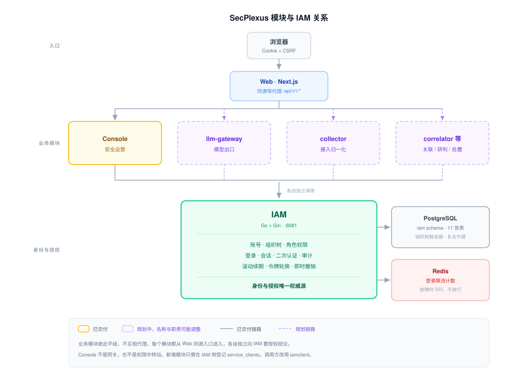
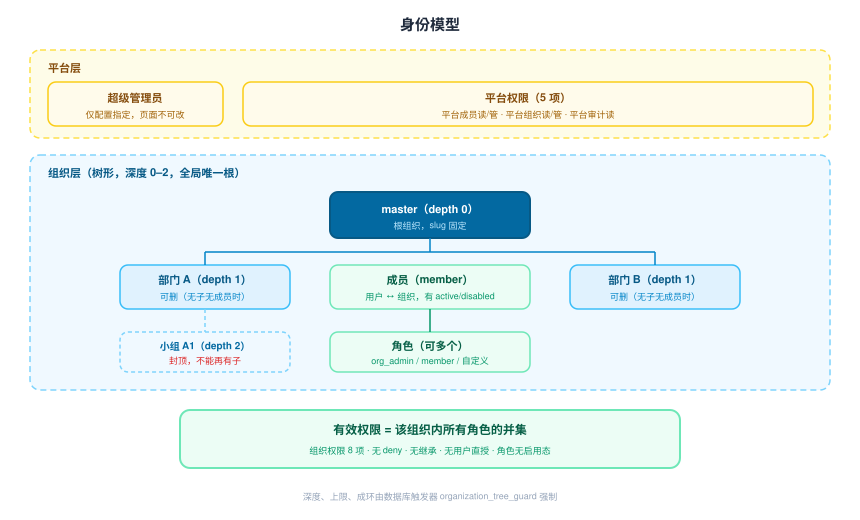
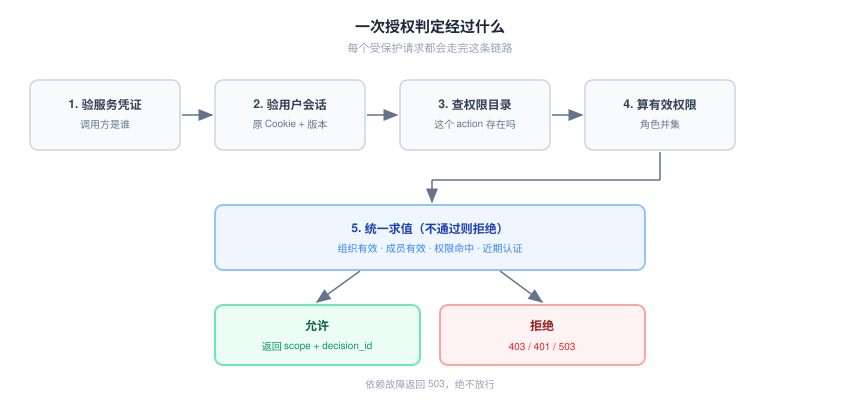

# SecPlexus IAM

平台的身份与授权服务。管账号、组织、角色、权限、登录会话和身份审计。

所有其他模块都向它要授权结论，自己不做身份判断。



## 它是什么

IAM 是整个平台里唯一知道「你是谁、你能干什么」的地方。

用户登录拿到 HttpOnly Cookie。此后每个请求，业务模块把 Cookie 转给 IAM，IAM 回答两件事，这个人是谁，这个动作允不允许。业务模块不存用户表，不校验密码，不判断角色。

用 Go + Gin 实现，不部署 Keycloak、Zitadel 这类独立身份产品。认证、用户目录、授权在同一个进程里。大厂拆成独立用户中心是被几十个系统几万员工的规模逼出来的部署拆分，不是领域本该拆。我们是一家公司内部的部门级隔离，拆开只剩同步和一致性成本。Grafana、GitLab、Django、TheHive 都是内置合并的。

## 它管什么，不管什么

| 管 | 不管 |
|---|---|
| 账号、密码、登录会话 | 业务资源的属主和可见性 |
| 组织树、用户关系 | 审批状态机 |
| 自定义角色和权限分配 | 菜单和按钮长什么样 |
| 登录、改密、身份审计 | 具体某条 Case 该不该给你看 |
| 回答「这个 action 在哪个组织允不允许」 | 业务模块内部的状态检查 |

IAM 回答的是「你有没有这个能力」，不是「这条数据归不归你」。后者必须由资源所属模块自己查真实归属，因为只有它知道那张表长什么样。

## 业务架构

### 三个概念

**用户**是自然人，全局唯一。一个人的账号在整个平台只有一个。

**组织**是数据隔离的边界。一个用户可以属于多个组织，在每个组织里是独立的用户关系，持有独立的角色。

用「组织」不用「租户」，因为我们做的是公司内部分层级的数据控制，不是 SaaS 多客户。TheHive 用 organisation，Grafana 用 organization，GitHub 用 organization，同一个意思。

**角色**是权限的容器。角色只有名称、说明和权限三项，没有业务代码、没有内置与自定义之分，也不预设任何角色；组织需要什么角色，由使用者按需创建并勾选权限。



### 组织是树，不限深度

组织支持父子层级，不设业务深度上限。全局只有一个根，标识固定为 `master`。新建组织不指定父节点时默认挂到根下面。

约束由数据库触发器强制，不是应用层记得检查

- **深度计算**：子节点的 depth 由父节点推导，不能手写
- **禁止成环**：把自己的后代设成自己的父节点会被拦下
- **溢出兜底**：`CHECK(depth BETWEEN 0 AND 1000)` 只防 smallint 溢出，不是业务上限

改挂父组织后，整棵子树的 depth 在同一事务内由服务层重算。

标识（slug）创建后不可修改，它是 URL 和审计里的稳定引用。名称和父子关系可以改。

删除组织有两个前置条件，不满足就拒绝：不能是根组织、不能有子组织。组织内的用户关系、角色与授权随组织一并删除，因此不要求先清空用户。

权限沿祖先链向下继承：在任一祖先组织获得的权限对其全部后代生效，反向不成立。

### 多角色，权限取并集

一个人在一个组织里可以同时是「管理员」和「审计员」。有效权限是所有角色的并集。

刻意这么设计。现实中同一个人经常身兼多职，强制单角色会逼出「为每种组合建一个角色」的组合爆炸，最后角色表里躺着「管理员+审计员」「管理员+只读」这类垃圾。

首版没有 deny 优先级，没有角色继承，没有用户直授。要收回权限就把他从角色里移除。

### 权限目录在代码里

13 个权限，5 个平台级、8 个组织级。

```
平台级（仅超级管理员）
  iam.platform.users.read              查看平台用户
  iam.platform.users.manage            管理平台用户与重置密码
  iam.platform.organizations.read      查看平台组织
  iam.platform.organizations.manage    管理组织与组织管理员
  iam.platform.audit.read              查看全部审计

组织级（组织内授权）
  iam.organizations.read               查看组织信息
  iam.organizations.manage             修改组织信息（经平台组织管理入口）
  iam.users.read                       查看组织用户
  iam.users.manage                     管理组织用户
  iam.roles.read                       查看角色及权限
  iam.roles.manage                     编辑自定义角色
  iam.roles.assign                     为用户分配自定义角色
  iam.audit.read                       查看所属组织审计
```

清单在 `internal/authorization/permissions.json`，版本化管理。数据库里有一份运行时投影，启动时同步。

同步带校验，如果某个权限的 module、resource_type、action 或 scope 变了但没有配套迁移，启动直接失败 `permission meaning changed without a reviewed migration`。不允许悄悄改变语义。

模块开发者定义「能做什么」，组织管理员决定「谁能做」。组织管理员没法凭空造出一个后端不存在的权限。

委派有上限。操作者只能把「自己当前持有 且 目录标记 delegable」的组织权限授予别人。持有 `iam.roles.assign` 不等于拥有全部业务权限。

### 一次授权判定怎么走的



五个步骤，全在同一个数据库事务里。

只做请求内合并，不跨请求缓存。这是刻意的。一旦缓存「允许」结果，撤权就不是即时的，用户被移出组织后还能继续访问一段时间。不存在 Redis 故障后继续用旧权限的降级路径。

依赖不可用时返回 503，绝不放行。

### 超级管理员由配置指定

唯一超级管理员来自 `config.yaml` 的 `bootstrap.username/password`。

应用里没有接口能创建、删除、改密码或授予这个身份。本人也不能自助改密。换人只能改配置然后重启所有副本。

它是最后的兜底。如果能被页面修改，一个被盗的普通管理员账号就能把自己提权成超管，整个权限体系归零。

改配置会递增身份版本、撤销旧身份的所有会话、写审计。明文不进响应和日志。

## 认证与会话

### 覆盖范围

| 能力 | 状态 |
|---|---|
| 用户名密码登录 | ✅ |
| 登出 | ✅ |
| 二次认证（高风险操作前重新输密码） | ✅ |
| 本人改密 | ✅ |
| 会话校验（每个请求） | ✅ |
| 滚动续期 | ✅ |
| 令牌轮换 | ✅ |
| 即时撤销（改密/停用/恢复后） | ✅ |
| 并发登录限流 | ✅ |
| 账号锁定 | ✅ |
| 公开注册 | ❌ 不做 |
| SSO（OIDC/SAML） | ❌ 未实现 |
| MFA | ❌ 未实现 |
| API Token / SCIM | ❌ 未实现 |

**没有公开注册是刻意的。** 账号由管理员创建，平台超管建全局账号，组织管理员建组织用户。谁能进系统必须有人负责。如果开放注册，任何知道域名的人都能建账号。

### 会话机制

不用 JWT，用服务端会话 + Cookie。

```
登录
  → 校验密码（Argon2id）
  → 建逻辑会话（user_sessions）
  → SCS 写 Cookie（存会话 ID）
  → 返回 HttpOnly Cookie

每个后续请求
  → 加载 Cookie
  → 查逻辑会话：状态 / token 摘要 / 身份版本 / 双超时
  → 续期 idle_expires_at（不超过 absolute）
```

三个机制配合

| 机制 | 作用 |
|---|---|
| **滚动续期** | 每次请求把空闲超时往后推，默认 30 分钟 |
| **令牌轮换** | 登录和二次认证时换新 token，旧逻辑会话标记撤销 |
| **身份版本** | 改密、停用、撤超管时递增 `auth_epoch`，所有旧会话立即失效 |

`absolute_expires_at` 是硬上限，默认 8 小时，滚动续期不能突破它。

**这套比 JWT 更严格**。JWT 一旦签发无法撤销，而这里每次请求都查库验证，撤权即时生效。

Cookie 特性

```
HTTP 环境   spx_session          HttpOnly, SameSite=Lax, Path=/
HTTPS 环境  __Host-spx_session   HttpOnly, SameSite=Lax, Path=/, Secure
```

CSRF token 放在独立 Cookie `spx_csrf`，写请求必须带 `X-CSRF-Token` header。

### 登录防爆破

三层防护

| 层 | 限制 |
|---|---|
| 按来源 IP | 每分钟 60 次 |
| 按账号 | 每 15 分钟 20 次 |
| 连续失败锁定 | 默认 5 次失败锁 15 分钟 |

限流计数在 Redis，Redis 故障时登录写操作返回 503，不放行。

密码计算有并发上限，同时最多 4 个 Argon2id 运算。这是防 CPU 打满，不是限用户。

失败登录也写审计（`outcome=denied`，`reason=invalid_credentials`），但只在有明确用户时递增失败计数。不存在的用户名不会暴露差异，实现上走一个假哈希比较，耗时一致。

### 账号规则

**用户名** 3–39 位，字母开头、字母或数字结尾，中间允许 `.` `_` `-`。拒绝连续分隔符（`a--b`、`a..b`）。

保留名单阻止新账号占用系统概念标识，`root`、`system`、`master`、`support`、`security`、`api`、`null`、`undefined`。保留检查只在创建时做，不进入登录路径，否则已存在的账号会登不进去。

**密码** 12–128 个 Unicode 字符，不能含 NUL。用 Argon2id 哈希，存 PHC 格式（含参数）。

**邮箱** 可选，最长 254 字符，本地部分不超过 64。唯一性用小写归一后的生成列加部分唯一索引，空邮箱不参与唯一性。不剥离加号子地址（那是合法的），也不剥离点号（那只对 gmail 消费者账号成立）。

**显示名** 1–100 字符，不能含 NUL。

**时区** 可选，用户展示偏好。接受 `utc`、`browser` 语义值或合法 IANA 时区名。服务端始终以 UTC 存储和传输，这列只影响渲染。

## 技术架构

### 模块间关系

业务模块是**平级**的，没有上下游之分。

```
                    浏览器
                       │  Cookie + CSRF
                       ▼
                  Web（同源入口）
                       │  /api/v1/{module}/* 窄代理
        ┌──────────────┼──────────────┐
        ▼              ▼              ▼
    Console       llm-gateway    collector…
        │              │              │
        └──────────────┴──────────────┘
                       │  各自独立调用
                       ▼
                      IAM（:8081）
                   ├─▶ PostgreSQL
                   └─▶ Redis
```

每个模块从 Web 同源入口进入，各自向 IAM 要授权结论。

**Console 不是网关，不是权限中转站。** 它只是安全运营业务模块，按自身业务需要调用其他模块。其他模块要验权限，直接调 IAM。

这一点在架构文档里写死了（`docs/design/architecture/02-technical-architecture.md` 第 153 行），也是代码事实，Web 的代理白名单里 `iam` 和 `console` 是并列的两个模块前缀，没有谁包着谁。

### IAM 的请求链路

```
浏览器
   HttpOnly Cookie（spx_session）+ CSRF token
      ↓
Web（Next.js）
   同源窄代理 /api/v1/iam/*
      ↓
IAM（Go + Gin，:8081）
   ├─▶ PostgreSQL（iam schema）
   └─▶ Redis（限流计数）
```

Web 只做转发，不解析身份，不合并权限。Cookie 原样传。

单端口，用户接口和服务接口共用 `/api/v1/iam` 前缀，按路由分别认证。应用内明文 HTTP，HTTPS 由外层反向代理终止。

### 技术选型

| 用途 | 选择 | 为什么 |
|---|---|---|
| HTTP | Gin | 原生路由、中间件、错误链、SSE |
| ORM | GORM | 授权判定要在事务里同时读会话、组织、用户、权限四张表，手写有大量重复字段映射 |
| 驱动 | pgx v5 | GORM 的 postgres driver 走它，SCS 和原生 SQL 共用同一个池 |
| 会话 | SCS | Cookie 编码、续期、store 接口现成 |
| 密码 | Argon2id | 内存硬，抗 GPU 爆破 |
| CSRF | gorilla/csrf | 标准实现 |
| 迁移 | Goose | 显式执行，版本记录在库，不做启动自动建表 |
| 命令 | Cobra | 七个子命令 |
| 配置 | Viper + mapstructure | YAML 声明环境占位，严格类型解码 |

### 十一张表

```
iam.users                 用户主表（含 timezone、email_normalized）
iam.password_credentials   密码哈希、失败计数、锁定
iam.organizations          组织（含 parent_id、depth 树结构）
iam.organization_users      用户 ↔ 组织
iam.roles                  角色（系统 + 自定义）
iam.permissions            权限目录（运行时投影）
iam.role_permissions       角色 ↔ 权限
iam.organization_user_roles 用户 ↔ 角色
iam.user_sessions          逻辑会话（可枚举、可撤销）
iam.scs_sessions           SCS 的 Cookie 存储
iam.audit_events           审计
```

三条值得知道的设计

**密码单独一张表**：登录失败计数要用 `FOR UPDATE` 锁行。合进 `users` 的话，每次登录都会锁用户行，挡住所有读操作。

**两张会话表不是重复**：`scs_sessions` 只存 Cookie 指向的会话 ID，`user_sessions` 存完整状态（token 摘要、身份版本、双超时）。Cookie 带指针，状态在库里。

**外键都带 org_id 复合约束**：`role_permissions(org_id, role_id)` 指向 `roles(org_id, id)`。从存储层杜绝跨组织串用，比应用层校验可靠。

### 角色和组织没有启用/停用状态

未删除即可用。只有用户和用户关系有 active/disabled。

这个简化是有意的。多一个 status 就多一套状态机，每个查询都要带 `status='active'` 条件，而这些条件经常被忘记。删掉之后「存在即有效」是唯一需要记住的规则。

## 别的服务怎么用

### 一个客户端，一个方法

```go
import "github.com/EayonLee/SecPlexus/src/packages/go/iamclient"

client, _ := iamclient.New(
    "http://127.0.0.1:8081",
    os.Getenv("SPX_CONSOLE_IAM_TOKEN"),
)
defer client.Close()

decision, err := client.Authorize(
    ctx, r,
    iamclient.PermissionIAMOrganizationsRead,
    orgID,
    nil,
)
```

`r` 是原始 `*http.Request`，client 从里面取 Cookie、CSRF header、method、path、Origin。调用方不用自己拼。

返回的 `decision`

```go
decision.Allowed       // 允不允许
decision.DecisionID    // 排障和审计关联
decision.Principal     // 用户是谁
decision.Scope         // platform 或 organization + org_id
```

`iamclient` 包里除 `Authorize` 外只有 `Close`。类型定义在 `types.go`，权限常量是生成代码。

### 两条铁律

**服务凭证不能替代用户身份。** 每个调用方有自己的 token，在 IAM 的 `service_clients` 里配置，同时限定能问哪些 action。token 只证明「我是 Console」，不证明「我是张三」。IAM 验完服务凭证后，还要再验用户 Cookie。

**用户 Cookie 不能替代服务凭证。** 反过来也不行。两条通道独立，缺一不可。

配置长这样

```yaml
service_clients:
  console:
    token: "${SPX_CONSOLE_IAM_TOKEN-}"
    actions: [iam.organizations.read]
```

`actions` 是白名单，不在列表里的 action 一律拒绝。token 用 SHA-256 摘要比对，常数时间比较，防时序攻击。

### 当前接入情况

**已接入，Console。** 它调 IAM 验证组织访问和 SSE 授权，是唯一配了 `service_clients` 的模块。

**规划中，其余模块。** 按架构设计，`llm-gateway`、`collector`、`correlator`、`agent-runtime`、`soar`、`scheduler` 等后续模块都会各自接入 IAM，方式完全一样，在自己的 `config.yaml` 里配一个 `service_clients` 条目，拿一个独立 token，声明自己需要问哪些 action。

**它们不经过 Console。** Console 是安全运营业务模块，不是网关，不是权限中转站。每个模块直连 IAM。

模块定义还在演进，具体有哪些、叫什么名字，以后可能变。但接入方式不会变，因为它是 IAM 的契约，不是某个模块的实现细节。

新增一个模块的完整动作只有两步

```yaml
# 1. IAM 侧加一段配置
service_clients:
  your-module:
    token: "${SPX_YOUR_MODULE_IAM_TOKEN-}"
    actions: [iam.organizations.read]
```

```go
// 2. 调用方用 iamclient
client, _ := iamclient.New(iamURL, yourToken)
decision, err := client.Authorize(ctx, r, action, orgID, nil)
```

不用改 IAM 代码，不用重启其他模块。

### 调用方必须做和不该做

必须做，把返回的 `Scope` 和路由里的 `org_id` 比对，不一致就拒绝。这是防中间人篡改组织范围的最后一道闸。

必须做，真实资源的归属自己查。IAM 说「你在组织 A 有读权限」，不代表「组织 A 里这条 Case 你能看」。

不该做，读 IAM 的表。不该做，导入 IAM 的 `internal` 包。不该做，自己实现一套角色判断。

Console 就是这么接的，`src/apps/console/internal/handler/server.go` 里只有一次 `s.IAM.Authorize` 调用，其余全是业务逻辑。

## 怎么跑起来

### 本地开发

从仓库根目录，用统一入口

```sh
cp .env.example .env
chmod 600 .env
# 填数据库密码、管理员密码、CSRF key、Console 的 IAM token

pnpm compose:up postgres redis   # 或者连已有实例
make dev
```

`make dev` 先跑迁移和初始化，再启动 IAM、Console、Web。

### 七个命令

```sh
go run ./src/apps/iam/cmd check-config         --config src/apps/iam/config.yaml
go run ./src/apps/iam/cmd serve                --config src/apps/iam/config.yaml
go run ./src/apps/iam/cmd migrate              --config src/apps/iam/config.yaml
go run ./src/apps/iam/cmd status               --config src/apps/iam/config.yaml
go run ./src/apps/iam/cmd maintain             --config src/apps/iam/config.yaml
go run ./src/apps/iam/cmd revoke-after-restore --config src/apps/iam/config.yaml
go run ./src/apps/iam/cmd reset-password --user-id <uuid> --config src/apps/iam/config.yaml
```

`check-config` 离线校验，不连数据库不建日志。改完配置先跑这个。

`status` 只读，不因状态查询隐式建表。

`maintain` 清理过期数据，每次每表最多 1000 条，由部署侧定时调度。

`revoke-after-restore` 必须在数据库恢复后、开放流量前跑。否则备份里的旧会话会复活。

`reset-password` 是运维兜底，交互式无回显输入，走和普通改密一样的用例，撤销会话、写审计，不会顺便提权。

### 首次启动做了什么

```
迁移建表
      ↓
同步权限目录和系统角色
      ↓
账号表为空？
   ├─ 是 → 建超管 + 根组织（slug=master）
   └─ 否 → 同步配置里的超管，身份变了就撤会话
      ↓
校验 schema 版本和唯一超管存在
      ↓
serve 就绪
```

没有安装页面。管理员是配置给的，直接去登录页登。

迁移、种子、首账号初始化都可重试，并发取 advisory 锁。初始管理员和根组织在同一事务创建。

### 配置

配置在 `src/apps/iam/config.yaml`，每项都有中文注释说明是什么、默认值为什么这么定、改了会怎样。

必填四项，由环境变量或私有 `.env` 提供

```
SPX_IAM_CSRF_KEY            32 字节，签名 CSRF token
SPX_IAM_BOOTSTRAP_PASSWORD  超管密码，12–128 字符
SPX_CONSOLE_IAM_TOKEN       Console 调 IAM 凭证，32–512 字节
SPX_POSTGRES_PASSWORD       数据库密码
```

关键默认值

| 配置 | 默认 | 约束 |
|---|---|---|
| `session_idle_timeout` | 30m | > 0 |
| `session_absolute_timeout` | 8h | ≥ idle，≤ 168h |
| `reauth_window` | 30m | > 0 |
| `login_max_failures` | 5 | 1–100 |
| `login_lock_duration` | 15m | > 0 |
| `audit_days` | 365 | 1–36500 |
| `session_days` | 30 | 1–36500 |

改配置要重启，不热更新。

## API 一览

35 个业务路由加 1 个服务路由，全部在 `/api/v1/iam` 下。另有 `/health/ready` 就绪检查。

**认证**

```
GET  /auth/context           CSRF 上下文
POST /auth/login             登录
POST /auth/logout            登出
POST /auth/reauthenticate    二次认证
```

**本人**

```
GET   /me                    本人摘要 + 组织列表 + 能力投影
PATCH /me                    更新时区偏好
POST  /me/password           本人改密
```

**平台账号（超管）**

```
GET   /users                 列表
POST  /users                 创建
GET   /users/:id             详情
PATCH /users/:id             更新
POST  /users/:id/reset-password   重置密码
```

**平台组织（超管）**

```
GET    /organizations        列表
GET    /organizations/tree   组织树
POST   /organizations        创建
PATCH  /organizations/:id    更新
DELETE /organizations/:id    删除（需无子组织）
```

**组织内（组织权限）**

```
GET    /orgs/:org_id/users                        用户列表
POST   /orgs/:org_id/users                        添加用户
PATCH  /orgs/:org_id/users/:id                    更新用户
DELETE /orgs/:org_id/users/:id                    移除用户
GET    /orgs/:org_id/roles                        角色列表
POST   /orgs/:org_id/roles                        创建角色
GET    /orgs/:org_id/roles/:id                    角色详情
PATCH  /orgs/:org_id/roles/:id                    更新角色
DELETE /orgs/:org_id/roles/:id                    删除角色
GET    /orgs/:org_id/roles/:id/users              角色下的用户
PUT    /orgs/:org_id/roles/:id/permissions        全量替换角色权限
PUT    /orgs/:org_id/users/:id/roles              全量替换用户角色
POST   /orgs/:org_id/permission-preview           权限变更预览
```

**平台 / 目录**

```
GET  /permissions            权限目录
GET  /audit-events           审计日志（服务端按权限裁剪可见范围）
```

**服务接口**

```
POST /authorize              服务凭证 + action 白名单 + 原用户上下文
```

统一响应 `{code, message, data, request_id}`。401 身份失效、403 授权拒绝、409 冲突、429 限流、503 依赖故障。

## 数据

### 审计

`iam.audit_events` 记录谁、什么时候、对什么、做了什么、结果如何。

```sql
org_id          -- 组织范围，平台操作为 NULL
actor_type      -- user / system / deployment_operator
actor_id        -- 操作者
actor_name      -- 快照，防止用户改名后追溯困难
action          -- 如 iam.roles.manage
target_type     -- user / role / membership / organization / platform
target_id       -- 目标 ID
outcome         -- success / denied / failure
reason_code     -- 受控原因码
request_id      -- 跨服务关联
decision_id     -- 授权判定关联
metadata        -- 白名单字段，8KiB 以内
```

审计和业务变更在同一事务，要么都成要么都不成。审计写入失败会导致安全变更回滚。

不记录密码、Cookie、原始请求体。

### 保留期

| 数据 | 默认 | 说明 |
|---|---|---|
| 审计 | 365 天 | 《网络安全法》第二十一条要求日志留存不少于六个月。180 天正好是法定下限没有余量，所以默认一年 |
| 已失效会话 | 30 天 | 只影响审计排查用的历史，会话有效性由 `absolute_expires_at` 判定 |
| SCS Cookie 行 | 过期即清 | 临时存储 |

都可配置。清理是物理删除，删掉之后追溯不了。

### 组织命名

名称 1–30 个 Unicode 码点，允许中文和正常展示字符，拒绝控制字符。

标识 3–30 位，小写字母、数字、下划线、连字符，字母开头字母或数字结尾，唯一，创建后不可改。

Go 请求模型、Web 的 Zod、数据库 CHECK 三处保持一致。

## 实现结构

```
src/apps/iam/
  cmd/main.go              命令解析、配置加载、选择启动或维护入口
  config.yaml              配置、环境占位、默认值
  migrations/              版本化 SQL，已执行的脚本不修改
  internal/
    bootstrap/             创建依赖、组装服务、失败清理
    config/                类型化加载和校验，不建连接
    router/                路由注册
    handler/               请求绑定、统一错误映射
      management/          用户、组织、角色、审计管理
    middleware/            Session 提交屏障、CSRF、服务身份、契约校验
    service/               用例、最终授权、组织范围、事务、审计顺序
    repository/            GORM 查询、锁、SQL、初始化、维护
    authentication/        凭证用例、SCS、可撤销逻辑会话、限流
    authorization/         权限求值和委派规则（不依赖 HTTP 和存储）
    identity/              账号、密码、邮箱、显示名、时区规则
    model/                 HTTP DTO 和请求边界校验
    testutil/              集成测试的隔离数据库
```

分层原则，handler 只管 HTTP，service 管事务和业务不变量，repository 管 SQL，authorization 是纯函数不碰 IO。

想换授权求值引擎（比如将来上 Casbin 或 OpenFGA），改 `authorization` 一个包就行。

### 会话提交屏障

IAM 独有的一处机制。

SCS 的 `LoadAndSave` 不能保证「会话写库失败时不发送成功响应」，所以 IAM 的非流式响应先写进缓冲区，确认 SCS 持久化成功后才发给浏览器。

失败时补偿撤销已创建的逻辑会话，然后返回 503。不会出现「浏览器拿到 Cookie 但服务端没这个会话」的哑状态。

Console 的 SSE 是流式，不经过这个屏障。

### 管理写操作用统一事务边界

所有管理写走同一个 `Manage` 方法

```
取 advisory 事务锁（串行化低频管理写）
  ↓
按 UUID 顺序锁涉及的用户
  ↓
按 UUID 顺序锁涉及的组织
  ↓
重新验证操作者会话版本和当前权限
  ↓
校验目标
  ↓
执行业务变更 + 写审计
  ↓
提交
```

串行化低频管理写，比在多个入口分别处理竞态简单。登录和普通业务读不持这把锁。

### 超级管理员保护

平台始终至少保留一个 active 的超级管理员。会破坏这条的写操作返回 409，并发场景也覆盖。

组织层不强制保留管理员：管理员能力由「自定义角色 + 相应权限」达成，超级管理员是最终兜底。这样组织不会因为角色被清空而永久卡死。

## 几个容易被误解的点

**它不是 OAuth 服务器。** 没有 client credentials、没有 scope、没有 refresh token 这套 OAuth 词汇。有登录、有会话、有滚动续期和令牌轮换，但不是 OAuth 协议。

**它也做用户登录。** `POST /auth/login` 是真账号密码登录，返回 HttpOnly Cookie。不只是服务间认证。

**它不缓存授权结果。** 每次判定都读数据库。将来如果压测证明是瓶颈，也只会考虑缓存拒绝结果，不会缓存允许结果。

**Console 不是必经中转。** 其他模块要验权限直接调 IAM，不用经过 Console。

**组织是树且不限深度。** 全局唯一根，单父、禁止成环由数据库触发器强制，不设业务深度上限。

**角色和用户关系的状态语义不同。** 角色没有 status（存在即可用），组织内的用户关系有 active/disabled。

## 相关文档

- [技术架构](../../../docs/design/architecture/02-technical-architecture.md) 全景服务划分和数据流
- [配置指南](../../../docs/development/configuration.md) 字段、优先级、重启要求
- [测试指南](../../../docs/development/testing.md) 怎么跑单元、集成、E2E
- [角色管理开发示例](../../../docs/development/role-management.md) 从协议到前端的一条完整链路
- [日志与错误定位](../../../docs/development/observability.md) 用 request_id 串起跨服务排障
